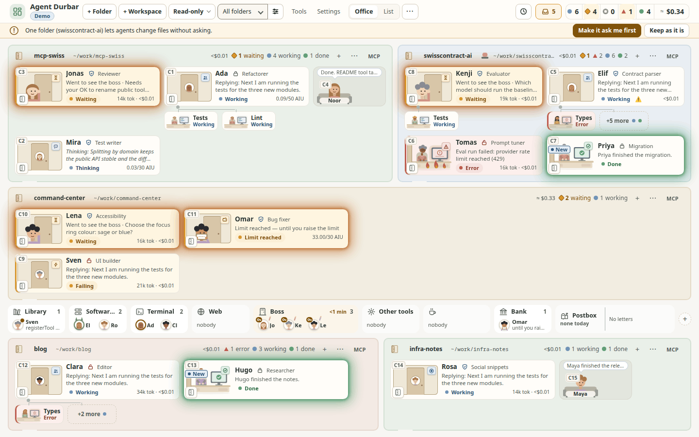
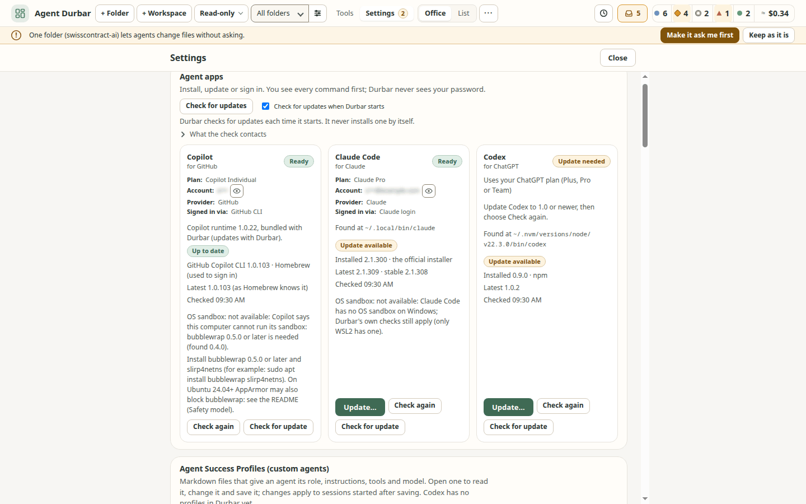

<p align="center">
  
</p>

<h1 align="center">Agent Durbar</h1>

<p align="center"><em>A calm command center for your AI agents</em></p>

Agent Durbar is an office-style desktop app to **see, chat with and coordinate AI agents across several agent apps (harnesses)**: GitHub Copilot, Claude Code and OpenAI Codex. It is for **anyone who works with agents**, not only developers. A room is any folder an agent works in: code, documents, research or notes.

**Website:** <https://three-feathers.github.io/agent-durbar/>

> **Status: alpha.**
> - The newest pre-release is [`v0.1.0-alpha.18`](https://github.com/three-feathers/agent-durbar/releases/tag/v0.1.0-alpha.18). It is unsigned and not notarized.
> - What changed in each release is in the [CHANGELOG](CHANGELOG.md).
> - **Where it has been run:** Linux by hand every day. macOS by hand on the owner's and a teammate's Macs (macOS 26, Apple Silicon), from source and the simulator, including real Copilot sessions; fixes from those runs are merged. The Copilot MCP Sign in and the keychain change were checked on the owner's Mac with a test build (`v0.1.0-alpha.14-mcptest.1`) before they merged. Windows by hand on a real PC on 2026-10-21 by the owner with a colleague; its findings are filed ([#467](https://github.com/three-feathers/agent-durbar/issues/467): Copilot was not found or offered for install without Node.js).
> - **What CI checks on Linux, macOS and Windows:** every change builds and starts the packaged app (spec 012 T044), and the UI checks run on all three (spec 008, [#389](https://github.com/three-feathers/agent-durbar/pull/389)). A real-account end-to-end workflow, where Copilot, Claude Code and Codex each install, sign in and answer on all three OSes, passed 9 of 9 on 2026-10-20 (spec 062, [#402](https://github.com/three-feathers/agent-durbar/pull/402)); real installs of each agent app as a standard and an admin user are checked in CI too (spec 060, [#393](https://github.com/three-feathers/agent-durbar/pull/393)). Since 2026-10-22 pull requests run Linux and Windows; macOS runs on every push to `main` and nightly (spec 008), and the real-account workflow runs daily on cheap models instead of on every push (spec 062).
> - Built by [Three Feathers](https://github.com/three-feathers), tracked on the [project board](https://github.com/orgs/three-feathers/projects/1).


> **Disclaimer.** Agent Durbar is an independent community project. It is **not affiliated with, endorsed by or sponsored by GitHub, Microsoft, Anthropic or OpenAI**. "GitHub Copilot", "Visual Studio Code", "Claude" and "Codex" are trademarks of their owners. Durbar only drives the tools you installed yourself, on your own machine.

## Contents

- [What you can do](#what-you-can-do)
- [Harnesses](#harnesses)
- [Install](#install)
- [Safety model](#safety-model)
- [Costs and caps](#costs-and-caps)
- [Themes](#themes)
- [Build from source](#build-from-source)
- [Known limits](#known-limits)
- [Roadmap](#roadmap)
- [How we work](#how-we-work)
- [License and credits](#license-and-credits)

## What you can do

**The office**
- Every agent is a person at a desk in its folder's room. You see at a glance who is idle, working, thinking, waiting for you or in trouble. A working agent whose last tool calls failed in a row says **Failing** (its door sign, with a lightning icon, in the amber trouble colours); one whose agent app is retrying a failed model call says **Retrying** with the attempt and a short reason (*Retrying (attempt 3 of 10) – servers busy (HTTP 529)*), and *Gave up after 4 retries – rate limit* when the retries run out (spec 034; read from each app's documented events, not yet seen on a real session). While an agent app compacts (summarises) a long conversation the card says **Compacting** with *Compacting the conversation…*, the chat shows a line where history was summarised (or *Older messages dropped…* when an app only trims), and the context ring says it too ([desk and chat](docs/screenshots/015-compacting-office-1440x900.png), [chat](docs/screenshots/015-compacting-chat-1440x900.png); at 1280x800: [desk](docs/screenshots/015-compacting-office-1280x800.png), [chat](docs/screenshots/015-compacting-chat-1280x800.png)); after a compaction whose new size the app does not report, the ring waits for the next message instead of showing the old figure (spec 015; Claude Code and Codex are read from their documented messages, Copilot's compaction was seen on a real account, none of the new Claude, Codex or truncation paths on a real session). A card in an Allow all folder says **Allow all**, and hovering a card tells when it last did something.
- 10-15 agents stay readable on one 1440x900 or 1280x800 screen, and the desks get denser on their own. Checked with 15 real Copilot sessions at once (Linux, 2026-10-21): no overlap or clipping at either size. With **few agents the desks grow** (up to about 2.5x, the largest size that fits without scrolling) and show more: the full title on two lines, up to 8 lines of the agent's thinking or reply as it streams (newest at the bottom), the start of the last reply when it is done, and tokens and cost. They get smaller as agents are added, down to the usual densities; the size is the largest that fits, so a new row of desks can make it drop several sizes at once. Grown desks come before the side panel below. A wide grown desk (one agent, or a row with spare width) uses the width for **more information, not longer lines**: beside the stream it shows the start of the last reply (masked) and the tool, usage, context and time on task, in columns of at most about 85 characters a line, and folds back to one column as it gets narrower. Simulator-checked from 1024x700 to 2560x1440 ([1 agent](docs/screenshots/001-fill-1-1440x900.png), [1 agent at 1920x1080](docs/screenshots/001-fill-1-1920x1080.png), [4 agents](docs/screenshots/001-fill-4-1440x900.png), [6 agents](docs/screenshots/001-fill-6-1440x900.png)); not yet watched on real sessions.
- **Finished agents rest in the lounge** when others still work in their folder, so the busy desks get the width: a lounge corner at the end of the desk row (about 300 px for five). An agent that finished in the last 10 minutes sits on the couch, its name on the cushion, with a speech bubble saying what it did last (the start of its reply on up to three lines, secrets masked); an older one naps in a bunk bed and dreams of its last work (with several sleepers the dreams take turns; "+N asleep" past four). Each is the same character as at its desk. Hover or keyboard focus opens a small card beside the lounge; a click or Enter opens the chat as before. Waiting, Error, Limit and Paused agents never rest, and a folder where everyone is finished stays as it is. Turn it off in Settings > Detail level (*Finished agents rest in the lounge*). Simulator-checked at 1440x900 and 1280x800 ([2 working, 2 on the couch, 3 asleep](docs/screenshots/001-shutters-1440x900.png)); not yet watched on real sessions.
- **A finished agent's reply is marked "New" until you have seen it** (spec 001 FR-170..FR-177, spec 005 FR-176, FR-177, issue 691). When an agent finishes while you are not looking at its chat (you are in the office, in another chat, in the Browser tab or in the Notes drawer, or the window is hidden), its desk, list row and chat-strip item get a small **New** badge with a dot, and the desk a soft green glow, and the person zooms gently (a desk that needs you glows amber-orange and its person pulses more, and that wins; reduced motion: static glow only; spec 001 FR-178); the desk's accessible name adds "new reply not read yet" and one polite announcement says "<name> finished. New reply." (once, not per streaming update; none for a hidden folder or floor, which keeps its marker for when it is shown again). It is a marker beside the state, not a state: the Done count, sort, filters, attention and permissions are as before, and an unread agent **stays on its desk** instead of going to the couch. It clears only when its chat is shown (opening the chat, or coming back to the Chat tab, closing the Notes drawer or bringing the window back while it is open) or with **Mark as read** in the card menu (right-click, or Shift+F10 / the Menu key on a focused desk or list row); closing the chat or returning to the office does not clear it, and once read the agent follows the couch rule above. The badge pulses once when it appears, and only if your system allows motion. **It is not kept across a restart** (like the chat itself): after a restart or reload nothing is marked. Simulator-checked at 1440x900 and 1280x800 (all 15 unread fit; `npm run check:unread`); not watched on real sessions. 
- **Cabin doors with meeting-room signs** (spec 017, owner request): each session is an office cabin. While the agent works, must not be disturbed or is away, its door is closed **in place of the desk**, with the agent's photo and a sign like the one beside a meeting-room door: **Busy**, **Thinking**, **Retrying**, **Compacting** (the agent app summarises its conversation), **Failing** (tool calls keep failing), **In a meeting** (one of its helpers works), **Do not disturb** (paused, or on a coffee break that resumes by itself), **Away** (session ended). An agent **waiting for you** (a question or a permission) stands in front of its closed door and waves, under the **Waiting for you** sign; at Durbar's **spending limit** it holds out an empty wallet under **Limit reached** (the same props on its figure in the lobby: waving at the Boss, the wallet at the Bank). When its work is done the door stands open with a **Done** tag and you see the desk as before; a free agent shows **Available**; an agent with an error keeps its door open with **Alert** and small flames on the desk. The desk's status pill keeps its plain word (Working, Thinking, Retrying, Failing, Error, ...) as before; on the card, mini and micro desks the door's sign is its icon only, with its full word in its tooltip (a door you closed also shows its word, DND, and the desk's accessible name says it). A click on a closed door opens the chat. **Close a door yourself** with the small door button on a desk (keyboard too, `aria-pressed`): the agent is then **Do not disturb**, its scheduled prompts wait at the door (never sent, never lost, kept across a restart) and remote control goes off; opening the door lists them (masked) and asks whether to **Send all** (in order, the next one when the agent is free, through the schedules, so Pause all and each schedule's own limit still apply) or **Discard** them (Keep closed is the default; [screenshot](docs/screenshots/017-held-dialog-1440x900.png)); an open door that still holds some says **Available · N held**, and a door that cannot hold more says so instead of dropping a prompt quietly. If remote control cannot be turned off, the door stays open and says why; while a door you closed is shut, turning remote control on is refused with an **Open the door** button. Messages typed remotely on github.com or claude.ai go straight into the agent app, so Durbar cannot hold them; it turns remote control off instead. Every animation is still with reduced motion or in Serious mode. Settings > Detail level > **Office layout** switches between **Office with cabins** (the default) and **Open office**, the desks as they were before the cabins ([screenshot](docs/screenshots/017-open-office-1440x900.png), [at 1280x800](docs/screenshots/017-open-office-1280x800.png), [the setting](docs/screenshots/017-office-layout-1440x900.png)); switching to Open office with a door you closed asks first and opens it (Send all or Discard what it holds), so nothing held is hidden. Simulator-checked at 1440x900 and 1280x800 in all six themes ([screenshot](docs/screenshots/017-signs-1440x900.png)); not yet watched on real sessions.
- **Live activity on the desks:** while an agent works you see what it is doing without opening the chat: the latest sentence of its thinking, the tool it runs ("Reading src/x.ts", "Running npm test") or the reply as it streams. With few agents across, a panel beside each desk shows a few lines; in a busy office it takes the line under the agent's name (the name stays). At most 4 updates a second, nothing moves, and secrets are masked like everywhere else. Settings > General > *Live activity on desks* turns it off. Simulator-checked ([sparse](docs/screenshots/001-live-activity-side-1440x900.png), [busy](docs/screenshots/001-live-activity-dense-1440x900.png)); not yet watched on a real session.
- **Boss, Bank and Postbox in the lobby** (who waits, what is scheduled, who is where): an agent with a **question or a permission** for you gets up and walks to the **Boss** in the middle of the lobby and queues there, first come first served, with a small **?** or **key** on its figure; the Boss shows the longest wait ("12 min") and its desk an empty chair with *Went to see the boss*. Click a figure to open its chat at the request; once you answer, it walks back. An agent at **your spending limit** waits at the **Bank** (click: the chat with the raise-limit card); usage-window limits of the agent apps still go to the coffee corner. The **Postbox** shows the next three scheduled runs ("09:14 · mcp-swiss · Morning summary"), how many are still due today and a flag for a missed or failed run; when a schedule fires, a letter flies to that desk (not with reduced motion). Click it for Settings > Schedules. Every lobby place says **who** is there and what they do ("Ada · npm test"; initials when names do not fit, "+N" lists everyone), and room headers count in words ("4 working"). Theme words rename the three tiles (Durbar: Diwan-e-Khas, Khazana, Dak ghar). Simulator-checked at 1440x900 and 1280x800 ([office](docs/screenshots/001-lobby-15-1440x900.png), [1280x800](docs/screenshots/001-lobby-15-1280x800.png), [few agents](docs/screenshots/001-lobby-3-1440x900.png), [Retro](docs/screenshots/001-lobby-15-1440x900-retro.png)); not yet seen on a real session or on a Mac or Windows PC.
- **Sub-agents (helpers) sit under the agent that started them, and show what they do when the office has room** (spec 001, issue 697). With few agents, while the parent desks can stay at least 1.4x grown, a helper is a **card with labelled lines** instead of a name-and-status tile: **Task**, what it does **Now** (the tool, its intent or *Thinking*), its **Result** when it is done or **Failed** with the error, and a line of facts (model, time, tool calls, tokens); the full card when there is room, name plus one line when there is less, the small tile as before when there is not even that (so 15 agents look as they did). What the agent app did not send reads *Task not reported*, *Result not reported* or *No activity reported yet*, never another field: OpenAI Codex sends no result for a helper, so its card says so. Click a card for the helper's read-only activity. **Task, Result and Failed text is always on the office floor when there is room** (masked for secret shapes like everywhere else and cut to 240 characters); only the **Now** line follows *Live activity on desks*. There is no setting to hide the rest, and none is planned (owner decision, 2026-10-25), so mind screen sharing: a result can show file contents, names or other text that is not a token. Simulator-checked ([two agents, 1440x900](docs/screenshots/001-helpers-2-1440x900.png) and [1280x800](docs/screenshots/001-helpers-2-1280x800.png); [three agents, 1440x900](docs/screenshots/001-helpers-3-1440x900.png) and [1280x800](docs/screenshots/001-helpers-3-1280x800.png)); not run on a real session (what each agent app sends is read from the adapters and earlier captures, not seen live for this).
- Agents show how they are doing: heavy, monster, ambulance, room sirens. Main agents walk to a **place** in a shared lobby for the tool they use.
- **Coffee break** (spec 068): when an agent's usage limit is used up (a Claude Code or Codex plan window, Copilot's premium requests or rate limit), it waits in the lobby's **coffee corner** with a cup instead of showing an error. Its card says *Coffee break — resumes at 4:24 PM* when the agent app says when the limit resets. The spending limit you set in Durbar sends the agent to the **Bank** instead (*Limit reached — until you raise the limit*). When the limit resets it comes back and sends one message to continue, but only by itself when that costs nothing extra (a plan or rate window); a quota that may lead to paid usage, or *Always ask me* in Settings, asks first. It never resumes past your spending limit or after a restart, and never checks on its own whether a limit has reset ([screenshot](docs/screenshots/068-coffee-office-15-1440x900.png)). Click an agent in the coffee corner (or press Enter on it) to open its chat, where a bar says how long the break lasts (*On a coffee break · back in 4 min*) and offers **Retry now**: one message now instead of waiting (right-click or Shift+F10 on the corner's entry offers the same; [screenshot](docs/screenshots/068-coffee-bar-1440x900.png)). Simulator and unit tests only: no real session has been run into a limit, so the limit messages and reset times of the agent apps are read from their docs and may differ.
- **Floors** group rooms and can be switched off. With two or more floors, right-click a folder (or its **⋯**) and choose **Move to floor ▸** to send the whole folder, agents included, to another floor, with **Undo**. A **List** view is there when you want rows instead of desks: agent app, last activity and cost columns, sortable, with J/K to move.
- A room's **⋯** menu offers New session, Rename, Hide and **Remove folder**. You can also rename a folder in place: the pencil next to its name (or **F2** on its door) edits the name where it is.

**Chat**
- Click an agent to open a full-screen chat. All the other agents stay in a slim strip.
- You see its thinking, tool calls and replies as they stream in, with Markdown and copy buttons. An open tool call shows the whole command (with Copy), how long it took and its output; a Claude Code or Codex edit request has a **Show the change** diff (a Codex request with no known file says "Codex did not say which file").
- **File edits show up while the agent writes them:** the moment an agent starts changing a file, the chat shows "Editing app.js" with its folder and "+12 −3", and the change itself as a compact diff (12 lines, then **Show all**) that grows as the agent writes it; several files are listed one by one. The line under the chat names what runs now ("Editing app.js · 12s", or "Waiting for your OK" while a permission card waits). An edit that was refused or failed says so ("Could not edit app.js"; Simple: "Not changed"). In Simple the words are plain ("Changing 2 files") and the diff is behind **See what changes**. Secrets in a diff are masked (by the adapter, then in main with the session's MCP secret values too). Claude Code and Copilot stream the edit, so the row appears before the tool runs (checked on real sessions, Linux); Codex sends the whole change at once, so its row appears when the edit starts ([spec 005](specs/005-chat-fullscreen-and-agent-strip/spec.md), [screenshot](docs/screenshots/005-edit-expert-1440x900.png)).
- Attach files and images by picking, dropping or pasting.
- **A browser in every chat** (spec 080, issue [#556](https://github.com/three-feathers/agent-durbar/issues/556)): each chat has **Chat | Browser** tabs. The Browser tab has an address field, Back, Forward, Reload and Stop, a **Sound** toggle (sound starts off) and **Open in system browser**. Each session gets its own private, in-memory profile: cookies, storage and cache are never shared with another session and are wiped when the session ends, is removed or its folder is removed. Only `http` and `https` addresses open; `file:`, `javascript:`, other schemes and addresses with a user name and password are refused with a reason. Linux and the simulator only so far; see Known limits.
- Questions an agent asks you appear as a card with its choices, an "Other" answer and Skip. The whole question, every choice and its description are shown in full; Enter in the "Other" box sends your answer (Shift+Enter adds a line). While a question waits and its card is scrolled out of view, the bar above the message box shows it; a short one can be answered right there (its choices, an "Other" box and Skip), a longer one has **Show question**. Several context compactions in a row are one line that counts them ("Context compacted 4 times · last 10:21").
- **Needs you:** one inbox of every agent waiting for you, oldest first with how long each has waited. Open it with **I**, **Ctrl+Shift+A** (also from a text box) or **Ctrl+A** when the cursor is not in a text box or the chat log (there Ctrl+A still selects all). While Durbar is in the background the window title ("(3) Agent Durbar"), the app icon and one notification tell you (Settings > Notifications turns it off; it shows only the agent's name and a short summary). In a waiting chat, **Alt+A** allows once, **Alt+S** allows for the session, **Alt+D** denies and **Alt+N** goes to the next agent; **?** lists every shortcut.
- **Under the message box**, as in VS Code, one compact row sets how the next message runs: the profile, the mode (*Read-only*, *Ask first*, *Allow all* in red), the model's name (its menu holds the effort and the context window choices that model has), a small **context ring** coloured by how full the window is (green, amber from 70%, red above 90%; hover for "Context 55% of 1M"; click for a token summary with one bar per type the agent app reports: system instructions, tool definitions, chat messages, other; Claude Code and Codex report only a total, and the summary says so; **Compact** is there too), **MCP 12/16** (servers on out of all servers for this chat; it opens the server list), and attach file or image. In a narrow window what does not fit goes under **⋯**; the mode always stays in view. Simple shows the mode, memory and attachments ([screenshot](docs/screenshots/005-composer-expert-light-1440x900.png), [token summary](docs/screenshots/005-composer-ctxsummary-1440x900.png), [at 1280x800](docs/screenshots/005-composer-ctxsummary-1280x800.png)).
- **Type `/` for the folder's skills and commands** (spec 073): at the start of a word in the message box, a list shows the skills, commands and prompt files of this agent app in the folder or workspace, then your own (user level), then a short allow list of the app's built-ins where typing them really runs them (Claude Code only: `compact`, `context`, `cost`, `init`, `review`, `security-review`; a built-in a later Claude Code adds is never offered by default). Each row has the name, a one-line description and where it comes from; typing filters, arrow keys move, Tab or Enter put it in the box, Esc closes the list. Places: Claude Code `.claude/skills`, `.claude/commands` (and `~/.claude`); Copilot `.github/skills`, `.claude/skills`, `.agents/skills` (and `$COPILOT_HOME/skills`, default `~/.copilot/skills`, and `~/.agents/skills`); Codex `.agents/skills` (and `~/.agents/skills`, `~/.codex/skills`, `~/.codex/prompts` as `/prompts:<name>`). Every app also lists VS Code prompt files: the folder's `.github/prompts/*.prompt.md` and your VS Code user prompts (`Code/User/prompts` in `%APPDATA%`, `~/Library/Application Support` or `~/.config`); Durbar fills their `${input:name}` variables from your words (in order, or `name=value`). Claude Code and Copilot do not load these files in Durbar's sessions (checked), and Codex's app-server does not expand a typed `/name`, so for a folder or user entry Durbar sends that file's text with your words as its arguments, and the chat says so ([screenshot](docs/screenshots/073-slash-1440x900.png)).
- **Send / Stop:** one button inside the message box. It is **Send** while the agent is idle and **Stop** (with a spinner beside it) while a reply runs; type during a reply and Send shows beside Stop. **End** a session from More, or Stop and End from the agent's card menu ([screenshot](docs/screenshots/005-card-menu-stop-end-1440x900.png)).
- **A message box that grows** (spec 005, issue #592): long prompts grow the box up to 40% of the chat (then it scrolls), and the transcript always keeps a few lines visible. Drag the thin handle on its top edge to choose a height (or focus it and use the arrow keys); double-click it, or press Enter on it, to let it grow with your text again. The chosen height is remembered for the whole app on this computer.

**Sessions and folders**
- One session per folder or `.code-workspace` file, or several per folder (**+ New** in a chat's header, or **+ New session** under More).
- The top bar is one row: **+ Folder** and **+ Workspace** come first, right after the app name (Ctrl+O and Ctrl+Shift+O; on a Mac also **File > Add Folder…** ⌘O and **Add VS Code Workspace…** ⇧⌘O), the **Defaults** chip (for example "Copilot · Read-only · Auto") sets the agent app, permission mode and model for new sessions, and **Manage folders** sits next to the folder filter. On narrower screens the status counters show a dot and a number (the words are in their tooltips).
- After a restart, each folder **continues its open sessions** (up to 6 per folder, each resumed when you open its chat or send it a message), and Durbar **remembers where you were**: the window's place and size (back on a screen it fits, else 1440x900), Office or List, the folder filter and the open chat.
- After more than 30 minutes closed, a **Since you were away** strip says how long it was and which scheduled prompts did not run, with **Run missed now** for each.
- **After a crash**, one card says "N sessions were interrupted" (the ones that were mid-reply when Durbar stopped unexpectedly: a crash, a kill or a power loss) with **Resume all**, **Pick…** and **Dismiss** ([screenshot](docs/screenshots/006-crash-card-1440x900.png)). Resuming reopens each session under its own mode and cap and shows its earlier conversation; it sends no prompt, and the reply that was being written is lost, so say "continue". Nothing resumes by itself and the last prompt is never sent again. Durbar keeps only a small marker file of session ids to know (no prompts, replies or paths), removed on a normal exit; a second Durbar running on the same profile is not mistaken for a crash (when in doubt Durbar shows no card rather than offer a running Durbar's sessions). Run on the simulator (`DURBAR_SIM_CRASH=3`); not checked with a real crash.
- **End of day:** quitting while agents are still working asks first ("2 agents are still working. Quit anyway?", Cancel is the default). **End all sessions** (top bar **⋯** and Ctrl+K) ends every running session after a confirmation; the chats stay.
- **Ctrl+K** lists your 5 most recent chats first, and **Ctrl+`** jumps back to the previous chat.
- **Go to (keyboard navigator):** **Ctrl+F** (⌘F on a Mac, "F for floor"; it was Ctrl+J until 2026-10-23; change it in **Settings > Keyboard**, which refuses shortcuts the app, text editing or the operating system already use, also by the letter a key types on your keyboard layout) opens a small box from anywhere: pick a floor, a folder, then an agent, or type **C** and a number to jump to that chat (`C 3`), **F** and a space for every folder. Type to filter, use the arrows or the numbers shown, Esc steps back. The chat opens with the cursor in the message box, and Enter sends as usual, with the folder's own mode and limits. Every other way of opening a chat (a click on a desk or list row, Ctrl+K, Needs you) puts the cursor there too, also in a chat that waits for an answer (never on its Allow button); **N** for the next agent keeps the cursor on the chat's name, so N, N walks the queue. Text you typed and did not send (and its attachments) is kept per chat while the app runs, in memory only (never saved to disk, as a draft may hold a pasted secret; ending or removing the session drops it), and a small pencil on the desk, list row and chat strip marks a chat with an unsent draft. **Ctrl+Backspace** (⌘⌫) goes back to the office when the cursor is not in a text box and no text is selected; in the message box it deletes as always, and Esc goes back from there. Every chat has a number, shown as **C3** on its desk, its list row and its chat header; it keeps it while it is in the office and after a restart ([screenshot](docs/screenshots/074-navigator-start-1440x900.png)). It is the Ctrl+K box in a Go-to mode; the operating-system shortcut list it checks is a known list, not every one there is, and it was not tried on a real Mac or Windows machine. The shortcut follows the key's position: on a Dvorak layout it is the key that types U. Ctrl+F, Ctrl+A and Ctrl+Backspace have not been tried on a real Mac or Windows machine.
- **Previous sessions** is a collapsible section right above the conversation (▸ *Previous sessions* with a count; *Earlier chats* in Simple; [screenshot](docs/screenshots/006-sessions-expanded-1440x900.png)). Click the row or press **Ctrl+Shift+H** (⇧⌘H on a Mac) to open or close it; your choice is remembered on this computer for every chat. It lists a folder's earlier sessions to **Resume**, and VS Code's Copilot Chat history as a read-only copy (it opens at the latest message, and **Continue in VS Code** opens the folder there; [screenshot](docs/screenshots/009-vschat-latest-1440x900.png)). With two or more entries, a **search box** filters them by title (case and accents ignored). Each row has a **⋯** menu (also right-click or Shift+F10): **Pin to top**, **Hide** (only in Durbar; the session stays in VS Code and the CLI; **Show hidden (N)** brings hidden rows back) and, for Copilot and Codex sessions, **Delete…**, which asks the agent app to delete that one session for good (after a red confirmation; Claude Code has no per-session delete, so it is shown disabled). A session that still has a card in the office cannot be deleted: end it and remove it from the office first. VS Code chats can be pinned or hidden, never deleted ([screenshot](docs/screenshots/006-prev-menu-1440x900.png)). Pins and hides are saved as ids only in `durbar-folders.json`; a delete adds a *Session deleted* row (app, short id, date, no title) to the activity log.
- **Notes: keep a message or an idea and carry on with it later** (spec 083, [issue 699](https://github.com/three-feathers/agent-durbar/issues/699)): every finished message has a **⋯** (*Actions for this message*) next to *Copy*; **Save to notes** keeps it, with a toast to **Rename…** or **Show** it. **Notes…** in the chat's More menu, **Ctrl+Shift+M** (⇧⌘M on a Mac) or Ctrl+K *Notes* opens a drawer over the chat log (the message box stays usable): *This session* first, then *This folder*, each with **Insert** (puts the text in the message box at the caret, with a blank line first when the box has text; it never sends by itself), **Edit…**, **Rename…**, **Copy** and **Delete…**, plus **+ Note** for an idea of your own. Notes are also in the `/` list, in a *Notes* group after the commands (at most 5 with nothing typed, then *All notes…*), also in a chat whose agent app lists no commands. Notes belong to the folder, are stored on this computer only (`<userData>/notes/`, mode 0600) and are masked first: a token or a secret value Durbar knows about is replaced by `[redacted]` before anything is written, so a secret in a saved message cannot be got back from the note, and a note with parts hidden says so before you send it ([screenshot](docs/screenshots/083-notes-drawer-1440x900.png), [the same at 1280x800](docs/screenshots/083-notes-drawer-1280x800.png); the `/` list: [1440x900](docs/screenshots/083-notes-slash-1440x900.png), [1280x800](docs/screenshots/083-notes-slash-1280x800.png)). A **Notes N** button in the chat header (only when the folder has notes; its tooltip says how many are from this session) opens the drawer; a message already saved shows a small note icon (*Saved to notes: <title>*) that opens the drawer on its note; and a search field at the top of the drawer filters by title and text ([the header count](docs/screenshots/083-notes-count-1440x900.png), [the marker](docs/screenshots/083-notes-marker-1440x900.png), [at 1280x800](docs/screenshots/083-notes-count-1280x800.png) and [the marker at 1280x800](docs/screenshots/083-notes-marker-1280x800.png)). Not yet: saving a selection, the per-folder Notes screen, the optional `.durbar/notes.md` in the project and *Open source* (the next slice of the spec).
- **Rename a session** (click the chat title, the pencil next to a name on a card, a list row or a Previous sessions row, **F2** on a focused card, row or title, or the More menu and the card menu, which open a small dialog): give any main session a short name (1 to 60 characters; Enter saves, Esc cancels, empty brings the app's own title back). It shows on the card, the list, the chat header, the strip, the inbox, notifications, Schedules and Previous sessions, instead of the first prompt. The name is kept in Agent Durbar and also saved in the agent app, so it may sync with your account: Copilot and Codex now (a Copilot session that is not open is opened without sending anything, renamed and released again; a Codex thread shows in `codex resume` once it has had a turn), Claude Code at the session's next message (`--name`; it shows in Claude's `/resume` list and when you resume that session by its id). A name saved in an app cannot be removed from Durbar. Copilot keeps named sessions when it cleans up old ones.
- **New session with a summary:** start fresh from a hand-off summary of the current conversation, which you edit before it is sent.
- **Continue in another app:** with two or more agent apps ready, **More > Continue in another app…** moves a conversation to Claude Code, Codex or Copilot in the same folder: the reviewed summary, headed by where it came from, is the new session's first message, and the old session keeps its history. Checked on real accounts (Copilot → Claude Code, Claude Code → Codex).
- **Scheduled prompts** per folder or for one session, while the app is open: once, every N minutes, or on a calendar (every day, weekdays, or weekly on chosen days, at a local time that stays put across daylight-saving changes). A schedule can have its own **limit** in AI credits or dollars (the agent app's unit): when its runs have spent that much, it pauses and says so. A schedule for a session that has ended pauses too, and is never sent elsewhere unless you choose the folder's agent. Prompts that Copilot itself schedules in a session (`/every`, `/after`) are listed read-only. The **Schedules** button in the top bar (a clock and the number of active schedules, left of **Needs you**; Ctrl+Shift+S, ⇧⌘S on a Mac, or Ctrl+K) opens **Settings > Schedules** from any view; a small **!** on its clock says a run was missed or failed since you last looked, and a pause mark says **Pause all** is on. Open a folder's schedules from its **⋯** menu, the **clock** in its header (shown once it has schedules), the **Schedules** button in its chat, or **Settings > Schedules** for all folders. **Edit…** on a schedule changes its prompt, time, target or limit in place (it keeps its last run and spend). A **starter kit** has templates:
  - *Start my day* (a morning briefing from your mail and calendar MCP servers);
  - *Summarize my day*, *Plan my day*;
  - *Open pull requests and CI*, and a dependency check.

  The briefing and planning ones end by **asking you what to do next** with a question card, and the agent waits for you in the office.
- **Custom agents** per session: `.github/agents` or `~/.copilot/agents` for Copilot, `.claude/agents` for Claude.
- **Agent Success Profiles (edit profile files):** *Settings > Agent Success Profiles (custom agents)* lists the profile files of your folders and your user folder; **Edit** in the Profile menu or **Open** in Settings shows a file in a large editor with **Edit | Split | Preview** (remembered on this computer), a front matter check, a live preview (the chat's safe Markdown: no scripts, no images, only web links) and **Save** (Ctrl+S / ⌘S). It warns before closing with unsaved changes and before overwriting a file changed elsewhere; **New Agent Success Profile…** opens a template in the editor, and nothing is written until you press **Save** (cancel or close at any step and no file is left): the default *Agent Success Profile* (like a job success profile: Role and goal, Scope and non-goals, Inputs and context to gather first, Working method, Quality bar and definition of done, Safety limits with two fixed lines (the session's permission mode decides; never handle secrets), Output format, When to ask the user) or a *Standard agent* (name, description, tools, model, then instructions); both start with read-only tools ([screenshot](docs/screenshots/043-editor-new-asp-split-1440x900.png)). **Delete** (in the Profile menu beside **Edit**, and **Delete…** in Settings) removes a profile file you can write after a confirmation; every list shows a new, changed or deleted profile at once, also in the Profile menu of a running session ([screenshot](docs/screenshots/043-profile-delete-confirm-1440x900.png)). **Create with AI…** writes an Agent Success Profile from a short description or an eight-question questionnaire (one question per section; the agent app is asked to think the role through, make every line checkable and mark what it assumed): one request to an installed agent app through the same no-tools, nothing-kept path as the AI theme maker (its cost is shown on the button first); Durbar checks the reply (all sections; only the read-only tools plus those you list under **Extra tools**, never a tool your text merely mentions, and the draft names every extra tool; HTML kept only as text) and opens it unsaved in Split view for you to review; one action sends at most one request, also if you cancel and try again while it runs ([screenshot](docs/screenshots/043-ai-questionnaire-1440x900.png)). Changes apply to sessions started after saving; Codex has no profiles yet ([screenshot](docs/screenshots/043-editor-split-clean-1440x900.png), [spec 043](specs/043-custom-agents/spec.md) FR-010..FR-017).
- **Open in VS Code** opens the folder (VS Code, then Insiders, then VSCodium).
- **Folder status:** in a chat, the folder chip also shows the git branch and how many files have uncommitted changes (`~/work/api · main · 3 changed`); click it for the list of changed files with their +/− lines and **Open in VS Code**. Read-only (Durbar never runs a git command that writes, and no command set in the folder's own git config, such as an fsmonitor hook, a filter or an external diff, runs). Submodules are not looked into: one whose commit moved counts as changed, but uncommitted work inside a submodule does not. Filters are never run either, so a touched file kept by git-lfs, git-crypt or another clean filter can show as changed here while `git status` says it is clean; nothing extra for a folder that is not a git repository ([screenshot](docs/screenshots/063-folder-changes-1440x900.png)).
- **Undo an agent's file changes:** after a turn in which the agent edited files, the chat shows what changed with **Undo these changes…**. A dialog lists each file (restore, remove the file it created, create back the file it deleted) and nothing is written until you confirm; the current files are kept, so you can undo the undo. It refuses when a file changed after that turn. Only edits made with the agent apps' file-edit tools are covered (not shell commands, MCP tools, or Codex in Allow all), inside the session's folders, while Durbar runs ([spec 065](specs/065-checkpoints/spec.md)).
- **End-of-session summary:** when you end a session, its chat gets one line: files changed and +/− lines (git, since the first message Durbar sent in this run), new files, commits, how long it ran, and its cost from the usage figures ("cost not reported" when there is none). **Show uncommitted changes** opens the folder's changes that are not committed yet (what the session committed is counted in the line, not listed). A folder that is not git says so, and a folder git could not be read in (a time limit, too much output) says that instead; a folder that already had changes says they are counted too. Pull requests are listed only when the agent app reports them (none does yet), never guessed. Numbers are Durbar's own, not the agent app's (git runs with every filter driver off, so a touched git-lfs or git-crypt file can count as changed); the lounge bubble and the daily briefing do not show it yet ([spec 085](specs/085-session-summary/spec.md)).
- **Send to several sessions…** (top bar ⋯ or Ctrl+K): one message to the running sessions you tick, each with its own agent app, mode and spending limit. Busy sessions, and sessions waiting for you, can't be ticked; the button says how many get it ([screenshot](docs/screenshots/064-send-several-1440x900.png)).
- **Plan first** (chat mode menu → *Plan first (next message)*): the agent proposes a plan in its app's own plan mode and changes nothing until you press *Approve*; *Revise…* sends your changes, *Reject* ends it. The approved plan still runs in the folder's permission mode, so in Read-only changes stay refused. Checked on real Copilot, Claude Code and Codex sessions (2026-10-21).

**Models, context and tools**
- Pick the model and reasoning effort per session, and switch them in a running session: Claude Code and Codex from the next message, the conversation kept (checked on real accounts 2026-10-20); Copilot too, but not yet seen on a paid plan.
- Copilot's **Auto** model has a routing choice in the same model menu: *Efficiency* (the default), *Balance* or *Intelligence*, remembered per agent; a higher tier asks first, since Auto may then pick models that cost more. Shown only when the bundled Copilot runtime supports it (1.0.87+); a tier set by your organization's Copilot policy is shown locked (also one Durbar cannot name), and a tier Copilot could not switch to is reported, with the tier still in use. Not yet run on a real account with Balance or Intelligence (simulator and unit tests only).
- A context ring under the message box shows how full the window is; a click opens the token summary with **Compact**. The model's menu shows its window.
- **MCP servers:**
  - your Copilot CLI list (`~/.copilot/mcp-config.json`) is used first;
  - each folder can add extras (with a trust prompt), import them from `.vscode/mcp.json`, and switch a server on or off per session.
  - **+ Add server** can also put a server in **all my folders**: Durbar writes it into the agent apps' own lists (Copilot CLI `~/.copilot/mcp-config.json`, Claude Code `~/.claude.json`, Codex `~/.codex/config.toml`; you tick which apps, or pick one when only one is installed). You first review each file and the exact entry; every file is backed up next to it (`<file>.durbar-<time>.bak`, the last 3 kept; to undo, copy a backup back by hand), a file that does not parse or changed since the review is not written, every other byte of the file is kept (only that server's entry changes, in JSON and in Codex TOML), and each written file is left readable only by you (0600 on macOS and Linux; on Windows the folder's permissions). By default secret values are **referenced** (`${NAME}`, Codex `env_vars` / `env_http_headers`) so you set them in your environment; *Write the values into the files* puts them in each app's config in plain text (readable only by you, but by any program running as you). Durbar passes the Claude Code servers to its sessions through a private temp file, not the command line. Settings > MCP lists every app's servers with their sources and a **Remove…** with the same review. With two or more lists, **Harmonize** lists servers missing or different between them (field names only, never values) and copies one to the others with the same review; references stay references, and a copy keeps a server switched off, its hidden tools and its tool list (an app whose list cannot hold that is refused, with the reason); an entry with fields Durbar cannot copy as written (such as Claude Code `oauth`, or a number in a Codex `env`) is named and not copied, and a replace says what it drops. A symlinked config file is written through the link. Durbar's own Claude Code sessions get Claude Code's user list too (switch per server in Settings). Checked with the real Copilot CLI, Claude Code and Codex in a scratch home: each lists the entries Durbar wrote and drops them after Remove ([spec 069](specs/069-mcp-global-controls/spec.md) T060);
  - in a chat's **More > MCP servers**, each server shows where it comes from (Copilot, Claude Code, Codex, Durbar folder, built-in, runtime); click its name to list its **tools** (name and the first line of each description, masked; untick a tool to turn it off for this folder: the agent app's own filter gets it at the next session or *Restart session* (Copilot `excludedTools`, Claude Code `--disallowedTools`, Codex `disabled_tools`; not verified on a real account for Copilot, and for Codex on a server from your own `config.toml`) and Durbar's permission check refuses it too (when the app asks); only tools named with letters, digits, `_`, `.` or `-` can be turned off; asked from the agent app only while the session runs: Copilot `listTools`, Claude Code `mcp_status`, Codex `mcpServerStatus/list`; fakes only, not run on a real account, [spec 069](specs/069-mcp-global-controls/spec.md)); the row keeps its state word, hint and **Details** below; the switch turns it on or off for this session, and **Remove…** removes a server from the list it comes from (with the same review);
  - in a chat's **More > MCP servers**, **Restart** restarts one server in this session (Copilot and Claude Code; Codex has no per-server restart), and **Restart session with these servers** ends the session and resumes it with what Settings and the folder's extras say now, keeping the conversation (it asks first when the agent is busy, has session permissions or remote control). Copilot and Claude Code start their servers with your next message. Checked on a real Copilot session (2026-10-21, Linux: Restart, a server that cannot start, and Restart session with a changed server set); Claude Code and Codex in simulator and test harnesses only ([spec 058](specs/058-mcp-session-controls/spec.md));
  - each server row in that dialog shows one word with an icon: Running, Starting, Failed, Needs sign-in, Off for this session (you switched it off here), Off in Settings or in the agent app's name (its switch then shows off too), Stopped, Not set up for this session or Not started yet. A failed, needs-sign-in or app-disabled server adds a short hint, and **Details** shows the error text with **Copy**. The text is masked first (secrets in the text and in links masked) and cut at 300 characters. A long list scrolls inside the dialog and the buttons stay in view. The dialog follows the agent app's reports while it is open ([spec 058](specs/058-mcp-session-controls/spec.md); checked in the simulator and unit tests, not yet against a real agent app's reports);
  - **Settings > MCP servers** shows the same live state for every server over all running chats (*Live in your chats*: "Failed in 1 chat · Running in 2 chats", "Not started yet"), and the *Advanced: MCP servers* heading says how many need attention. Open a server to see each chat that uses it, with that chat's state, hint and **Details**, and **Restart** it in that chat, **Restart session with these servers**, or **Open in chat** (that chat's own MCP dialog). With no running chat it says so. Same words, masking and confirmations as the chat dialog; simulator and unit tests only, not checked against a real agent app's reports ([spec 058](specs/058-mcp-session-controls/spec.md), issue #596; [picture](docs/screenshots/058-mcp-settings-1440x900.png));
  - **Why a server failed**: a failed or needs-sign-in server says why in plain words (*Not installed (command not found)*, *Crashed on start*, *Timed out*, *Disconnected later*, *Refused the connection*, *Refused: needs sign-in*, *Permission denied*, *Settings look wrong*, or *Failed (reason unknown)*: a reason is never guessed) and when Durbar saw it ("seen at 14:02"), in the chat's MCP dialog and in Settings. **Copy diagnostics** copies a masked summary for an issue report (server, state, reason, UTC time, transport, agent app and version, the masked error; home folders read `~`, OAuth codes and tokens are masked). The MCP chip under the message box shows a small red dot, and its name says "1 failed", when a server of that chat failed. The reasons come from what each agent app reports (Copilot's failure classification, Claude Code's skipped config entries, the error text); simulator and unit tests only, not checked against a real agent app's reports except Copilot's *command not found* ([spec 058](specs/058-mcp-session-controls/spec.md) FR-090..FR-097, issue #603; [picture](docs/screenshots/058-mcp-health-1440x900.png));
  - Copilot sessions keep an MCP server's sign-in (OAuth) in your system keychain (the SDK's "OS keychain": Credential Manager on Windows, Keychain on macOS; on Linux the desktop keyring, or, with no keyring, files under `~/.copilot/mcp-oauth-config/`), so one sign-in is shared by your Durbar sessions and survives the end of a session and a restart. The Copilot runtime keeps it; Durbar never reads it. Checked on 2026-10-21 with a demo OAuth server on GitHub's Windows and Linux runners (a new session in a new runtime connected with no new sign-in); not yet on a Mac or with a third-party server ([spec 058](specs/058-mcp-session-controls/spec.md) FR-070);
  - **Sign in to an MCP server from Durbar (Copilot):** a server that reads *Needs sign-in* in that dialog has **Sign in**: Durbar asks Copilot's own runtime to start its sign-in, then shows "Sign-in page on *host*" and opens your browser only when you click **Open sign-in page** (https pages only, never `localhost`, an IP address or a one-word host, with no user name, password or space in the address; an international host name is shown in its `xn--` form, with where the server came from and a plain line when the page is on a different site than the server; **Cancel** forgets it, and Durbar forgets it after 10 minutes, when the server connects, or when the session ends). Copilot runs the sign-in and keeps the result; Agent Durbar never sees a token, and the page address stays in memory (not in the activity log or the debug log). The row updates when Copilot reports the server connected. **Switch off for this session** is next to it, and *How to sign in from a terminal* shows a fallback (`copilot`, then `/mcp auth <name>`, then **Restart session with these servers**) that on 2026-10-23 did not carry over to a Durbar session on the one Mac it was tried on (spec 058 FR-074). Checked once on a real account (Copilot, macOS, 2026-10-23, one Microsoft-hosted server: it worked, the row was slow); the 5-second re-read, the host binding, the source line and the address rules came after and are checked in the simulator and tests only, and other servers, Windows and Linux are not checked ([spec 058](specs/058-mcp-session-controls/spec.md) FR-064..FR-069, issue #364; real check T105 pending);
  - **Sign in for Claude Code servers:** a Claude Code row that reads *Needs sign-in* has the same **Sign in**, two-step open and **Cancel**: Durbar asks the running Claude Code to start its own sign-in for that one server (it runs discovery and its own `127.0.0.1` callback; Durbar never sees a code or token and sends no callback address), and keeps the page for the 5 minutes Claude Code waits, minus a margin. Durbar never runs `claude mcp login` itself. The row keeps **Restart**: after a sign-in finished elsewhere (a terminal, or the browser after **Cancel**) it makes the running session pick it up, and opening the dialog or coming back to the window within 5 minutes of an attempt reads the list once. *How to sign in from a terminal* says: run `claude mcp login <name>`, finish in your browser (this works only for a server in Claude Code's own settings), then press **Restart** on the row. A server in Claude Code's own list that has `oauth` settings (`clientId`, `callbackPort`, `authServerMetadataUrl`, `scopes`) gets those, and only those, in Durbar's copy (never a client secret). The "different site" line compares with the agent app's own copy of the server (an earlier build could compare with a Copilot server of the same name). The request Durbar uses (`mcp_authenticate`) is not in Claude Code's documentation and was read from version 2.1.304 only; on another version, or with no answer in 30 seconds, the terminal steps show. Not checked on a real account yet: simulator and test harnesses only ([spec 058](specs/058-mcp-session-controls/spec.md) FR-175, FR-176, FR-180..FR-186; real check T106 pending; Codex rows follow in a later change);
  - when a server asks you for input (a small form, or a sign-in page), the chat shows it with **Submit / Decline / Cancel**; a page opens in your browser only after you click, and only if it is https (simulator and test harnesses only so far, not yet tried with a real server).
- **Tools** shows what each agent used, for *This session* and *All time*, and a **Cost** tab with each folder's ≈ money, AIU, Claude estimate, tokens and calls (the same *This session* or *All time*, with the start date under it), with **Copy as CSV**. Clicking a room's cost opens it.
- **Activity** (Tools > Activity) is a local log for a team lead: every answer to a permission request, every automatic approval (Allow all or a session permission), every mode or spending-limit change, and every MCP restart (spec 058), with time, agent, folder, agent app and mode. It keeps the newest 5000 rows on this computer, holds actions and decisions only (never prompts, replies or file contents), and exports to CSV or JSON. Claude Code and Codex in Allow all approve inside their own process, so their automatic approvals are not listed (Copilot's are).


## Harnesses

Durbar offers each agent app (harness) that is **installed and signed in on your computer**. When two or more are ready, the toolbar and the New session dialog show an **Agent app** picker; with one, nothing extra is shown.

**Updates ([spec 081](specs/081-cli-updates/spec.md)).** Settings > Agent apps shows, for each app, what is installed (*Installed 0.163.0 · Homebrew*), the install source Durbar found, and the newest version that source offers (*Latest 0.164.0 (as Homebrew knows it)*; Claude Code's native installer shows *latest* and *stable*, and *Update available* means below *stable*). A card has **Check again** (looks at the installed app again: version and sign-in) and **Check for update** (asks the source), the section has **Check for updates**, and Durbar also checks **once at every start, in the background, after the office is shown** (the switch *Check for updates when Durbar starts* is on by default; the organization keys `features.agentAppUpdateCheck: false`, `updates.mode: "off"` and `agentApps.allowInAppInstall: false` of spec 076 turn it off, and a policy that cannot be read turns it off too; spec 076's reader does not exist yet, so only your switch works today). A new version gets a badge with a number on the Settings entry and one toast per app and version. **Nothing installs by itself**: **Update…** shows the route that installed the copy first (the others sit behind *Show other ways*), then the native confirmation with the real path, the exact arguments, the version it installs and what that route checks. The simulator contacts nothing.



What each start contacts (every request shows your IP address and the time to that server; none carries a Durbar identifier, your installed version or Durbar's version; a copy installed outside Durbar's routes contacts nothing):

| Install source of the copy | Contacted at each start | Sent besides IP and time | Runs |
|---|---|---|---|
| npm (any app) | the registry in your npm configuration (default `registry.npmjs.org`) | npm's own `User-Agent` (npm and Node.js versions, OS, CPU), the package name, and **your registry token from `.npmrc` if one is set for that registry** (npm sends it; Durbar never reads `.npmrc`) | one `npm view` with the update notifier off |
| Homebrew | nothing expected: both runs set `HOMEBREW_NO_AUTO_UPDATE=1` and answer from Homebrew's local data (*unconfirmed* until checked on a Mac) | n/a | up to two local `brew` runs |
| winget | the winget source (Microsoft's CDN) | winget's own client data | one `winget list`, never accepting source terms for you |
| Codex, official installer | `github.com` (`/openai/codex/releases/latest`, redirect read and not followed) | set by Durbar: `User-Agent: AgentDurbar`, `Accept: */*` and `Accept-Language: en` (never your locale); added by Chromium: its fixed `Accept-Encoding` and `Sec-Fetch-*` headers | one request, header only |
| Copilot CLI, install script | `github.com` (`/github/copilot-cli/releases/latest`) | set by Durbar: `User-Agent: AgentDurbar`, `Accept: */*` and `Accept-Language: en` (never your locale); added by Chromium: its fixed `Accept-Encoding` and `Sec-Fetch-*` headers | one request, header only |
| Claude Code, native installer | `downloads.claude.ai` (`/claude-code-releases/stable` and `/latest`) | set by Durbar: `User-Agent: AgentDurbar`, `Accept: */*` and `Accept-Language: en` (never your locale); added by Chromium: its fixed `Accept-Encoding` and `Sec-Fetch-*` headers | two small requests |

Durbar's own requests use Chromium's network stack (your proxy and the OS certificates), with no cookies or credentials, a 10 s limit and a fixed host and path list. It never runs `copilot` to read its version. **Open sessions:** from the moment you choose *Update…* no session of that app starts or resumes (scheduled prompts that would start one are held) until the update ends; with sessions open you choose *Update when they end*, *End N sessions and update* or Cancel; sessions that are still open keep working. **Never as root**, never with `sudo` or an elevation of Durbar's own, and winget terms are never accepted for you. **Integrity** differs per updater and is shown in the confirmation: npm checks the registry's integrity hash; Homebrew checks the cask's sha256; winget checks its manifest's SHA256; `claude update`, `copilot update` and the vendors' installer scripts are *unconfirmed*. **`codex update`** (undocumented; only for the official Codex CLI in OpenAI's standalone folder, by owner decision) makes Codex download and run OpenAI's installer script with `sh` or PowerShell, which Durbar cannot see or check; the confirmation shows the exact command, and any failure offers the checked installer instead. Not yet run on a real Mac or Windows PC (see Known limits).

**What "signed in" means.** For Copilot and Codex, Durbar asks the service with a free call that needs a valid sign-in (Copilot: your GitHub quota; Codex: your OpenAI rate limits for a ChatGPT sign-in), so an expired sign-in shows as *Not signed in* after **Check again**. Codex signed in with an **OpenAI API key** has no rate limits to read, so Durbar asks Codex how it is signed in and shows "Signed in with an OpenAI API key." (in review, [#402](https://github.com/three-feathers/agent-durbar/pull/402)). Claude Code offers no free check, so Durbar trusts `claude auth status` and learns at the first message; that works with an `ANTHROPIC_API_KEY` too; if any app refuses a message because of its sign-in, the chat shows **Sign in** and then **Send again**. Checked on 2026-10-20 with a refused token: Copilot and Codex showed *Not signed in*, and Copilot's real error for a message refused because of its sign-in is now recognised. The end-to-end run on Linux, macOS and Windows (2026-10-20, run 39496442403, in review in #402) got exactly the card's words from the real services: Copilot "Signed in (checked with GitHub).", Codex "Signed in with an OpenAI API key.", Claude Code "Signed in on this computer; confirmed at the first message." The `v0.1.0-alpha.9` build predates that line, so it shows no sign-in line on the card ([#354](https://github.com/three-feathers/agent-durbar/issues/354)). After a Copilot sign-in, its shared runtime restarts so open Copilot sessions reconnect with the new login ("Reconnecting Copilot…"). A real expired Claude Code sign-in has not been tried.

**Which account.** Settings > Agent apps shows the account each app reports as signed in, for example "Signed in as o••• (GitHub, through the GitHub CLI)", "Signed in as y•••@example.com (Claude)" or "Signed in with an OpenAI API key". The name is masked and blurred until you press the eye button next to it; the reveal lasts only while that screen is open and is never saved. Once an app is signed in, its card lists what the app reports, one fact per line, instead of the general plan note: **Plan** (for example Claude Pro, ChatGPT Plus, Copilot Individual), **Account** (masked, with the eye button), **Provider** (GitHub, Claude, Anthropic, OpenAI) and **Signed in via** (GitHub CLI, Claude login, ChatGPT login, API key). A fact the app does not report is left out; Copilot's plan comes from a running Copilot session when there is one, otherwise from one short throw-away session per run (no message sent, its MCP servers switched off, deleted after; asked again only on **Check again** or after a sign-in); a check of the Copilot quota before and after showed no premium request used. The Agent app picker's tooltip and *About agent apps* show the same line, always masked. Each app tells Durbar itself, without a prompt and with no credits spent: Copilot's runtime sign-in status, `claude auth status`, and Codex's `account/read`. Durbar reads no token or credential file, keeps the answer in memory for the run, and asks again when Settings opens, on **Check again** and after a sign-in. The name or email is shown in the window only: never in the debug log, the activity log, exports or remote and chat messages. Checked on this team's real Linux accounts (one per app); not yet on macOS or Windows, and API-key and Enterprise sign-ins only from the vendors' docs and code ([spec 051](specs/051-harness-setup/spec.md), delta 2026-10-23).

| Harness | What Durbar runs | Checked on a real account |
| --- | --- | --- |
| **GitHub Copilot** | The Copilot runtime bundled with the official `@github/copilot-sdk`, with your `copilot login`. | Yes, since milestone 1. Checked on Copilot Pro (2026-10-20): switching between two real models with the conversation kept, reasoning effort, the long-context tier (272k → 872k), the confirmation when the new model's window is too small, and *Compact and switch*. Copilot's runtime does not stop at the credit limit, so Durbar enforces it (see [Costs and caps](#costs-and-caps)). |
| **Claude Code** | Your installed `claude` over its stream protocol. Durbar loads none of Claude's settings files by itself: a folder's own `.claude` hooks, permission rules and `.mcp.json` run only after you accept them (see *A folder's own agent setup* under the Safety model). Sessions are shared with the CLI both ways: Durbar lists the folder's earlier `claude` sessions, and sessions started in Durbar appear in `claude --resume` (checked on Claude Code 2.1.304; it relies on an undocumented setting, see spec 012 FR-159). | Yes (Claude Code 2.1.302-2.1.305; 2.1.305 in the end-to-end run on Linux, macOS and Windows, in review #402): every mode, interrupt, stop, resume, the live mode switch, models, previous sessions, questions, MCP switches, sub-agents, custom agents, the context window, the cost cap, summaries, and the full app across a restart. |
| **OpenAI Codex** | Your installed `codex app-server`, with a ChatGPT sign-in or an API key. | Yes (Codex 0.163, Linux): every mode, interrupt, End session, resume, a mode switch, models, history, questions, MCP tools, sub-agents, summaries, and the full app across a restart. |

What each harness can do differs a little, and Durbar hides a control a harness cannot honour rather than faking it. Two Codex specifics:
- A mode change applies from the next message.
- **Stop** does not kill a command that is already running; *End session* does.

Details and evidence: [spec 012](specs/012-claude-codex-adapters/spec.md).

**Remote control (Copilot and Claude Code, checked on real accounts).** In a running Copilot chat, **More > Control from GitHub (web and mobile)** turns on Copilot's remote control for that one session, after a dialog, and then a second native confirmation, that say its messages are sent to GitHub and that anyone who can see the session there can steer it. It is not available in **Allow all** (switch to Ask first). Durbar then shows the GitHub link (Copy link, Open on GitHub; open it in GitHub Mobile to steer from your phone), a **Remote** chip in the chat header and "· Remote" on the desk card. **Stop remote control** turns it off; ending or removing the session, or quitting Durbar, turns it off on GitHub too. On and off are written to the activity log. It is never on by default. Built on the SDK's experimental `remote` calls. It **needs a paid Copilot plan**: on Copilot Pro (2026-10-20) it started in a plain folder and in a `git init` folder, with a github.com link, steerable and not shared, and turned off cleanly. On Copilot Free it never started, in any folder, including a private GitHub repository; Durbar then says it did not start instead of showing it as on ([spec 054](specs/054-remote-control/spec.md)). In a **Claude Code** chat the same menu reads **Control from Claude (web and mobile)**: it uses Claude Code's own Remote Control, the link opens on claude.ai or in the Claude app, and it stays on when Durbar relaunches the session (for a model change or resume); if it cannot be turned back on, Durbar says so and shows it as off. Claude Remote Control was checked on a real account through `claude -p` on 2026-10-20; through Durbar's window only in the simulator. **Codex** has no per-session remote control that Durbar can turn on; use the ChatGPT app's own Codex access. The owner used a real Copilot remote session on 2026-10-21 ("it works perfectly"). Claude Code channels (Telegram) are not planned for now (a future idea, [#485](https://github.com/three-feathers/agent-durbar/issues/485)).

**Codex on Ubuntu 24.04 and later.** Codex's Read-only and Ask first modes run commands in its Linux sandbox (bubblewrap). Ubuntu blocks that for unprivileged programs, so those modes fail at start with a message saying so; Allow all needs no sandbox. To allow only bubblewrap, add an AppArmor profile (needs `sudo`):

```
# /etc/apparmor.d/bwrap, then: sudo apparmor_parser -r /etc/apparmor.d/bwrap
abi <abi/4.0>,
include <tunables/global>
profile bwrap /usr/bin/bwrap flags=(unconfined) {
  userns,
}
```

Codex also ships its own `bwrap` inside its npm package (`…/@openai/codex-linux-x64/vendor/…/codex-resources/bwrap`). Add a second profile with that path if `codex` still reports a sandbox error.

**Codex's sandbox on macOS and Windows.** Read-only and Ask first always need Codex's own sandbox. If it cannot start, the session does not start and nothing runs. Durbar says why, and the message has a **Change mode…** button that opens the usual mode menu (it never picks a mode for you):
- **Windows:** Codex's *elevated sandbox* must be set up once, and the native `codex.exe` used, not a `.cmd` shim.
- **macOS:** when Codex is reached through a link (Homebrew's `/opt/homebrew/bin/codex`, or the official installer's `~/.local/bin/codex`), its sandbox could not run Codex's own program again and Read-only and Ask first were refused (`sandbox-exec: execvp() … Operation not permitted`; openai/codex#41493, confirmed on a Mac 2026-10-23). Durbar now starts Codex from its real file, so the sandbox can run it; a full session with this fix has not been re-run on a Mac yet. The earlier refusal on GitHub's macOS runners (2026-10-20) is very likely the same cause. If Durbar itself runs inside another sandbox (a managed Mac or a CI machine), macOS can still refuse it; Durbar then shows a plain message instead of the raw error.

## Install

**Requirements**
- At least one agent app: GitHub Copilot (a free plan works), Claude Code, or OpenAI Codex. **Settings > Agent apps** can install it, least administrator rights first: the vendor's **official installer** (into your home folder, no admin; downloaded only from the vendor's own address), then npm, then winget or Homebrew (which may ask for admin), with the command shown first, and sign you in with the vendor's own page and a one-time code. Or install and sign in yourself, for example with `copilot login`. Durbar finds an agent app on your `PATH`, on your login shell's `PATH` (macOS and Linux, read once at start, at most 3 s), in the usual install folders, and in the folders of Node.js version managers (nvm, fnm, Volta, asdf, mise; nvm-windows and Volta on Windows) and Linuxbrew. Settings shows where it was found. Version detection reads only a bounded token on the first output line; malformed output or error prose leaves the app version unknown (offline regression tests; this parser change has not been checked against installed agent apps).
  - **Windows:** Durbar offers the official PowerShell installer (Claude Code, Codex), npm, and winget (Claude Code, Copilot). Choose a route and **Install**, or **Run** beside the vendor's command: Durbar runs it for you after showing the exact command (the PowerShell installers are downloaded from the vendor and run with Windows PowerShell; Copilot's winget route needs no Node.js). Prefer to install yourself? Each command also has a **Copy** button, for example in PowerShell `winget install GitHub.Copilot`, `irm https://claude.ai/install.ps1 | iex` or `winget install Anthropic.ClaudeCode`, and `powershell -ExecutionPolicy ByPass -c "irm https://chatgpt.com/codex/install.ps1 | iex"` for Codex (OpenAI publishes no winget package). Then choose **Check again** ([screenshot](docs/screenshots/051-install-manual-win32-1440x900.png), simulator). Durbar itself is not on winget yet: download it from the release page below.
  - Not tried yet: installs through winget or Homebrew, the official installers on a real machine, and the flows on macOS and Windows (a manual CI check on clean macOS, Windows and Linux machines, with and without admin rights, is spec 060 T060).
- Durbar never sees, stores or sends your tokens: each harness reads its own sign-in. Durbar has no accounts, no servers and no telemetry.
- Usage bills against **your** plans. Several agents in parallel can use credits quickly; see [Costs and caps](#costs-and-caps).
- Optional: VS Code, VS Code Insiders or VSCodium, for *Open in VS Code*.

**Download** the build for your system from the [Releases page](https://github.com/three-feathers/agent-durbar/releases). Check it against `SHA256SUMS.txt`. There is no auto-update: download a newer release to update.

| System | File |
| --- | --- |
| macOS, Apple Silicon | `Agent-Durbar-<version>-arm64.dmg` (or `.zip`) |
| macOS, Intel | `Agent-Durbar-<version>-x64.dmg` (or `.zip`) |
| Windows 10/11, x64 | `Agent-Durbar-Setup-<version>.exe` or `Agent-Durbar-<version>-portable.exe` |
| Linux, x64 | `Agent-Durbar-<version>-x86_64.AppImage` |

**The builds are not code-signed** (certificates cost money), so your OS warns you the first time. Only open files from this repository's Releases page.
- **macOS:** right-click the app and choose **Open**, or allow it in System Settings > Privacy & Security. If macOS says it is damaged, run `xattr -dr com.apple.quarantine "/Applications/Agent Durbar.app"`.
- **Windows:**
  - Which file: `Agent-Durbar-Setup-<version>.exe` installs to the Start menu; `Agent-Durbar-<version>-portable.exe` runs without installing.
  - Edge may block the download ("isn't commonly downloaded"): open Downloads (**…**), choose **Keep**, then **Show more > Keep anyway**.
  - Check the file in PowerShell: `Get-FileHash .\Agent-Durbar-Setup-<version>.exe -Algorithm SHA256` and compare the hash with the line for that file in `SHA256SUMS.txt`.
  - On "Windows protected your PC", click **More info**, then **Run anyway**.
  - The Copilot CLI needs PowerShell 6 or later (GitHub's docs, not checked by us); Windows only ships 5.1. If the Copilot card says so, install it with `winget install --id Microsoft.PowerShell -e`.
- **Linux:** run `chmod +x Agent-Durbar-*.AppImage && ./Agent-Durbar-*.AppImage`. The AppImage's launcher entry no longer forces `--no-sandbox`; its `AppRun` adds the switch by itself only on systems without unprivileged user namespaces (you can also add it by hand).
  - An AppImage needs FUSE 2. Ubuntu 22.04 and later do not install it: if the app does not start ("libfuse.so.2" / "dlopen()"), run `sudo apt install libfuse2t64` (Ubuntu 24.04 and later) or `sudo apt install libfuse2` (22.04), or start it without FUSE: `./Agent-Durbar-*.AppImage --appimage-extract-and-run`.
  - Saved MCP secrets need a desktop keyring (GNOME Keyring or KWallet). Without one, Durbar refuses to store them rather than keep them with a fixed key (spec 019): add a keyring, or pass secrets through the server's own environment.

**On a Mac** (spec 052 FR-083..FR-086; tried on real Macs, macOS 26 on Apple Silicon, and fixed after those runs: moving the window from an open chat, the traffic-light room, question cards and the chat strip):
- Shortcuts use ⌘ and are shown that way: ⌘K command palette, ⌘F Go to, ⇧⌘A (or ⌘A outside text) the Needs you inbox, ⌘⌫ back to the office (outside text), ⇧⌘N the next agent, ⇧⌘S Schedules. In a chat that waits for you, ⌥⌘A / ⌥⌘S / ⌥⌘D answer and ⌥⌘N goes to the next agent (Option alone types accents on a Mac). macOS itself uses ⌥⌘D to show or hide the Dock, so Deny may not reach Durbar with the keys; click it instead.
- **Agent Durbar > Settings…** (⌘,) opens Settings; the menu also has Edit, View (zoom, full screen), Window and Help.
- Closing the window hides it and **your agents keep running**; click the Dock icon to bring it back. Quit with ⌘Q.
- The title bar is hidden: you move the window by dragging the top bar (in a chat, the agent strip, a notice strip or a screen's header at the top). While a dialog or the command palette is open the window does not drag. These areas were fixed after a real-Mac report and are checked in the simulator (`npm run check:mac-titlebar`); double-click to zoom and full screen have not been checked on a real Mac yet.
- On Windows and Linux the window has no menu bar (no Reload or developer tools); copy and paste in text fields work as usual.

> **Trying it on Windows?** Durbar is built, started and (in review) end-to-end checked on Windows in CI, and the owner tried it on a real Windows PC with a colleague once (2026-10-21; [#467](https://github.com/three-feathers/agent-durbar/issues/467): Settings > Agent apps offered no install option, fix in review). It has not been used there day to day. If something does not work (the download, the installer, Settings > Agent apps, a harness that is not found), please [open an issue](https://github.com/three-feathers/agent-durbar/issues) with your Windows version and what you saw.

## Safety model

Agents run **locally, on your machine, as you**, in the folders you add. Every agent has a permission mode. The names are the same for every harness, and Durbar maps them to each tool's own controls.

- **Read-only** (the default): reads inside the session's folders only; everything else is denied. On Copilot, an MCP tool that its server marks read-only still runs without asking (the runtime does not ask Durbar); any other MCP tool is denied (both checked on 2026-10-20). **The runtime trusts the server's own mark:** a server that marks a writing tool read-only gets it run in Read-only, and Durbar never sees a permission request for it (the call still shows in the chat). Add only MCP servers you trust. Claude Code and Codex were not checked for this.
  When Read-only stops an edit or a command, the chat says so and offers **Switch to Ask first…**: it opens the mode menu (Read-only, Ask first, Allow all; Allow all still asks you to confirm). Afterwards, ask the agent again; nothing is resent for you ([screenshot](docs/screenshots/003-ro-ask-menu-1440x900.png)).
  On Codex, Read-only and Ask first rely on Codex's own sandbox: checked on Linux (reads limited to the session's folders, writes blocked; 2026-10-21). On macOS and Windows that sandbox depends on the system; if it cannot start, the session does not start and Durbar says why.
- **Ask first**: writes, shell commands, URLs and tools wait for *Allow once*, *Allow “…” for this session* or *Deny* (the same words in Simple and Expert).
  - **How far *for this session* reaches** ([spec 003](specs/003-permissions-and-approvals/spec.md) FR-013, FR-108): for a **write** it covers every file in that folder, not only the one asked about; *Allow for this session: any arguments* covers every simple command of that name (`git` also means `git push`). The approval card says so in a line above its buttons. A shell command's normal session button allows that exact command only.
- **Allow all**: no prompts. Use it only in folders you trust; it asks once to confirm.

Change the mode any time from the mode chip under the message box or the agent's card menu.

**Why was this allowed?** A tool card that ran without asking you carries a small tag saying why, only when Durbar itself decided it: **Allowed: session rule** (you chose *Allow “…” for this session*), **Allowed: Allow all**, **Allowed: folder read** (a path Durbar checked to be inside the session's folders) or **Allowed: attached file**. Open the card for the full sentence; for a session rule it also has **Undo this rule**, the same removal as the x on the grant chip: the next matching request asks again. A call you answered yourself has no tag. If the agent app allowed something on its own rule (a Claude Code settings rule, a hook, Codex or Copilot's own approvals, an auto-mode classifier), the card shows no tag rather than a guessed reason: none of the agent apps' own reasons is read yet. Not run against a real Copilot, Claude Code or Codex session ([screenshot](docs/screenshots/003-why-allowed-1440x900.png)).

**The agent app's own OS sandbox underneath** ([spec 087](specs/087-os-sandbox-floor/spec.md)). In **Read-only** and **Ask first** Durbar also turns on each agent app's own OS sandbox, as a second lock under its own checks: Durbar asks the app's sandbox to stop a shell command that gets past them (for example through a folder allow rule you accepted) from writing outside the folder or reaching the network. That is requested, not yet verified on a real session.
- **Claude Code:** its bash sandbox (macOS sandbox; on Linux bubblewrap and socat; Claude Code 2.1.219 or later). Read-only: no writes; Ask first: writes only in the session's folders; in your home folder only the session's folders can be read, and credential folders (`~/.ssh`, `~/.aws`, `~/.config/gh` and others) are denied even when a session folder is your home folder (a link there is denied at its target too; per Claude Code's docs the narrower read rule wins and a write deny holds inside an allowed folder; not yet run on a real session); network off; never an unsandboxed retry, and every command still asks you in Ask first. MCP servers, hooks (also a folder's own accepted hooks), the status line and Claude's own file tools are not in it: Durbar's checks cover what they can. **Windows has no Claude Code sandbox** (WSL2 only).
- **Copilot:** its local sandbox (macOS sandbox; Linux bubblewrap 0.5.0+ and slirp4netns; Windows 11 25H2 or 26H1 with ProcessContainer). Shell commands and local MCP servers run in it, with your `PATH` folders readable (resolved through links; never your home folder or a parent of it); network off; no credentials passed in. A session folder that is your home folder (or a parent of it) is opened to the sandbox only where Copilot can deny the credential folders inside it; otherwise commands there are refused by the sandbox. A session whose own folder is a credential folder (or, for Copilot without that support, holds one, such as `~/.config`) is not started in Read-only or Ask first: the chat says why and offers *Change mode…*. Any other folder of a workspace that is (or, for Copilot without that support, holds) a credential folder is left out of the sandbox, and the mode menu names it. Copilot's own file tools are checked by Durbar, not the OS. In Ask first a Copilot command card says *If you approve, Copilot’s sandbox may still let this write outside the folder (seen on Linux, 2026-10-25).*, and the chip tooltip says it too.
- **Codex:** unchanged: its read-limited profile already is the sandbox, and an approval card in Ask first says *If you approve, Codex may run this outside its sandbox.*

The mode chip says it after the mode: *Read-only · Sandboxed*, *Sandbox: checking* (until the app confirms it at its start), *Not sandboxed* (the tooltip says why), *Allow all · Sandboxed (managed)* or *(until a new session)*, and, for Copilot in Ask first, *Sandboxed (partial)* (an approved command may write outside the folder). Allow all keeps the app's default. When the sandbox cannot start, **nothing is sent**: the chat says why and offers *Continue without the OS sandbox* (this session; Durbar's own checks still apply) or *Change mode…*; only on native Windows, where Claude Code can never be sandboxed, also *Always continue on this computer* (undo it in Settings > Agent apps, which also shows each app's sandbox line) ([screenshot](docs/screenshots/087-sandbox-note-1440x900.png)). **Not verified on a real session yet:** built and tested on the simulator and with fakes only; every tooltip says *Requested; not verified on a real session.* until a real check per app and system is recorded.
**Your company's own agent-app policy** ([spec 076](specs/076-managed-config/spec.md) section O). When your organization has set the agent app's own machine policy (Claude Code `managed-settings.json`, Copilot `managed-settings.json`, Codex `requirements.toml`), Durbar reads it, read-only, and greys out what it blocks before anything starts: a permission mode (for example Allow all), a model, an MCP server or an MCP tool, with *Blocked by your organization's <app> policy* as the reason. Each key is read the way the vendor documents it, and Durbar refuses only what the agent app itself would refuse. What Durbar cannot read the vendor's way is shown as advice (*may be blocked by your organization*) and stays selectable. Copilot's policy comes from the Copilot runtime itself, which includes MDM, the registry and the enterprise's server-managed settings. For Claude Code and Codex, Durbar does not read MDM profiles, the Windows registry or server-managed settings; there the app still refuses the way it did before. Checked on fixture files only, not on a real managed machine ([mode menu](docs/screenshots/076-orgpolicy-mode-1440x900.png), [MCP server](docs/screenshots/076-orgpolicy-server-1440x900.png)).

**Coming back to a session.** Each session keeps the mode you last chose for it. After a restart, and when you resume it from *Previous sessions*, it comes back in that mode, also when it was Allow all and the session you opened the list from is in Read-only. Its chat then says which mode it is in and why ("Permissions: Allow all, the mode you last chose for this session"), and an Allow all that came back shows *restored* on the mode chip. A session Durbar has no mode for (one from before this change, or started outside Durbar) gets the folder's mode after a restart, or the mode of the session you resumed it from; the chat says that too. A resumed session that comes back in another mode than the session you opened it from is also written to the activity log. Grants from *Allow for this session* are never kept.

Rules that always apply:
- **The session browser** (spec 080) asks once per app profile before it opens (*Not now* / *Open the browser*). The page never gets Durbar's preload, Node or IPC: the browser view has no preload, a sandbox, no permissions (camera, location, notifications, fullscreen, devices) and no client certificates, and downloads are cancelled. The window gets only the page's address (without a user name or password), its title, loading, history and sound state, and a network error name; while a Durbar menu, dialog or toast covers the page, it also gets a still picture of the page, kept in memory only and never written to disk. A page's own dialogs (`alert`, `confirm`) are the system's boxes. A dialog in a session whose chat is not showing raises a toast naming the session (page text, masked) and brings that chat forward, once per session until you open it yourself, and marks it *Dialog open*. A page that asks before it is left opens Durbar's *Leave this page?* box, with *Stay* focused.
- **Durbar never deletes files itself.** *Delete…* in Previous sessions goes only through the agent app's own API (Copilot `deleteSession`, Codex `thread/delete`), only from Durbar's own window (not from MCP tools, remote control or schedules), never for a session still in the office, never for VS Code chats, and not for Claude Code. Not yet run against a real session.
- **Notes are private, masked and local** (spec 083). A note is saved on this computer only, in `<userData>/notes/<fingerprint>.json` (the folder 0700, the file 0600, no folder path inside), after Durbar has masked it: token shapes, the secret values Durbar already holds for the folder's MCP extras and the session, and anything split by Markdown marks or control characters. The raw text is never stored or logged. A secret you saved on purpose is therefore lost (only `[redacted]` is kept), and a secret that is neither a known value nor a known shape is stored as written, so do not keep passwords in notes. A notes file Durbar cannot read is never overwritten. There is no notes tool for agents and nothing is written into your project (the optional `.durbar/notes.md` mirror is a later slice and will be off by default).
- **Add project folders, not your home folder or a drive root.** Everything under an added folder counts as the agent's own; Durbar warns calmly when you add one of those.
- **Answering a question** an agent asks is allowed in every mode; it is not an action.
- **A profile (custom agent) from a folder's repository** asks once before it is used and never changes your mode. After you edit it, it asks again (the confirmation is for the file's exact content). Profile files are read and written only by the app's main process, only inside the agent folders (`.github/agents`, `.claude/agents`, `~/.copilot/agents`, `~/.claude/agents`), never through a link that leads out of them, at most 256 KB (64 KB for Claude Code, its own limit), with an atomic write; a new profile cannot take a Windows device name (`CON`, `NUL`, `COM1`...).
- **A folder's own agent setup** (spec 061). The folder's hooks, permission rules and MCP servers (`.claude/settings*.json`, `.mcp.json`, `.codex/config.toml`, `.github/hooks/`, `.github/copilot/settings.json`) are listed in full the first time the folder is added, and again when a file changes, before anything of it runs:
  - each item shows its exact command or rule; only text shaped like a token (GitHub, OpenAI/Anthropic, bearer, JWT, AWS keys, Slack tokens and webhooks, Discord webhooks, Telegram bot tokens) is hidden, MCP env values are shown as `NAME=value` before the command, except where the name looks secret (`DB_PASSWORD=[hidden]`; header values by name only), and arguments with spaces or shell characters are quoted. An item with something hidden, an MCP server that hands env values to a shell or an inline-code interpreter (also behind `env -S`, `timeout`, `nice`, `sudo` and similar), or one whose env sets a code-loading variable (`NODE_OPTIONS`, `BASH_ENV`, `LD_PRELOAD`, `PYTHONPATH`, `BASH_FUNC_*`, `MAKEFLAGS`, ...) starts unticked and says why;
  - a broad allow rule is marked: a whole tool, a wildcard-only pattern, a file tool on the root, home or a drive, and **every shell rule** (`Bash`, `Bash(git:*)`, `Bash(npm test:*)`, any argument);
  - everything is on unless you untick it, but hooks and broad allow rules start off and need your tick on *I have read these hooks (and broad allow rules)…*;
  - *Explain with AI* asks an installed agent app what a hook does and how risky it looks. It is advisory and can be wrong: the command shown is what runs.

  Accepted hooks and allow rules act without asking, even in Read-only, and the mode chip then reads *Read-only + folder rules*. Codex cannot run a folder's hooks from Durbar, and the dialog says so. Reopen the list from the mode menu: *This folder's setup…*. Without your answer, nothing of it applies. Copilot's runtime would otherwise run a repository's hooks by itself (checked 2026-10-20), so Durbar switches that off.
- **Durbar never logs** tokens, session content or your prompts, and stores only what a feature needs, on this computer: a scheduled prompt as you wrote it (`durbar-schedules.json`, readable only by you), your notes (masked, above) and the session names you choose (in Durbar's folder file, and sent to the agent app that has the session). The agent apps keep their own session history; Durbar does not copy it.
- **Masking is best effort.** Debug logs and the agent text shown on the office floor (desk lines, tooltips, the inbox, session titles) are masked by known token shapes and the secret values Durbar already holds: a secret with no recognisable shape is not masked, so do not paste passwords into chats or notes.
- **Linux without a desktop keyring:** Durbar refuses to save MCP secrets (it never falls back to a fixed key), but the agent apps keep their own sign-ins in plain files there: Copilot's MCP sign-ins under `~/.copilot/mcp-oauth-config/` (encryption and file permissions not checked), Claude Code and Codex in a `.credentials.json` in their own settings folder. Durbar does not read or change them; protect your home folder accordingly.

What Durbar does not do (the same list is in Settings):
- **Copilot in Ask first: a command you approve can still write outside the session folder** (seen on Linux, 2026-10-25, [#755](https://github.com/three-feathers/agent-durbar/issues/755)); its sandbox adds a writable place of its own, so the chip says *Sandboxed (partial)*, not *Sandboxed*. Durbar asks Claude Code and Copilot to stay in their folders. In Read-only and Ask first their shell commands also run in their own OS sandbox where it can start (checked on a real session only for Claude Code on Linux in Read-only); their own file tools and Claude Code's MCP servers are held only by Durbar's checks. Codex is held there by its sandbox.
- Spending limits are soft by one call: the call already running finishes and can go a little over the limit; then the chat asks you what to do. The first message after you resume a session may not be held, because its earlier spending is known only after that message's first usage report.
- It does not see your bill; costs are estimates.
- It sends nothing to any server of its own.
- Rooms you hide or switch off still run and cost money.

Codex in Read-only and Ask first gets an OS-enforced permission profile limited to the session's folders, and Durbar refuses those modes when the profile cannot be enforced. Claude Code gets its permission mode, allowed read tools and a check that reads stay inside your folders. Details: [spec 003](specs/003-permissions-and-approvals/spec.md) and [spec 012](specs/012-claude-codex-adapters/spec.md). To report a security problem, see [SECURITY.md](SECURITY.md).


## Costs and caps

- **Copilot** reports usage in AI credits (shown as AIU). A session can have a **spending limit**, at least 30 AI credits:
  - set it in the New session dialog or the limit chip;
  - a global default is in Settings;
  - it is saved per folder.

  It is a soft limit: when it is reached the agent goes on a coffee break "until you raise the limit" (spec 068) and the chat offers *Raise limit / Remove limit / Stop here*. Copilot's own runtime does not stop at the limit (real check, 2026-10-20: a 30-credit session reached 42.6), so **Durbar enforces it**: a turn that crosses the limit is stopped (the call already running can go over by its own cost), and a message sent at or over the limit is held until you choose. Checked on a real session (2026-10-20) and in tests ([spec 011](specs/011-credit-caps-and-usage-display/spec.md)). Copilot plans, the free one too, have a fixed price: Durbar shows usage, it does not charge you. The office and each room show usage totals, kept across restarts, with a reset in Settings.
- **Claude Code** reports a dollar *estimate*, shown as `≈ $… est.` and never mixed with AIU. A session can have a **spending limit in dollars** (at least $0.01):
  - Durbar passes what is left to Claude's own `--max-budget-usd`;
  - when the limit is reached, the chat offers *Raise limit / Remove limit / Stop here*;
  - the limit is per session.

  With a Claude subscription, nothing is billed per token.
- **Codex** reports tokens, with no price.

## Themes

**Settings > Theme** changes the whole app live, without a restart: colours, room frames, cards, fonts, place names, and the people and furniture in the office.
- **Clean Office:** the default, and the fallback for anything unknown or broken.
- **Corporate:** a navy bar, white rooms with an accent edge, square corners.
- **Retro Pixel:** a dark arcade page with pixel characters at CRT desks.
- **Durbar · Indian / European / Japanese:** three royal courts, each with its own frames, colours and court place names.
- **Make a theme with AI:** describe a look ("a pirate ship at night"), or pick one of the ideas, and Claude Code, Codex or Copilot designs a light or dark theme: colours, a style, place names and art for the people and furniture. Durbar keeps only safe values, cleans the art like an imported pack, and checks that text stays readable; the AI gets up to 3 passes to fix what fails. Try it on the whole app before you save it. One theme costs about a cent on Claude (haiku); Copilot spends AI credits from your plan (shown with the result): about 0.25 AI credits per pass on a free plan, checked on 2026-10-20.
- **Your own themes:** a folder with a `manifest.json` (colours, fonts, corner radii, shadows, the people's clothes and hair colours, a UI style and a scene kit from fixed lists, small SVG art including the desk's cup and laptop, place names), imported and exported in Settings. A theme is data only: no scripts and no CSS. Fonts are installed system fonts from an allow-list (a theme never downloads a font or loads a font file), sizes and spacing stay the app's so the office always fits, SVG art is rebuilt from allowed shapes, a value that is merely unusable falls back to the default and a text colour that would be hard to read is adjusted just enough (the theme stays light or dark), with a note in Settings, and a pack with markup or CSS in a value is refused with a message (spec 070).

Status, permission and credit wording, and the layout, are the same in every theme. Display fonts are your system's own serif and monospace fonts. Details: specs [035](specs/035-theme-foundation/spec.md)-[040](specs/040-user-themes/spec.md).

| Corporate | Retro Pixel | Durbar · Indian |
| --- | --- | --- |
|  |  |  |

**Settings > Detail level > Spacing** picks *Comfortable* (the default) or *Compact*, which tightens the chat, Settings, Tools, dialogs and the inbox; the office and the top bar keep their sizes.

## Build from source

```bash
npm ci
npm run typecheck && npm run build && npm test   # unit suites in parallel (~20 s); `npm test -- folders` filters; `npm test -- --bail` (or `TEST_BAIL=1`) stops at the first failing suite, for iterating, and the final run still runs everything
npm start                 # the app, with the harnesses you have installed and signed in
DURBAR_SIM=15 npm start   # 15 simulated agents: no sessions, no AI credits (main refuses every call that could reach a real agent app)
npm run check:office      # layout check at 1440x900 and 1280x800 (Electron; xvfb on Linux), simulator only
npm run shots:docs        # retake every screenshot the README and the website link (simulator, one Electron at a time; -- --only, --list, --out <dir>); every picture it writes is palette-compressed (about 60% smaller, with a quality guard)
npm run shots:compress    # compress screenshots by hand: the linked ones, or the files you name (-- --check only lists; DURBAR_SHOTS_COMPRESS=off turns it off in shots:docs)
npm run check:question-options  # question card text, options and descriptions in full; Enter sends a custom answer (simulator, xvfb on Linux)
npm run check:question-visible  # a waiting question stays visible in the answer bar; compactions in a row fold into one line (simulator, xvfb on Linux)
npm run check:sim-guard         # under DURBAR_SIM the real preload API is refused by main, no agent app is started and main starts no child process (simulator, xvfb on Linux)
npm run check:activity-table    # Tools > Activity shows the activity log table with the simulator's rows (simulator, xvfb on Linux)
npm run check:composer-toolbar  # chat settings under the message box (model name, context ring and token summary, MCP on/total, six themes), Send / Stop with a spinner, narrow panel overflow, the message box growing and its resize handle (simulator, xvfb on Linux)
npm run check:slash-suggest     # the "/" list in the message box: keyboard, ARIA, geometry, the "Sent the text of" note (simulator, xvfb on Linux)
npm run check:notes             # notes: save from a message's ⋯, the Notes drawer, Insert, notes in the "/" list, no secret anywhere (simulator, xvfb on Linux)
npm run check:notes-count       # notes: the header count, the marker on a saved message, the drawer's search, 300 notes under 100 ms (simulator, xvfb on Linux)
npm run check:sched-sendto      # Schedules dialog: Send to / Limit labels on one line, every option fits, session name on a hint line (simulator, xvfb on Linux)
npm run check:sched-top         # top-bar Schedules button: placement, one row, count, badge, opening at Schedules, Ctrl+Shift+S, Ctrl+K, demo (simulator, xvfb on Linux)
npm run check:geometry    # Retro lays out exactly like Clean Office (CHECK_ALL_THEMES=1: every theme, about a minute)
npm run check:theme-art   # a picked theme's people, gadgets and place icons on desks, walkers, the lobby and the chat strip (sample pack Pink Studio; simulator, xvfb on Linux)
npm run check:ui          # every simulator driver that asserts, one after another, on any OS (UI_SUITE_XVFB=1 keeps windows off a Linux desktop)
npm run check:themes      # on demand: the full layout check in every theme, a few at a time, low priority, memory limits
npm run pack:dir          # unpacked app for this OS in release/ (also dist, dist:mac:arm64, dist:mac:x64, dist:win, dist:linux; unsigned); then checks the Electron fuses and the display names
npm run check:fuses-launch  # on demand, after pack:dir: the packed Linux app opens its window and offers no debugger (xvfb on Linux)
npm run specs:index       # the full specs index from each spec's specs-index block, into specs/INDEX.md (git-ignored); --add specs/NNN-x for a new spec; specs:check in npm test
npm run labels:backfill   # dry run: the labels each issue and PR is missing (spec 021 FR-045); -- --create-labels --apply adds them (add-only)
npm run changelog:check   # check the changelog.d/ fragments (in npm test); changelog:preview lists them; a tag's notes come from them, then changelog:build folds them (changelog.d/README.md)
```

`npm run smoke` and `npm run verify:cap` use a real Copilot login and may spend credits: run them only on purpose. Under `DURBAR_SIM` the main process refuses every window call except the install-route list and the app version and never creates a real adapter, so a simulator run or driver cannot spend credits; a deliberate real check runs without `DURBAR_SIM` (spec 010 FR-022..FR-027). The **E2E real accounts** workflow (spec 062) installs the three agent apps on Linux, macOS and Windows, signs in with the CI account's secrets and lists models every day; one tiny turn each (Claude on Haiku, Codex on a small model) runs daily on Linux and on macOS and Windows weekly or by hand. It runs once a day and by hand, never on a push or a pull request. The supported CI platforms are listed once, in `.github/platforms.json`. GitHub Actions also runs the UI checks (geometry, office layout, the Mac title bar, `check:ui`) on Windows and Linux for each pull request and on macOS nightly, and keeps the screenshots of each run (workflow *UI on three OSes*; simulator only). macOS does not run on pull requests: build and test runs on every push to `main`, the other macOS checks nightly, and a failed nightly run opens an issue (spec 008 FR-106). Releases are built by GitHub Actions from `v*` tags on `main` into a draft release that the maintainer publishes by hand; a test-build tag (`v0.1.0-alpha.N-test.M`) builds a draft pre-release from any branch, with the unmerged commits as its notes (spec 008 FR-121).

**Layout of the repository:**
- `src/main` (Electron main), `src/preload`, `src/renderer` (plain HTML/CSS/JS, the simulator);
- `src/adapters` (Copilot, Claude Code and Codex adapters, the permission broker), `src/shared`;
- `scripts/` (tests and screenshot drivers), `specs/` (Spec Kit specs), `docs/`.

## Known limits

- **Windows has had one hands-on look.** Linux and macOS are used every day. On Windows the owner and a colleague tried it on a real PC on 2026-10-21 (findings [#467](https://github.com/three-feathers/agent-durbar/issues/467)); that was a manual look, not a scripted check. The packaged app is built and checked on all three systems in CI. **Codex's Read-only and Ask first modes refuse to start on Windows** unless Codex's elevated sandbox is set up and you use the native `codex.exe` (not a `.cmd` shim): Durbar says what is missing and what to do, and you can use Allow all, or Claude Code or Copilot. That refusal follows Codex's documentation and was not tried on a real Windows PC.
- **"Allow … for this session" can be broad.** For a simple shell command it approves every argument of that command name (allowing `git` for this session also allows `git push`), and a write grant covers every file in that folder; code and privilege commands are never offered the any-arguments grant, and you always choose it yourself. Undo it with the x on the grant chip. Not configurable yet (spec 003 FR-013; the approval card offers it as "run <command> (any arguments)").
- **Very narrow windows:** at about 900 px wide or less, with several agents in one room and helpers, a lobby seat can stick out of its place tile ([#737](https://github.com/three-feathers/agent-durbar/issues/737)). The office still works; the layout there is the same as in earlier versions.
- **Where your data lives:** the installed app keeps its settings, folders and saved MCP servers in `agent-durbar` under the OS app-data folder (`%APPDATA%` on Windows, `~/Library/Application Support` on macOS, `~/.config` on Linux). `npm start` and the simulator use their own `agent-durbar-dev` folder next to it, so developing never touches the installed app's data. To keep data from an older dev run, start once with `DURBAR_USER_DATA=<old folder>` or copy the folder by hand.
- **Unsigned builds:** expect the OS warnings above.
- **Keychain prompts on a Mac:** macOS may ask whether a program can use your Keychain. Durbar's own item (`agent-durbar Safe Storage`, which protects saved MCP secret values) is read at most once per run, and only when a server with secrets starts or you change a secret; because Durbar's builds are not signed with an Apple Developer ID, **Always Allow** for it holds until the next update (code signing, [#4](https://github.com/three-feathers/agent-durbar/issues/4), would end that). Copilot's own items (your `copilot login` and, since Durbar asks Copilot to keep them (spec 058 FR-070), the MCP servers' sign-ins) are read by the one Copilot runtime Durbar starts per run and shares across all sessions. Since [#623](https://github.com/three-feathers/agent-durbar/issues/623) the mac package keeps **GitHub's own signature** on that runtime (it used to be re-signed ad-hoc with the app), so the Keychain sees the same program as the `copilot` CLI, and a new MCP sign-in made from Durbar asks nothing (checked on the owner's Mac, 2026-10-23). **When upgrading from an older Durbar:** on the first launches you may need to press **Always Allow** for each item twice, once per launch. After that there are no prompts. On the owner's Mac with 10 servers, the first two launches asked about 25 times each and the third asked nothing. If you also use the `copilot` CLI with the same MCP sign-ins, prompts may come back after the CLI saves them; this has not been checked. If prompts keep coming back: In a Copilot chat's **MCP servers** dialog, use **Sign in again…** on a server, or **Sign in again to all**: Copilot forgets the saved sign-in and you sign in again in your browser, so the current runtime saves it anew. The server stays signed out until you finish in the browser; Cancel or the time limit leaves it signed out. It is offered only for remote servers Agent Durbar knows by their address (not built-in or local ones). Whether this ends the prompts has **not been checked on a Mac yet** ([#623](https://github.com/three-feathers/agent-durbar/issues/623)). If it doesn't, you can delete the `copilot-mcp-oauth` items in Keychain Access and sign in again. Durbar never reads or changes the keychain itself ([spec 058](specs/058-mcp-session-controls/spec.md) FR-162..FR-164). Claude Code and Codex use their own installed programs and their own Keychain items, as in a terminal.
- **Names in packaged builds:** the display name is `Agent Durbar` (Start menu and desktop shortcuts, Add/Remove Programs, `.app`, AppImage `Name=`), while the run-time identity stays `agent-durbar` on every OS (profile folder, Keychain, WM_CLASS). `scripts/check-names.js` compares the packed app with `package.json` on every package build. On Windows a packaged build sets the AppUserModelId `io.github.three-feathers.agentdurbar` so toasts and the taskbar match the Start menu shortcut. Checked on a real Linux build (AppImage `.desktop`, packed app started on the simulator); the Windows names and AUMID and the macOS bundle names are asserted only by the *Installed app* workflow in CI, and the taskbar, toasts, Mac menu-bar title and a Linux launcher or dock were not seen on a real desktop ([#9](https://github.com/three-feathers/agent-durbar/issues/9)).
- **No debugger in packaged builds:** release builds ignore `--inspect`, `NODE_OPTIONS` and `ELECTRON_RUN_AS_NODE` (Electron fuses; `scripts/check-fuses.js` reads them from the packed binary on every package build on Linux, macOS and Windows: `pack:dir`, the `dist*` scripts, and so the packaged-check workflow and the release build) and always drop `remote-debugging-port` and `remote-debugging-pipe`, whatever the spelling. Run from source (`npm start`) to debug. Checked on the packed Linux build, including `-remote-debugging-port` with one dash (`npm run check:fuses-launch`); the fuse check itself has been run locally on Linux only, and macOS and Windows have not been tried by hand (on Windows Chromium also accepts `/` and any case, which the guard covers by removing the switches by name). The ASAR integrity fuse has no effect on Linux.
- **VS Code's own chats are read-only.** VS Code keeps them in an undocumented store that cannot be continued from outside; Durbar shows a copy. Copilot CLI/SDK sessions *can* be resumed.
- **Caps are soft:** one model response can overshoot them, and the figures are what each harness reports. Copilot's runtime does not stop at its limit at all, so Durbar does: a turn is stopped after the call that crosses it (real check, 2026-10-20). Durbar learns a resumed session's earlier spending only from the runtime's first usage report, so the first message after a resume is never held.
- **A floor that is switched off is quiet.** The agents under it keep running and can spend credits or wait for an approval; nothing stops them for you.
- **Schedules run only while Durbar is open.** A schedule's limit counts what its run uses from the moment it is sent until that turn ends (a message you send during that turn counts too). They were tested on the simulator and with fakes, not on a real session. The agent apps' own schedules are shown only for Copilot, and only while Durbar is running and the app reports them.
- **Session names:** the rename into Copilot, Codex and Claude Code was checked on real accounts only by another team member's agent, which ran the raw protocol and CLI calls by hand and looked at the CLI lists (Durbar's own adapters ran on fakes only), not in VS Code; Claude Code applies the name at the next message (it relies on the undocumented `CLAUDE_CODE_ENTRYPOINT` value of spec 012 FR-159 to show in `/resume`), and the VS Code Claude extension's list did not show a `-p` session at all in a real check on a Mac (untested with that value).
- **MCP sign-ins (Copilot):** **Sign in** in the MCP dialog calls the Copilot runtime's `mcp.oauth.login` (marked experimental in the SDK) and was checked once on a real account (Copilot, macOS, 2026-10-23, `agent365-teams`: it worked, but the row lagged behind the runtime's status, so Durbar now re-reads the server list every 5 seconds, for at most 10 minutes, while the sign-in page is open). The re-read (whether it can start other servers on a real runtime is unknown), how long the runtime waits for you, and what happens to its waiting listener after **Cancel** are unverified, and so are other servers, Windows and Linux. Whether a sign-in you made in the Copilot CLI (`/mcp auth`) is seen by a Durbar session, and the other way round, is not verified ([spec 058](specs/058-mcp-session-controls/spec.md) FR-068/FR-074, real check T105 pending). Keeping sign-ins (FR-070) was checked for real on 2026-10-21 on GitHub's Windows and Linux runners with a demo OAuth server on loopback (a new session in a new runtime connected with no new sign-in); not on a Mac, a Linux desktop with a keyring, or a third-party https server. On Linux without a keyring the kept sign-in is a tokens file under `~/.copilot/mcp-oauth-config/`; whether it is encrypted and its file permissions were not checked.
- **"/" entries ([spec 073](specs/073-slash-suggestions/spec.md)):** checked on real apps on 2026-10-22 (3 tiny prompts): Claude Code in Durbar's sessions ignores a folder's `/command` (it reached the model as text) but runs built-ins such as `/context` itself; Copilot's `session.send` does not run a typed built-in such as `/list-dirs` (so none are listed for Copilot). Codex was read from its app-server schema only, not run. Durbar's expansion (a command's `$ARGUMENTS` and `$1`..`$9`, a skill's `SKILL.md`) is unit-tested and simulator-tested only; Claude commands' `!` shell lines and `@file` references are sent as text and never run by Durbar. Of the allow-listed Claude built-ins only `/context` was run through Durbar. Nested command folders and parent-folder skills are not listed. Codex's named `$KEY` arguments are not filled in. VS Code prompt files (2026-10-23): the Copilot CLI does not list or run them (checked at no cost on runtimes 1.0.98 and 1.0.103), so Durbar sends their text; their `mode`, `agent`, `model` and `tools` settings are shown but not applied, editor variables such as `${selection}` are sent as written (the chat says so), an expansion over 256 KB is not sent (the line goes as typed, with a note), only VS Code's default profile folder is read, and the macOS and Windows user folders are taken from VS Code's docs, not checked on those systems.
- **MCP sign-ins (Claude Code):** **Sign in** uses Claude Code's undocumented `mcp_authenticate` request, read from version 2.1.304 only and not checked on a real account (T106). Without a system keyring (common on Linux), Claude Code and Codex keep an MCP sign-in in a plain `.credentials.json` file in their own settings folder; Agent Durbar does not read or change it.
- **Imported MCP config:** importing from `.vscode/mcp.json` is a one-time copy per folder.
- **Organization policies of the agent apps** ([spec 076](specs/076-managed-config/spec.md) FR-206): for Claude Code and Codex only the documented machine files are read (no MDM, registry or server-managed settings; Copilot's come through its runtime). Codex's MCP server rules and its fully qualified host name are not checked. The mapping comes from the vendors' docs, fixture tests and a fake Copilot runtime, not from a real managed machine.
- **MCP servers for all folders** ([spec 069](specs/069-mcp-global-controls/spec.md)): the three agent apps read the written entries (T060, 2026-10-22), and Claude Code and Codex pass a referenced variable's value; whether Copilot expands `${NAME}` references (Q6) is not verified (it needs a signed-in Copilot session).
- **The session browser is new and only tried on test pages.** Each session has its own Browser tab, checked on Linux with Durbar's built-in test pages: not on real websites, a real desktop, Windows or macOS. A link in a chat still opens in your system browser (opening it in the Browser tab comes in a later version). There is no setting to switch the browser off yet: after you accept the one-time note the tab opens when you click it, and nothing loads before that. Downloads are cancelled for now and `prompt()` does not work in a page. A page's own dialog does not say which session it belongs to (Durbar's message does, and brings that chat forward). Once any browser view exists, two small Chromium files appear in the app's default profile and what they hold is not identified; the session's own profile writes nothing. A browser's own `title` tooltips are drawn by the system above the page.
- **Agent-app updates are new and untested on real machines.** The update check and the update button ([spec 081](specs/081-cli-updates/spec.md)) ran on the simulator and with fake tools only, not on a real Mac or Windows PC, and read documented output shapes (winget's table with English column names, Homebrew's and `claude update`'s output), not recorded runs. Homebrew's *latest* is only as fresh as Homebrew's local data (Durbar never runs `brew update`). The Claude channel files on `downloads.claude.ai` are not a documented API, and `codex update` is undocumented and runs a script Durbar cannot check. Scoop, Chocolatey, distribution packages and bun/pnpm copies are named, not updated. No organization policy can switch the start check off yet; only your switch does. A scheduled loop that wakes while its app updates counts that pass as failed instead of holding it. The fix for "Could not check: exit 127" on a Mac (an app opened from the Dock has a short PATH, so npm could not find node; it now says npm or node was not found and what to do) is from reading the cause, not seen fixed on a real Mac. The real-machine checks of the real updaters (spec 081 T040 to T042) have not been run, and the vendor texts it recognises (Claude Code's "updates are disabled" message, winget's table, a cancelled Windows UAC prompt) are documented shapes, not recorded output.
- **The OS sandbox floor is new and only partly checked.** For Read-only and Ask first Durbar asks each agent app to run commands inside its operating-system sandbox, and the chip (*Sandboxed* / *Not sandboxed*) and its tooltip show what it got ([spec 087](specs/087-os-sandbox-floor/spec.md)). What was really tried (one Linux session, 2026-10-25): **Claude Code in Read-only: verified on Linux only**, its sandbox refused a write in the folder. **Copilot in Ask first: do not rely on it for approved commands**: a command you approved wrote a file outside the session folder although the chip said Sandboxed, because Copilot's own policy has one more writable place than Durbar asked for (probably the temp folder, [#755](https://github.com/three-feathers/agent-durbar/issues/755)); the approval card and the tooltip say so. It may also apply in Read-only, so Copilot's Read-only tooltip says *writes: none asked; Copilot may add one*. **Not checked:** macOS and Windows, the network refusal, Claude's Ask first, Codex. Also not checked: that a write deny inside an allowed folder holds on a real session (Claude Code documents it), whether Copilot's session options update applies to a session that already exists, and what Copilot does on a host it does not support. Claude Code has no OS sandbox on native Windows: the chip says *Not sandboxed* and Durbar's own checks still apply. If an app's sandbox cannot start (for example Claude Code on Linux without bubblewrap and socat), Durbar tells you and asks before running that session without it (*Continue* this once, *Always continue* only where the cause cannot be fixed, or *Change mode…*); it recognises Claude Code's failure only by the word "sandbox" in its error, any other early exit shows as a crash. In Ask first, sandboxed commands have no network: `npm install`-style commands fail there (use Allow all). The organization key `permissions.requireOsSandbox` exists, but no organization-policy reader exists yet, so it cannot be set today ([#734](https://github.com/three-feathers/agent-durbar/issues/734)). If a credential folder becomes a link, or a link is repointed, while a session runs, its new target is not denied on Linux until the next launch.
- **Moving targets:** harness protocols change, so versions are pinned and checked.

## Roadmap

- **Done:**
  - the office, chat, permissions, attachments, MCP, tools, usage and caps, themes, floors, places, moods and scheduled prompts;
  - Copilot, Claude Code and Codex side by side, with session resume and continuation;
  - model and context switching, and new session with a summary.
- **Next:**
  - Windows day to day on real PCs, and Codex's sandbox on macOS and Windows;
  - the Durbar MCP server, to read the office from your own MCP client ([spec 041](specs/041-durbar-mcp/spec.md), in progress).
- **Ideas being specified:** a global assistant chat across sessions, multiple profiles (personal/work accounts), and a morning briefing. See the [issues](https://github.com/three-feathers/agent-durbar/issues).
- **Needs a purchase:** code signing and notarization ([spec 014](specs/014-signing-and-notarization/spec.md)).

What was built when, and how it was checked, is in the [feature history](docs/feature-history.md) and the [CHANGELOG](CHANGELOG.md).

## How we work

Agent Durbar is spec-driven with [GitHub Spec Kit](https://github.com/github/spec-kit): **no code without a spec, a plan and tasks.**
- Every feature has a folder in [`specs/`](specs/README.md). Each requirement is tagged `[IMPLEMENTED]` or `[KNOWN GAP]`, with how it was checked.
- The rules are in the [constitution](.specify/memory/constitution.md).
- A CI check fails a pull request that changes `src/` without changing `specs/`.
- Coding agents follow [AGENTS.md](AGENTS.md). People start with [CONTRIBUTING.md](CONTRIBUTING.md) and [docs/collaboration.md](docs/collaboration.md).
- Claim an issue on the [project board](https://github.com/orgs/three-feathers/projects/1) before you start.

## License and credits

[MIT](LICENSE), Copyright (c) 2026 Three Feathers contributors.

Agent Durbar is by **Three Feathers**. Key contributors: [vikramgorla](https://github.com/vikramgorla), [fjcabello](https://github.com/fjcabello) and [rubenlupi](https://github.com/rubenlupi) (GitHub handles are used as the names). The names live in [`src/shared/about.ts`](src/shared/about.ts) and are shown in the OS About panel and in Settings > About.

The app id is `io.github.three-feathers.agentdurbar` since 2026-10-16. A build from before then is a separate app to the OS; uninstall it by hand. Saved data is kept.

Repository: <https://github.com/three-feathers/agent-durbar>. See also [SECURITY.md](SECURITY.md), [CONTRIBUTING.md](CONTRIBUTING.md) and the [CHANGELOG](CHANGELOG.md).
