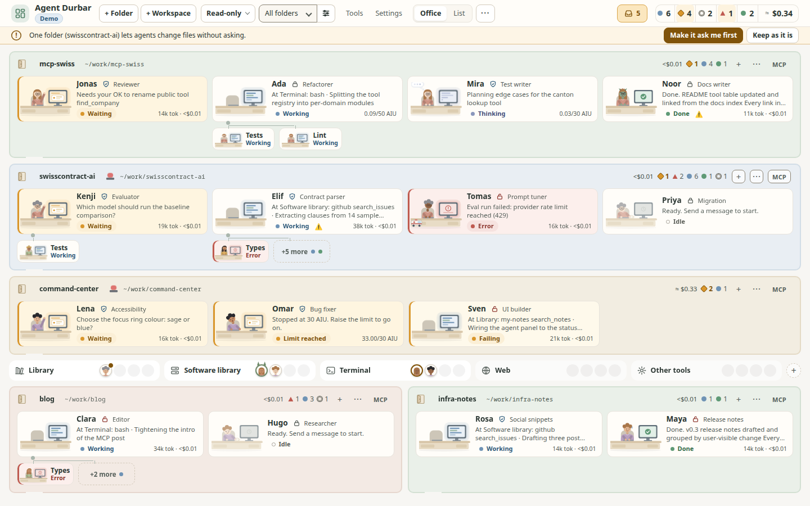
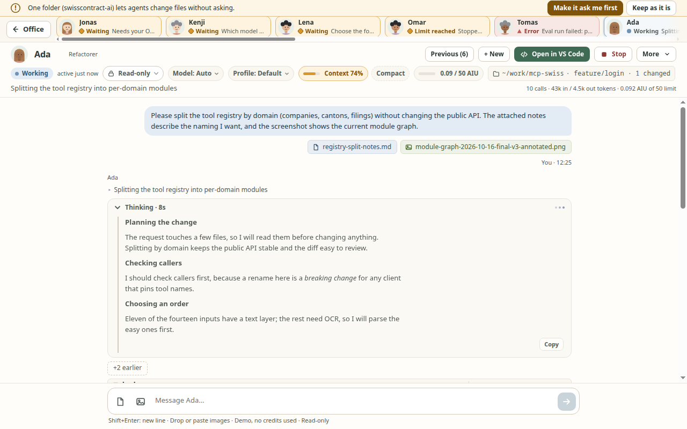
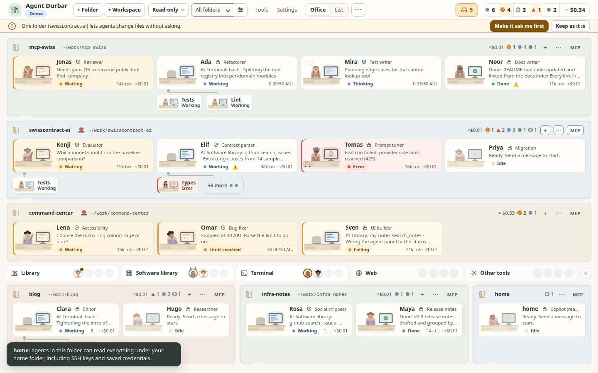
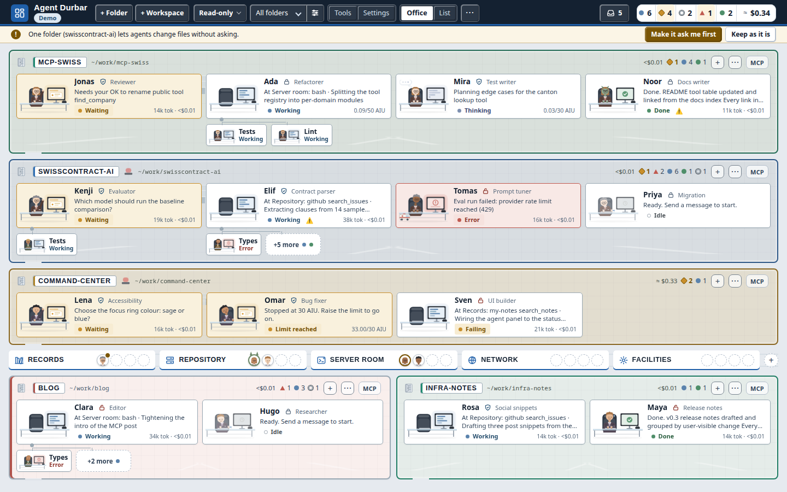
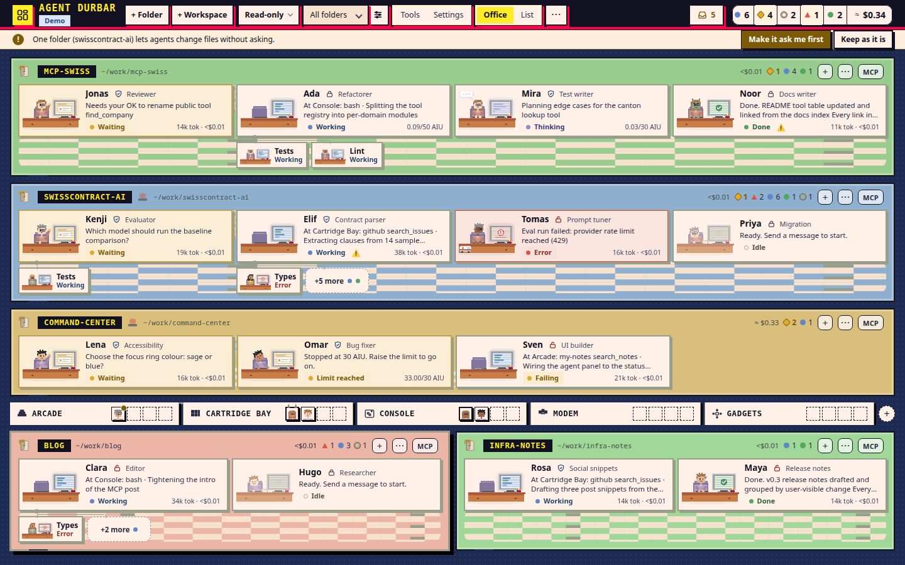
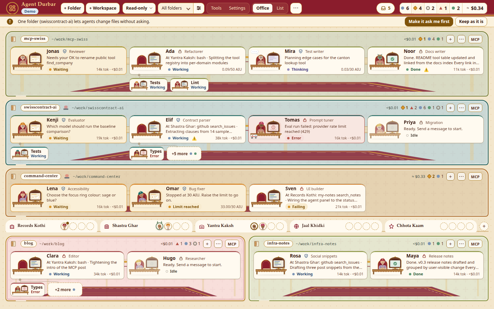

<p align="center">
  
</p>

<h1 align="center">Agent Durbar</h1>

<p align="center"><em>A calm command center for your AI agents</em></p>

Agent Durbar is an office-style desktop app to **see, chat with and coordinate AI agents across several agent apps (harnesses)**: GitHub Copilot, Claude Code and OpenAI Codex. It is for **anyone who works with agents**, not only developers. A room is any folder an agent works in: code, documents, research or notes.

**Website:** <https://three-feathers.github.io/agent-durbar/>

> **Status: alpha.**
> - The newest pre-release is [`v0.1.0-alpha.10`](https://github.com/three-feathers/agent-durbar/releases/tag/v0.1.0-alpha.10). It is unsigned and not notarized.
> - What changed in each release is in the [CHANGELOG](CHANGELOG.md).
> - **Where it has been run:** Linux by hand every day. macOS by hand on the owner's and a teammate's Macs (macOS 26, Apple Silicon), from source and the simulator, including real Copilot sessions; fixes from those runs are merged. Windows has not been run by hand on a real PC yet.
> - **What CI checks on Linux, macOS and Windows:** every change builds and starts the packaged app (spec 012 T044). In review: the UI checks on all three ([#389](https://github.com/three-feathers/agent-durbar/pull/389)), real installs of each agent app as a standard and an admin user ([#393](https://github.com/three-feathers/agent-durbar/pull/393)), and real-account end-to-end runs, where Copilot, Claude Code and Codex each install, sign in and answer on all three OSes: 9 of 9 on 2026-10-20 ([#402](https://github.com/three-feathers/agent-durbar/pull/402)).
> - Built by [Three Feathers](https://github.com/three-feathers), tracked on the [project board](https://github.com/orgs/three-feathers/projects/1).



> **Disclaimer.** Agent Durbar is an independent community project. It is **not affiliated with, endorsed by or sponsored by GitHub, Microsoft, Anthropic or OpenAI**. "GitHub Copilot", "Visual Studio Code", "Claude" and "Codex" are trademarks of their owners. Durbar only drives the tools you installed yourself, on your own machine.

## Contents

- [What you can do](#what-you-can-do)
- [Harnesses](#harnesses)
- [Install](#install)
- [Safety model](#safety-model)
- [Costs and caps](#costs-and-caps)
- [Themes](#themes)
- [Build from source](#build-from-source)
- [Known limits](#known-limits)
- [Roadmap](#roadmap)
- [How we work](#how-we-work)
- [License and credits](#license-and-credits)

## What you can do

**The office**
- Every agent is a person at a desk in its folder's room. You see at a glance who is idle, working, thinking, waiting for you or in trouble. A working agent whose last tool calls failed in a row says **Failing**, a card in an Allow all folder says **Allow all**, and hovering a card tells when it last did something.
- 10-15 agents stay readable on one 1440x900 or 1280x800 screen, and the desks get denser on their own. Checked with 15 real Copilot sessions at once (Linux, 2026-10-21): no overlap or clipping at either size.
- Sub-agents (helpers) sit next to the agent that started them.
- Agents show how they are doing: heavy, monster, ambulance, room sirens. Main agents walk to a **place** in a shared lobby for the tool they use.
- **Floors** group rooms and can be switched off. A **List** view is there when you want rows instead of desks: agent app, last activity and cost columns, sortable, with J/K to move.
- A room's **⋯** menu offers New session, Rename, Hide and **Remove folder**.

**Chat**
- Click an agent to open a full-screen chat. All the other agents stay in a slim strip.
- You see its thinking, tool calls and replies as they stream in, with Markdown and copy buttons. An open tool call shows the whole command (with Copy), how long it took and its output; a Claude Code edit request has a **Show the change** diff.
- Attach files and images by picking, dropping or pasting.
- Questions an agent asks you appear as a card with its choices, an "Other" answer and Skip. The whole question, every choice and its description are shown in full; Enter in the "Other" box sends your answer (Shift+Enter adds a line). While a question waits and its card is scrolled out of view, the bar above the message box shows it; a short one can be answered right there (its choices, an "Other" box and Skip), a longer one has **Show question**. Several context compactions in a row are one line that counts them ("Context compacted 4 times · last 10:21").
- **Needs you:** one inbox of every agent waiting for you, oldest first with how long each has waited. While Durbar is in the background the window title ("(3) Agent Durbar"), the app icon and one notification tell you (Settings > Notifications turns it off; it shows only the agent's name and a short summary). In a waiting chat, **Alt+A** allows once, **Alt+S** allows for the session, **Alt+D** denies and **Alt+N** goes to the next agent; **?** lists every shortcut.
- **Stop** a turn or **End** a session from the chat header or from the agent's card menu ([screenshot](docs/screenshots/005-card-menu-stop-end-1440x900.png)).

**Sessions and folders**
- One session per folder or `.code-workspace` file, or several per folder (**+ New** in a chat's header, or **+ New session** under More).
- The top bar is one row: **+ Folder** and **+ Workspace** come first, right after the app name (Ctrl+O and Ctrl+Shift+O; on a Mac also **File > Add Folder…** ⌘O and **Add VS Code Workspace…** ⇧⌘O), the **Defaults** chip (for example "Copilot · Read-only · Auto") sets the agent app, permission mode and model for new sessions, and **Manage folders** sits next to the folder filter. On narrower screens the status counters show a dot and a number (the words are in their tooltips).
- After a restart, each folder **continues its open sessions** (up to 6 per folder, each resumed when you open its chat or send it a message), and Durbar **remembers where you were**: the window's place and size (back on a screen it fits, else 1440x900), Office or List, the folder filter and the open chat.
- After more than 30 minutes closed, a **Since you were away** strip says how long it was and which scheduled prompts did not run, with **Run missed now** for each.
- **End of day:** quitting while agents are still working asks first ("2 agents are still working. Quit anyway?", Cancel is the default). **End all sessions** (top bar **⋯** and Ctrl+K) ends every running session after a confirmation; the chats stay.
- **Ctrl+K** lists your 5 most recent chats first, and **Ctrl+`** jumps back to the previous chat.
- **Previous (N)** in the chat header lists a folder's earlier sessions to **Resume**, and VS Code's Copilot Chat history as a read-only copy (it opens at the latest message, and **Continue in VS Code** opens the folder there; [screenshot](docs/screenshots/009-vschat-latest-1440x900.png)). With two or more entries, a **search box** filters them by title (case and accents ignored). Each row has a **⋯** menu (also right-click or Shift+F10): **Pin to top**, **Hide** (only in Durbar; the session stays in VS Code and the CLI; **Show hidden (N)** brings hidden rows back) and, for Copilot and Codex sessions, **Delete…**, which asks the agent app to delete that one session for good (after a red confirmation; Claude Code has no per-session delete, so it is shown disabled). A session that still has a card in the office cannot be deleted: end it and remove it from the office first. VS Code chats can be pinned or hidden, never deleted ([screenshot](docs/screenshots/006-prev-menu-1440x900.png)). Pins and hides are saved as ids only in `durbar-folders.json`; a delete adds a *Session deleted* row (app, short id, date, no title) to the activity log.
- **New session with a summary:** start fresh from a hand-off summary of the current conversation, which you edit before it is sent.
- **Continue in another app:** with two or more agent apps ready, **More > Continue in another app…** moves a conversation to Claude Code, Codex or Copilot in the same folder: the reviewed summary, headed by where it came from, is the new session's first message, and the old session keeps its history. Checked on real accounts (Copilot → Claude Code, Claude Code → Codex).
- **Scheduled prompts** per folder or for one session, while the app is open: once, every N minutes, or on a calendar (every day, weekdays, or weekly on chosen days, at a local time that stays put across daylight-saving changes). A schedule can have its own **limit** in AI credits or dollars (the agent app's unit): when its runs have spent that much, it pauses and says so. A schedule for a session that has ended pauses too, and is never sent elsewhere unless you choose the folder's agent. Prompts that Copilot itself schedules in a session (`/every`, `/after`) are listed read-only. Open them from a room's **⋯** menu, the **clock** in its header (shown once it has schedules), the **Schedules** button in its chat, or **Settings > Schedules** for all folders. A **starter kit** has templates:
  - *Start my day* (a morning briefing from your mail and calendar MCP servers);
  - *Summarize my day*, *Plan my day*;
  - *Open pull requests and CI*, and a dependency check.

  The briefing and planning ones end by **asking you what to do next** with a question card, and the agent waits for you in the office.
- **Custom agents** per session: `.github/agents` or `~/.copilot/agents` for Copilot, `.claude/agents` for Claude.
- **Open in VS Code** opens the folder (VS Code, then Insiders, then VSCodium).
- **Folder status:** in a chat, the folder chip also shows the git branch and how many files have uncommitted changes (`~/work/api · main · 3 changed`); click it for the list of changed files with their +/− lines and **Open in VS Code**. Read-only (Durbar never runs a git command that writes); nothing extra for a folder that is not a git repository ([screenshot](docs/screenshots/063-folder-changes-1440x900.png)).
- **Undo an agent's file changes:** after a turn in which the agent edited files, the chat shows what changed with **Undo these changes…**. A dialog lists each file (restore, remove the file it created, create back the file it deleted) and nothing is written until you confirm; the current files are kept, so you can undo the undo. It refuses when a file changed after that turn. Only edits made with the agent apps' file-edit tools are covered (not shell commands, MCP tools, or Codex in Allow all), inside the session's folders, while Durbar runs ([spec 065](specs/065-checkpoints/spec.md)).
- **Send to several sessions…** (top bar ⋯ or Ctrl+K): one message to the running sessions you tick, each with its own agent app, mode and spending limit. Busy sessions, and sessions waiting for you, can't be ticked; the button says how many get it ([screenshot](docs/screenshots/064-send-several-1440x900.png)).
- **Plan first** (chat mode menu → *Plan first (next message)*): the agent proposes a plan in its app's own plan mode and changes nothing until you press *Approve*; *Revise…* sends your changes, *Reject* ends it. The approved plan still runs in the folder's permission mode, so in Read-only changes stay refused. Checked on real Copilot, Claude Code and Codex sessions (2026-10-21).

**Models, context and tools**
- Pick the model and reasoning effort per session, and switch them in a running session: Claude Code and Codex from the next message, the conversation kept (checked on real accounts 2026-10-20); Copilot too, but not yet seen on a paid plan.
- A context chip shows how full the window is, with **Compact**.
- **MCP servers:**
  - your Copilot CLI list (`~/.copilot/mcp-config.json`) is used first;
  - each folder can add extras (with a trust prompt), import them from `.vscode/mcp.json`, and switch a server on or off per session.
  - when a server asks you for input (a small form, or a sign-in page), the chat shows it with **Submit / Decline / Cancel**; a page opens in your browser only after you click, and only if it is https (simulator and test harnesses only so far, not yet tried with a real server).
- **Tools** shows what each agent used, for *This session* and *All time*, and a **Cost** tab with each folder's ≈ money, AIU, Claude estimate, tokens and calls (the same *This session* or *All time*, with the start date under it), with **Copy as CSV**. Clicking a room's cost opens it.
- **Activity** (Tools > Activity) is a local log for a team lead: every answer to a permission request, every automatic approval (Allow all or a session permission), and every mode or spending-limit change, with time, agent, folder, agent app and mode. It keeps the newest 5000 rows on this computer, holds actions and decisions only (never prompts, replies or file contents), and exports to CSV or JSON. Claude Code and Codex in Allow all approve inside their own process, so their automatic approvals are not listed (Copilot's are).



## Harnesses

Durbar offers each agent app (harness) that is **installed and signed in on your computer**. When two or more are ready, the toolbar and the New session dialog show an **Agent app** picker; with one, nothing extra is shown.

**What "signed in" means.** For Copilot and Codex, Durbar asks the service with a free call that needs a valid sign-in (Copilot: your GitHub quota; Codex: your OpenAI rate limits for a ChatGPT sign-in), so an expired sign-in shows as *Not signed in* after **Check again**. Codex signed in with an **OpenAI API key** has no rate limits to read, so Durbar asks Codex how it is signed in and shows "Signed in with an OpenAI API key." (in review, [#402](https://github.com/three-feathers/agent-durbar/pull/402)). Claude Code offers no free check, so Durbar trusts `claude auth status` and learns at the first message; that works with an `ANTHROPIC_API_KEY` too; if any app refuses a message because of its sign-in, the chat shows **Sign in** and then **Send again**. Checked on 2026-10-20 with a refused token: Copilot and Codex showed *Not signed in*, and Copilot's real error for a message refused because of its sign-in is now recognised. The end-to-end run on Linux, macOS and Windows (2026-10-20, run 39496442403, in review in #402) got exactly the card's words from the real services: Copilot "Signed in (checked with GitHub).", Codex "Signed in with an OpenAI API key.", Claude Code "Signed in on this computer; confirmed at the first message." The `v0.1.0-alpha.9` build predates that line, so it shows no sign-in line on the card ([#354](https://github.com/three-feathers/agent-durbar/issues/354)). After a Copilot sign-in, its shared runtime restarts so open Copilot sessions reconnect with the new login ("Reconnecting Copilot…"). A real expired Claude Code sign-in has not been tried.

| Harness | What Durbar runs | Checked on a real account |
| --- | --- | --- |
| **GitHub Copilot** | The Copilot runtime bundled with the official `@github/copilot-sdk`, with your `copilot login`. | Yes, since milestone 1. Checked on Copilot Pro (2026-10-20): switching between two real models with the conversation kept, reasoning effort, the long-context tier (272k → 872k), the confirmation when the new model's window is too small, and *Compact and switch*. Copilot's runtime does not stop at the credit limit, so Durbar enforces it (see [Costs and caps](#costs-and-caps)). |
| **Claude Code** | Your installed `claude` over its stream protocol. Durbar loads none of Claude's settings files: a folder's own `.claude` hooks and `.mcp.json` do not run (checked 2026-10-20). Sessions are shared with the CLI both ways: Durbar lists the folder's earlier `claude` sessions, and sessions started in Durbar appear in `claude --resume` (checked on Claude Code 2.1.304; it relies on an undocumented setting, see spec 012 FR-159). | Yes (Claude Code 2.1.302-2.1.305; 2.1.305 in the end-to-end run on Linux, macOS and Windows, in review #402): every mode, interrupt, stop, resume, the live mode switch, models, previous sessions, questions, MCP switches, sub-agents, custom agents, the context window, the cost cap, summaries, and the full app across a restart. |
| **OpenAI Codex** | Your installed `codex app-server`, with a ChatGPT sign-in or an API key. | Yes (Codex 0.163, Linux): every mode, interrupt, End session, resume, a mode switch, models, history, questions, MCP tools, sub-agents, summaries, and the full app across a restart. |

What each harness can do differs a little, and Durbar hides a control a harness cannot honour rather than faking it. Two Codex specifics:
- A mode change applies from the next message.
- **Stop** does not kill a command that is already running; *End session* does.

Details and evidence: [spec 012](specs/012-claude-codex-adapters/spec.md).

**Remote control (Copilot and Claude Code, checked on real accounts).** In a running Copilot chat, **More > Control from GitHub (web and mobile)** turns on Copilot's remote control for that one session, after a dialog, and then a second native confirmation, that say its messages are sent to GitHub and that anyone who can see the session there can steer it. It is not available in **Allow all** (switch to Ask first). Durbar then shows the GitHub link (Copy link, Open on GitHub; open it in GitHub Mobile to steer from your phone), a **Remote** chip in the chat header and "· Remote" on the desk card. **Stop remote control** turns it off; ending or removing the session, or quitting Durbar, turns it off on GitHub too. On and off are written to the activity log. It is never on by default. Built on the SDK's experimental `remote` calls. It **needs a paid Copilot plan**: on Copilot Pro (2026-10-20) it started in a plain folder and in a `git init` folder, with a github.com link, steerable and not shared, and turned off cleanly. On Copilot Free it never started, in any folder, including a private GitHub repository; Durbar then says it did not start instead of showing it as on ([spec 054](specs/054-remote-control/spec.md)). In a **Claude Code** chat the same menu reads **Control from Claude (web and mobile)**: it uses Claude Code's own Remote Control, the link opens on claude.ai or in the Claude app, and it stays on when Durbar relaunches the session (for a model change or resume); if it cannot be turned back on, Durbar says so and shows it as off. Claude Remote Control was checked on a real account through `claude -p` on 2026-10-20; through Durbar's window only in the simulator. **Codex** has no per-session remote control that Durbar can turn on; use the ChatGPT app's own Codex access. Claude Code channels (Telegram) are planned, not built.

**Codex on Ubuntu 24.04 and later.** Codex's Read-only and Ask first modes run commands in its Linux sandbox (bubblewrap). Ubuntu blocks that for unprivileged programs, so those modes fail at start with a message saying so; Allow all needs no sandbox. To allow only bubblewrap, add an AppArmor profile (needs `sudo`):

```
# /etc/apparmor.d/bwrap, then: sudo apparmor_parser -r /etc/apparmor.d/bwrap
abi <abi/4.0>,
include <tunables/global>
profile bwrap /usr/bin/bwrap flags=(unconfined) {
  userns,
}
```

Codex also ships its own `bwrap` inside its npm package (`…/@openai/codex-linux-x64/vendor/…/codex-resources/bwrap`). Add a second profile with that path if `codex` still reports a sandbox error.

**Codex's sandbox on macOS and Windows.** Read-only and Ask first always need Codex's own sandbox. If it cannot start, the session does not start and nothing runs. Durbar says why, and the message has a **Change mode…** button that opens the usual mode menu (it never picks a mode for you):
- **Windows:** Codex's *elevated sandbox* must be set up once, and the native `codex.exe` used, not a `.cmd` shim.
- **macOS:** on GitHub's macOS runners, macOS refused Codex's `sandbox-exec` (2026-10-20). Whether an ordinary Mac ever does this is not known yet. Durbar shows a plain message instead of the raw error.

## Install

**Requirements**
- At least one agent app: GitHub Copilot (a free plan works), Claude Code, or OpenAI Codex. **Settings > Agent apps** can install it, least administrator rights first: the vendor's **official installer** (into your home folder, no admin; downloaded only from the vendor's own address), then npm, then winget or Homebrew (which may ask for admin), with the command shown first, and sign you in with the vendor's own page and a one-time code. Or install and sign in yourself, for example with `copilot login`. Durbar finds an agent app on your `PATH`, on your login shell's `PATH` (macOS and Linux, read once at start, at most 3 s), in the usual install folders, and in the folders of Node.js version managers (nvm, fnm, Volta, asdf, mise; nvm-windows and Volta on Windows) and Linuxbrew. Settings shows where it was found.
  - Not tried yet: installs through winget or Homebrew, the official installers on a real machine, and the flows on macOS and Windows (a manual CI check on clean macOS, Windows and Linux machines, with and without admin rights, is spec 060 T060).
- Durbar never sees, stores or sends your tokens: each harness reads its own sign-in. Durbar has no accounts, no servers and no telemetry.
- Usage bills against **your** plans. Several agents in parallel can use credits quickly; see [Costs and caps](#costs-and-caps).
- Optional: VS Code, VS Code Insiders or VSCodium, for *Open in VS Code*.

**Download** the build for your system from the [Releases page](https://github.com/three-feathers/agent-durbar/releases). Check it against `SHA256SUMS.txt`. There is no auto-update: download a newer release to update.

| System | File |
| --- | --- |
| macOS, Apple Silicon | `Agent-Durbar-<version>-arm64.dmg` (or `.zip`) |
| macOS, Intel | `Agent-Durbar-<version>-x64.dmg` (or `.zip`) |
| Windows 10/11, x64 | `Agent-Durbar-Setup-<version>.exe` or `Agent-Durbar-<version>-portable.exe` |
| Linux, x64 | `Agent-Durbar-<version>-x86_64.AppImage` |

**The builds are not code-signed** (certificates cost money), so your OS warns you the first time. Only open files from this repository's Releases page.
- **macOS:** right-click the app and choose **Open**, or allow it in System Settings > Privacy & Security. If macOS says it is damaged, run `xattr -dr com.apple.quarantine "/Applications/Agent Durbar.app"`.
- **Windows:**
  - Which file: `Agent-Durbar-Setup-<version>.exe` installs to the Start menu; `Agent-Durbar-<version>-portable.exe` runs without installing.
  - Edge may block the download ("isn't commonly downloaded"): open Downloads (**…**), choose **Keep**, then **Show more > Keep anyway**.
  - Check the file in PowerShell: `Get-FileHash .\Agent-Durbar-Setup-<version>.exe -Algorithm SHA256` and compare the hash with the line for that file in `SHA256SUMS.txt`.
  - On "Windows protected your PC", click **More info**, then **Run anyway**.
  - The Copilot CLI needs PowerShell 6 or later (GitHub's docs, not checked by us); Windows only ships 5.1. If the Copilot card says so, install it with `winget install --id Microsoft.PowerShell -e`.
- **Linux:** run `chmod +x Agent-Durbar-*.AppImage && ./Agent-Durbar-*.AppImage`. The AppImage's launcher entry no longer forces `--no-sandbox`; its `AppRun` adds the switch by itself only on systems without unprivileged user namespaces (you can also add it by hand).
  - An AppImage needs FUSE 2. Ubuntu 22.04 and later do not install it: if the app does not start ("libfuse.so.2" / "dlopen()"), run `sudo apt install libfuse2t64` (Ubuntu 24.04 and later) or `sudo apt install libfuse2` (22.04), or start it without FUSE: `./Agent-Durbar-*.AppImage --appimage-extract-and-run`.
  - Saved MCP secrets need a desktop keyring (GNOME Keyring or KWallet). Without one, Durbar refuses to store them rather than keep them with a fixed key (spec 019): add a keyring, or pass secrets through the server's own environment.

**On a Mac** (spec 052 FR-083..FR-086; tried on real Macs, macOS 26 on Apple Silicon, and fixed after those runs: moving the window from an open chat, the traffic-light room, question cards and the chat strip):
- Shortcuts use ⌘ and are shown that way: ⌘K command palette, ⇧⌘A the Needs you inbox, ⇧⌘N the next agent. In a chat that waits for you, ⌥⌘A / ⌥⌘S / ⌥⌘D answer and ⌥⌘N goes to the next agent (Option alone types accents on a Mac). macOS itself uses ⌥⌘D to show or hide the Dock, so Deny may not reach Durbar with the keys; click it instead.
- **Agent Durbar > Settings…** (⌘,) opens Settings; the menu also has Edit, View (zoom, full screen), Window and Help.
- Closing the window hides it and **your agents keep running**; click the Dock icon to bring it back. Quit with ⌘Q.
- The title bar is hidden: you move the window by dragging the top bar (in a chat, the agent strip, a notice strip or a screen's header at the top). While a dialog or the command palette is open the window does not drag. These areas were fixed after a real-Mac report and are checked in the simulator (`npm run check:mac-titlebar`); double-click to zoom and full screen have not been checked on a real Mac yet.
- On Windows and Linux the window has no menu bar (no Reload or developer tools); copy and paste in text fields work as usual.

> **Trying it on Windows?** Durbar is built, started and (in review) end-to-end checked on Windows in CI, but nobody on the team has used it on a real Windows PC yet. If something does not work (the download, the installer, Settings > Agent apps, a harness that is not found), please [open an issue](https://github.com/three-feathers/agent-durbar/issues) with your Windows version and what you saw.

## Safety model

Agents run **locally, on your machine, as you**, in the folders you add. Every agent has a permission mode. The names are the same for every harness, and Durbar maps them to each tool's own controls.

- **Read-only** (the default): reads inside the session's folders only; everything else is denied. On Copilot, an MCP tool that its server marks read-only still runs without asking (the runtime does not ask Durbar); any other MCP tool is denied (both checked on 2026-10-20). Claude Code and Codex were not checked for this.
  On Codex, Read-only and Ask first rely on Codex's own sandbox: checked on Linux (reads limited to the session's folders, writes blocked; 2026-10-21). On macOS and Windows that sandbox depends on the system; if it cannot start, the session does not start and Durbar says why.
- **Ask first**: writes, shell commands, URLs and tools wait for *Allow once*, *Allow “…” for this session* or *Deny* (the same words in Simple and Expert).
- **Allow all**: no prompts. Use it only in folders you trust; it asks once to confirm.

Change the mode any time from the chat header chip or the agent's card menu.

**Coming back to a session.** Each session keeps the mode you last chose for it. After a restart, and when you resume it from *Previous sessions*, it comes back in that mode, also when it was Allow all and the session you opened the list from is in Read-only. Its chat then says which mode it is in and why ("Permissions: Allow all, the mode you last chose for this session"), and an Allow all that came back shows *restored* on the mode chip. A session Durbar has no mode for (one from before this change, or started outside Durbar) gets the folder's mode after a restart, or the mode of the session you resumed it from; the chat says that too. A resumed session that comes back in another mode than the session you opened it from is also written to the activity log. Grants from *Allow for this session* are never kept.

Rules that always apply:
- **Durbar never deletes files itself.** *Delete…* in Previous sessions goes only through the agent app's own API (Copilot `deleteSession`, Codex `thread/delete`), only from Durbar's own window (not from MCP tools, remote control or schedules), never for a session still in the office, never for VS Code chats, and not for Claude Code. Not yet run against a real session.
- **Add project folders, not your home folder or a drive root.** Everything under an added folder counts as the agent's own; Durbar warns calmly when you add one of those.
- **Answering a question** an agent asks is allowed in every mode; it is not an action.
- **A profile (custom agent) from a folder's repository** asks once before it is used and never changes your mode.
- **Durbar never stores or logs** tokens, session content or your prompts. Debug logs are redacted.

What Durbar does not do (the same list is in Settings):
- Durbar asks Claude Code and Copilot to stay in their folders but cannot force them; only Codex is held there by the system (in Read-only and Ask first).
- It does not stop a reply halfway: spending limits are checked between replies.
- It does not see your bill; costs are estimates.
- It sends nothing to any server of its own.
- Rooms you hide or switch off still run and cost money.

Codex in Read-only and Ask first gets an OS-enforced permission profile limited to the session's folders, and Durbar refuses those modes when the profile cannot be enforced. Claude Code gets its permission mode, allowed read tools and a check that reads stay inside your folders. Details: [spec 003](specs/003-permissions-and-approvals/spec.md) and [spec 012](specs/012-claude-codex-adapters/spec.md). To report a security problem, see [SECURITY.md](SECURITY.md).



## Costs and caps

- **Copilot** reports usage in AI credits (shown as AIU). A session can have a **spending limit**, at least 30 AI credits:
  - set it in the New session dialog or the limit chip;
  - a global default is in Settings;
  - it is saved per folder.

  It is a soft limit: when it is reached (*Spending limit reached*), the chat offers *Raise limit / Remove limit / Stop here*. Copilot's own runtime does not stop at the limit (real check, 2026-10-20: a 30-credit session reached 42.6), so **Durbar enforces it**: a turn that crosses the limit is stopped (the call already running can go over by its own cost), and a message sent at or over the limit is held until you choose. Checked on a real session (2026-10-20) and in tests ([spec 011](specs/011-credit-caps-and-usage-display/spec.md)). Copilot plans, the free one too, have a fixed price: Durbar shows usage, it does not charge you. The office and each room show usage totals, kept across restarts, with a reset in Settings.
- **Claude Code** reports a dollar *estimate*, shown as `≈ $… est.` and never mixed with AIU. A session can have a **spending limit in dollars** (at least $0.01):
  - Durbar passes what is left to Claude's own `--max-budget-usd`;
  - when the limit is reached, the chat offers *Raise limit / Remove limit / Stop here*;
  - the limit is per session.

  With a Claude subscription, nothing is billed per token.
- **Codex** reports tokens, with no price.

## Themes

**Settings > Theme** changes the whole app live, without a restart: colours, room frames, cards, fonts, place names, and the people and furniture in the office.
- **Clean Office:** the default, and the fallback for anything unknown or broken.
- **Corporate:** a navy bar, white rooms with an accent edge, square corners.
- **Retro Pixel:** a dark arcade page with pixel characters at CRT desks.
- **Durbar · Indian / European / Japanese:** three royal courts, each with its own frames, colours and court place names.
- **Make a theme with AI:** describe a look ("a pirate ship at night"), or pick one of the ideas, and Claude Code, Codex or Copilot designs a light or dark theme: colours, a style, place names and art for the people and furniture. Durbar keeps only safe values, cleans the art like an imported pack, and checks that text stays readable; the AI gets up to 3 passes to fix what fails. Try it on the whole app before you save it. One theme costs about a cent on Claude (haiku); Copilot spends AI credits from your plan (shown with the result): about 0.25 AI credits per pass on a free plan, checked on 2026-10-20.
- **Your own themes:** a folder with a `manifest.json` (colours, a UI style and a scene kit from fixed lists, small SVG art, place names), imported and exported in Settings. A theme is data only: no scripts and no CSS, SVG art is rebuilt from allowed shapes, and a pack that breaks a rule is refused with a message.

Status, permission and credit wording, and the layout, are the same in every theme. Display fonts are your system's own serif and monospace fonts. Details: specs [035](specs/035-theme-foundation/spec.md)-[040](specs/040-user-themes/spec.md).

| Corporate | Retro Pixel | Durbar · Indian |
| --- | --- | --- |
|  |  |  |

**Settings > Detail level > Spacing** picks *Comfortable* (the default) or *Compact*, which tightens the chat, Settings, Tools, dialogs and the inbox; the office and the top bar keep their sizes.

## Build from source

```bash
npm ci
npm run typecheck && npm run build && npm test   # unit suites in parallel (~20 s); `npm test -- folders` filters
npm start                 # the app, with the harnesses you have installed and signed in
DURBAR_SIM=15 npm start   # 15 simulated agents: no sessions, no AI credits
npm run check:office      # layout check at 1440x900 and 1280x800 (Electron; xvfb on Linux), simulator only
npm run check:question-options  # question card text, options and descriptions in full; Enter sends a custom answer (simulator, xvfb on Linux)
npm run check:question-visible  # a waiting question stays visible in the answer bar; compactions in a row fold into one line (simulator, xvfb on Linux)
npm run check:sched-sendto      # Schedules dialog: Send to / Limit labels on one line, every option fits, session name on a hint line (simulator, xvfb on Linux)
npm run check:geometry    # every theme lays out exactly like Clean Office (about a minute)
npm run check:ui          # every simulator driver that asserts, one after another, on any OS (UI_SUITE_XVFB=1 keeps windows off a Linux desktop)
npm run check:themes      # on demand: the full layout check in every theme, a few at a time, low priority, memory limits
npm run pack:dir          # unpacked app for this OS in release/ (also dist, dist:mac:arm64, dist:mac:x64, dist:win, dist:linux; unsigned); then checks the Electron fuses and the display names
npm run check:fuses-launch  # on demand, after pack:dir: the packed Linux app opens its window and offers no debugger (xvfb on Linux)
```

`npm run smoke` and `npm run verify:cap` use a real Copilot login and may spend credits: run them only on purpose. The **E2E real accounts** workflow (spec 062) installs the three agent apps on Linux, macOS and Windows, signs in with the CI account's secrets and runs one tiny turn each; it runs by hand, weekly and on `main`, never on pull requests. The supported CI platforms are listed once, in `.github/platforms.json`. GitHub Actions also runs the UI checks (geometry, office layout, the Mac title bar, `check:ui`) on macOS, Windows and Linux runners and keeps the screenshots of each run (workflow *UI on three OSes*; simulator only). Releases are built by GitHub Actions from `v*` tags into a draft release that the maintainer publishes by hand.

**Layout of the repository:**
- `src/main` (Electron main), `src/preload`, `src/renderer` (plain HTML/CSS/JS, the simulator);
- `src/adapters` (Copilot, Claude Code and Codex adapters, the permission broker), `src/shared`;
- `scripts/` (tests and screenshot drivers), `specs/` (Spec Kit specs), `docs/`.

## Known limits

- **Windows has not been used by hand.** Linux is used every day and macOS on real Macs (from source and the simulator). A packaged-app check runs on all three in CI, and real-account end-to-end runs on all three are in review (#402), but nobody has used the Windows build on a real PC, or the packaged macOS `.dmg` day to day.
- **Where your data lives:** the installed app keeps its settings, folders and saved MCP servers in `agent-durbar` under the OS app-data folder (`%APPDATA%` on Windows, `~/Library/Application Support` on macOS, `~/.config` on Linux). `npm start` and the simulator use their own `agent-durbar-dev` folder next to it, so developing never touches the installed app's data. To keep data from an older dev run, start once with `DURBAR_USER_DATA=<old folder>` or copy the folder by hand.
- **Unsigned builds:** expect the OS warnings above.
- **Names in packaged builds:** the display name is `Agent Durbar` (Start menu and desktop shortcuts, Add/Remove Programs, `.app`, AppImage `Name=`), while the run-time identity stays `agent-durbar` on every OS (profile folder, Keychain, WM_CLASS). `scripts/check-names.js` compares the packed app with `package.json` on every package build. On Windows a packaged build sets the AppUserModelId `io.github.three-feathers.agentdurbar` so toasts and the taskbar match the Start menu shortcut. Checked on a real Linux build (AppImage `.desktop`, packed app started on the simulator); the Windows names and AUMID and the macOS bundle names are asserted only by the *Installed app* workflow in CI, and the taskbar, toasts, Mac menu-bar title and a Linux launcher or dock were not seen on a real desktop ([#9](https://github.com/three-feathers/agent-durbar/issues/9)).
- **No debugger in packaged builds:** release builds ignore `--inspect`, `NODE_OPTIONS` and `ELECTRON_RUN_AS_NODE` (Electron fuses; `scripts/check-fuses.js` reads them from the packed binary on every package build on Linux, macOS and Windows: `pack:dir`, the `dist*` scripts, and so the packaged-check workflow and the release build) and always drop `remote-debugging-port` and `remote-debugging-pipe`, whatever the spelling. Run from source (`npm start`) to debug. Checked on the packed Linux build, including `-remote-debugging-port` with one dash (`npm run check:fuses-launch`); the fuse check itself has been run locally on Linux only, and macOS and Windows have not been tried by hand (on Windows Chromium also accepts `/` and any case, which the guard covers by removing the switches by name). The ASAR integrity fuse has no effect on Linux.
- **VS Code's own chats are read-only.** VS Code keeps them in an undocumented store that cannot be continued from outside; Durbar shows a copy. Copilot CLI/SDK sessions *can* be resumed.
- **Caps are soft:** one model response can overshoot them, and the figures are what each harness reports. Copilot's runtime does not stop at its limit at all, so Durbar does: a turn is stopped after the call that crosses it (real check, 2026-10-20).
- **Floors that are off are quiet:** their agents keep running and can spend credits or wait for an approval.
- **Schedules run only while the app is open**, and a schedule's limit counts usage from its send until that turn ends (a message you send during that turn counts too). The agent app's own schedules are only shown for Copilot and only when reported while Durbar runs; none of this has been tried on a real session yet.
- **Imported MCP config:** importing from `.vscode/mcp.json` is a one-time copy per folder.
- **Moving targets:** harness protocols change, so versions are pinned and checked.

## Roadmap

- **Done:**
  - the office, chat, permissions, attachments, MCP, tools, usage and caps, themes, floors, places, moods and scheduled prompts;
  - Copilot, Claude Code and Codex side by side, with session resume and continuation;
  - model and context switching, and new session with a summary.
- **Next:**
  - macOS and Windows on real machines;
  - the Durbar MCP server, to read the office from your own MCP client ([spec 041](specs/041-durbar-mcp/spec.md), in progress).
- **Ideas being specified:** a global assistant chat across sessions, multiple profiles (personal/work accounts), and a morning briefing. See the [issues](https://github.com/three-feathers/agent-durbar/issues).
- **Needs a purchase:** code signing and notarization ([spec 014](specs/014-signing-and-notarization/spec.md)).

What was built when, and how it was checked, is in the [feature history](docs/feature-history.md) and the [CHANGELOG](CHANGELOG.md).

## How we work

Agent Durbar is spec-driven with [GitHub Spec Kit](https://github.com/github/spec-kit): **no code without a spec, a plan and tasks.**
- Every feature has a folder in [`specs/`](specs/README.md). Each requirement is tagged `[IMPLEMENTED]` or `[KNOWN GAP]`, with how it was checked.
- The rules are in the [constitution](.specify/memory/constitution.md).
- A CI check fails a pull request that changes `src/` without changing `specs/`.
- Coding agents follow [AGENTS.md](AGENTS.md). People start with [CONTRIBUTING.md](CONTRIBUTING.md) and [docs/collaboration.md](docs/collaboration.md).
- Claim an issue on the [project board](https://github.com/orgs/three-feathers/projects/1) before you start.

## License and credits

[MIT](LICENSE), Copyright (c) 2026 Three Feathers contributors.

Agent Durbar is by **Three Feathers**. Key contributors: [vikramgorla](https://github.com/vikramgorla), [fjcabello](https://github.com/fjcabello) and [rubenlupi](https://github.com/rubenlupi) (GitHub handles are used as the names). The names live in [`src/shared/about.ts`](src/shared/about.ts) and are shown in the OS About panel and in Settings > About.

The app id is `io.github.three-feathers.agentdurbar` since 2026-10-16. A build from before then is a separate app to the OS; uninstall it by hand. Saved data is kept.

Repository: <https://github.com/three-feathers/agent-durbar>. See also [SECURITY.md](SECURITY.md), [CONTRIBUTING.md](CONTRIBUTING.md) and the [CHANGELOG](CHANGELOG.md).
