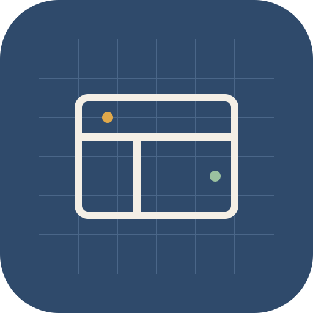
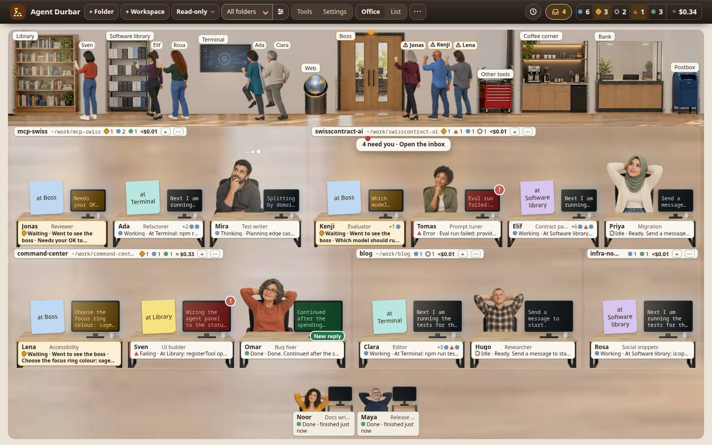
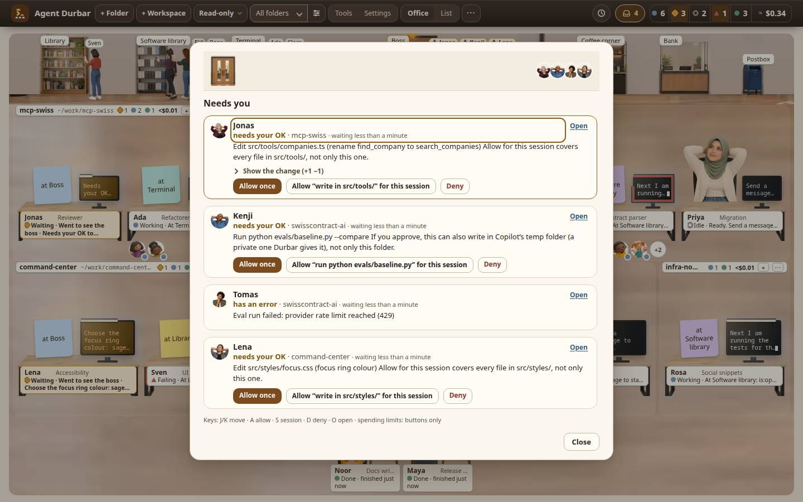
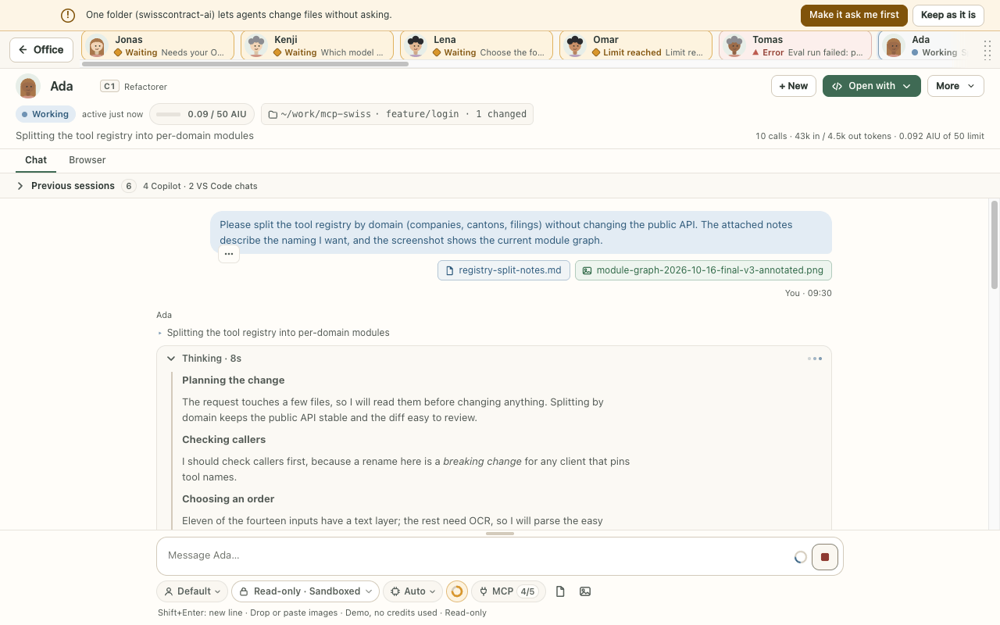
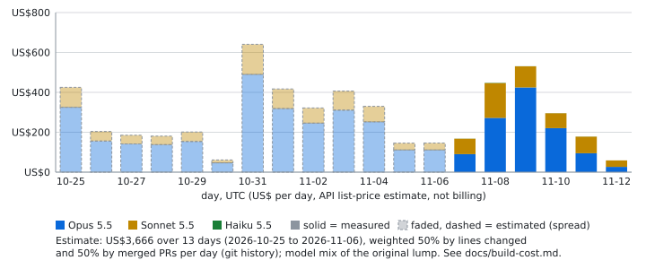

<p align="center">
  
</p>

<h1 align="center">Agent Durbar</h1>

<p align="center"><em>A calm command center for your AI agents</em></p>

<p align="center"><a href="#build-cost-so-far"></a></p>

When you run many agent sessions across several windows, you end up watching your digital agents instead of working. Agent Durbar puts them in one office and shows you only the ones that need you. It is for anyone who works with agents, not only developers: a room is any folder an agent works in.

**[Download the latest for macOS, Windows or Linux](https://github.com/three-feathers/agent-durbar/releases/latest)** (unsigned, see [Install](#install)) · [Website](https://three-feathers.github.io/agent-durbar/)



**Works with:** GitHub Copilot, Claude Code and OpenAI Codex ([agent apps](docs/harnesses.md)). **Not yet:** signed builds (your OS warns the first time), auto-update, and Windows tried by hand only once; the spending limit is soft ([known limits](docs/limits.md)).

> **Status:** first stable release, latest [`v0.1.15`](https://github.com/three-feathers/agent-durbar/releases/tag/v0.1.15), unsigned. What changed: [CHANGELOG](CHANGELOG.md).

## What it does

- **An office, not a log:** every agent is a person at a desk in its folder's room; you see who is working, waiting for you or in trouble.
- **Needs you:** one inbox of every agent waiting for an answer or a permission, oldest first.
- **Full-screen chat** with tool calls, diffs, questions and files, and the other agents always in view.
- **Three agent apps side by side:** Copilot, Claude Code and Codex, with the same permission modes and spending controls.
- **Sessions that last:** resume after a restart, scheduled prompts, undo file changes, notes.
- **MCP servers** shared across your agent apps, with health, sign-in and what each costs in context.
- **Three looks:** the Real office (shown here), the flat Clean Office (the default) and Retro Pixel.





Every feature, with its limits: [docs/features.md](docs/features.md).

## Install

Download the build for your system from the [Releases page](https://github.com/three-feathers/agent-durbar/releases) (macOS `.dmg`, Windows `.exe`, Linux `.AppImage`) and check it against `SHA256SUMS.txt`. There is no auto-update. You also need at least one agent app (Copilot, Claude Code or Codex); **Settings > Agent apps** can install it for you.

**The builds are not code-signed** (certificates cost money), so your OS warns you the first time. Only open files from this repository's Releases page.
- **macOS:** right-click the app and choose **Open**, or allow it in System Settings > Privacy & Security.
- **Windows:** on "Windows protected your PC", click **More info**, then **Run anyway**.
- **Linux:** run `chmod +x Agent-Durbar-*.AppImage && ./Agent-Durbar-*.AppImage` (it needs FUSE 2, see the details).

Every file, the Windows and Mac notes, verifying a download and the requirements: [docs/install.md](docs/install.md).

## Safety model

**Everything runs locally as you; Durbar has no accounts, servers or telemetry and never sees your tokens; agents start Read-only.** Every agent has one of three permission modes, named the same for every agent app:

- **Read-only** (the default): reads inside the session's folders only; everything else is denied.
- **Ask first**: writes, shell commands, URLs and tools wait for *Allow once*, *Allow for this session* or *Deny*.
- **Allow all**: no prompts. Use it only in folders you trust; it asks once to confirm.

An approval card marks lookalike letters in a host, program or tool name (a Cyrillic letter in a Latin word, a fullwidth form) and names an address's host as the network reads it; it warns and never blocks, with small closed lists rather than the full confusables table ([docs/safety.md](docs/safety.md)).

Usage bills against **your** plans; a per-session spending limit is a soft limit. Details and spending caps: [docs/safety.md](docs/safety.md). Report a problem: [SECURITY.md](SECURITY.md).

## Quick start

1. Install an agent app and sign in to it, then start Agent Durbar.
2. **+ Folder** (Ctrl+O) adds a folder as a room; pick the agent app and keep **Read-only** until you trust the folder.
3. Click an agent to chat. Press **I** for everyone waiting for you, **Ctrl+K** for the command palette, **?** for all shortcuts.

No agent app yet? From a clone: `npm ci && DURBAR_SIM=15 npm start` starts the app with 15 agents, no sessions and no AI credits.

## Contributing

Try it and tell us what confuses you or breaks, as an [issue](https://github.com/three-feathers/agent-durbar/issues). To build it:

```bash
npm ci
npm run typecheck && npm run build && npm test
npm start
```

How we work (spec-driven, with [GitHub Spec Kit](https://github.com/github/spec-kit)): [CONTRIBUTING.md](CONTRIBUTING.md), [docs/development.md](docs/development.md).

## More documentation

[Features](docs/features.md) · [Agent apps](docs/harnesses.md) · [Install](docs/install.md) · [Safety and costs](docs/safety.md) · [Themes](docs/themes.md) · [Known limits](docs/limits.md) · [Development](docs/development.md) · [Credits](docs/credits.md) · [CHANGELOG](CHANGELOG.md)

<!-- build-cost:begin (written by `npm run usage:readme`; method in docs/build-cost.md) -->
## Build cost so far

**About US$4,753** at API list prices to build this app with AI agents, as of 2026-11-10 (release [`v0.1.15`](https://github.com/three-feathers/agent-durbar/releases/tag/v0.1.15)): an **API list-price estimate, not billing** of work on 3 machines since 2026-10-25, mostly spread over earlier days rather than measured. The rest is not counted yet; the split, the spread of the earlier days and the method: [docs/build-cost.md](docs/build-cost.md).


<!-- build-cost:end -->

## License and credits

[MIT](LICENSE), Copyright (c) 2026 Three Feathers contributors. Agent Durbar is by **Three Feathers**; key contributors: [vikramgorla](https://github.com/vikramgorla), [fjcabello](https://github.com/fjcabello) and [rubenlupi](https://github.com/rubenlupi) (GitHub handles are used as the names). The art and who made it: [docs/credits.md](docs/credits.md).

Agent Durbar is an independent community project, **not affiliated with, endorsed by or sponsored by GitHub, Microsoft, Anthropic or OpenAI**. "GitHub Copilot", "Visual Studio Code", "Claude" and "Codex" are trademarks of their owners; Durbar only drives the tools you installed yourself, on your own machine.
