# Agent Durbar

Command center to see, chat with and coordinate coding agents (Copilot CLI first) in an office-style view.

> Status: **alpha, `v0.1.0-alpha.3` ([published pre-release](https://github.com/three-feathers/agent-durbar/releases/tag/v0.1.0-alpha.3), unsigned, not notarized).** `main` has unreleased changes after it, among them the per-folder MCP import from VS Code (see [CHANGELOG.md](CHANGELOG.md), "Unreleased"). The Electron app starts real GitHub Copilot sessions through `@github/copilot-sdk`, one per folder or `.code-workspace` file, and feeds the office view from live events. 10-15 agents stay readable on one 1440x900 / 1280x800 screen. Latest work: [milestone 10 and usage totals](#status-milestone-10-tools-all-time-the-copilot-cli-mcp-list-first-mcp-extras-per-folder). Only Linux has been run by hand; macOS and Windows are built and unit-tested in CI but untested on real hardware. Built by [Three Feathers](https://github.com/three-feathers); the work is tracked on the [project board](https://github.com/orgs/three-feathers/projects/1).


> **Disclaimer.** Agent Durbar is an independent, community project. It is **not affiliated with, endorsed by or sponsored by GitHub or Microsoft**. "GitHub", "GitHub Copilot" and "Visual Studio Code" are trademarks of their respective owners. This app only drives the official `@github/copilot-sdk` and the `code` command on your own machine.

## Requirements

- **A GitHub Copilot subscription (a free plan works) and a Copilot login on your machine.** Agent Durbar does not ship or replace Copilot: it uses the Copilot runtime bundled with the official SDK and your existing Copilot sign-in. Sign in once with the GitHub Copilot CLI (`copilot login`; install it from [github/copilot-cli](https://github.com/github/copilot-cli)) before starting a session. Agent Durbar never sees, stores or sends your token: the Copilot runtime reads it from the place the CLI saved it (your OS keychain or the Copilot config folder), and Agent Durbar has no accounts, no servers and no telemetry of its own.
- Usage bills against **your** Copilot plan (AI credits); several agents in parallel can use credits quickly.
- Optional: VS Code with the `code` command, for the "Open in VS Code" button.

## Install from releases

Download the build for your system from the [Releases page](https://github.com/three-feathers/agent-durbar/releases) (pre-releases are alpha builds). **Release status:** [`v0.1.0-alpha.3`](https://github.com/three-feathers/agent-durbar/releases/tag/v0.1.0-alpha.3) is **published as a pre-release** (2026-10-17) and is the only public download. It is **unsigned and not notarized**, and it has **not been tested on real Mac or Windows hardware** (only Linux was run by hand). Upgrading in place from alpha.2 was not checked. `v0.1.0-alpha.1` is an unpublished draft. `v0.1.0-alpha.2` was never published: its draft was removed in favour of alpha.3 (the git tag `v0.1.0-alpha.2` remains). You can also build from source (below).

| System | File |
| --- | --- |
| macOS, Apple Silicon (M1 and later) | `Agent-Durbar-<version>-arm64.dmg` (or `...-arm64.zip`) |
| macOS, Intel | `Agent-Durbar-<version>-x64.dmg` (or `...-x64.zip`) |
| Windows 10/11, x64 | `Agent-Durbar-Setup-<version>.exe` (installer) or `Agent-Durbar-<version>-portable.exe` |
| Linux, x64 | `Agent-Durbar-<version>-x86_64.AppImage` (`chmod +x` it, then run) |

There is no auto-update: download a newer release to update.

### What's new in v0.1.0-alpha.3

Full list in [CHANGELOG.md](CHANGELOG.md). Short version, since alpha.2:

- **The permission mode is called *Allow all*** (was *Allow edits*; it always approved everything). Names are **Read-only / Ask first / Allow all** (spec 003, PR #15). Builds of alpha.2 still say *Allow edits*.
- **Usage totals:** the office header shows the total AI credits (AIU) of all agents since the app opened, and each room header and closed door plate shows that folder's total. In memory only, not saved across restarts; "credits not reported" is shown when the runtime sends no figure (spec 011, PR #17).
- Windows paths in "Approve for this session" scopes are unit-tested (spec 003, PR #16); a known gap remains for case and `/` vs `\` in grant keys.
- Docs catch-up and a "Keep docs in sync" rule (spec 025).
- **Still unsigned and not notarized** (steps below). **Untested on real macOS and Windows hardware**: CI builds and unit-tests them, only Linux has been run by hand.

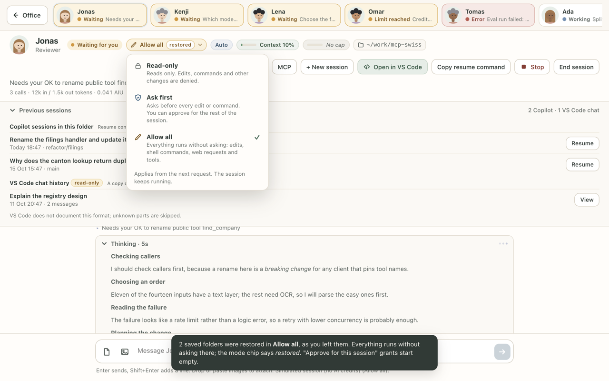
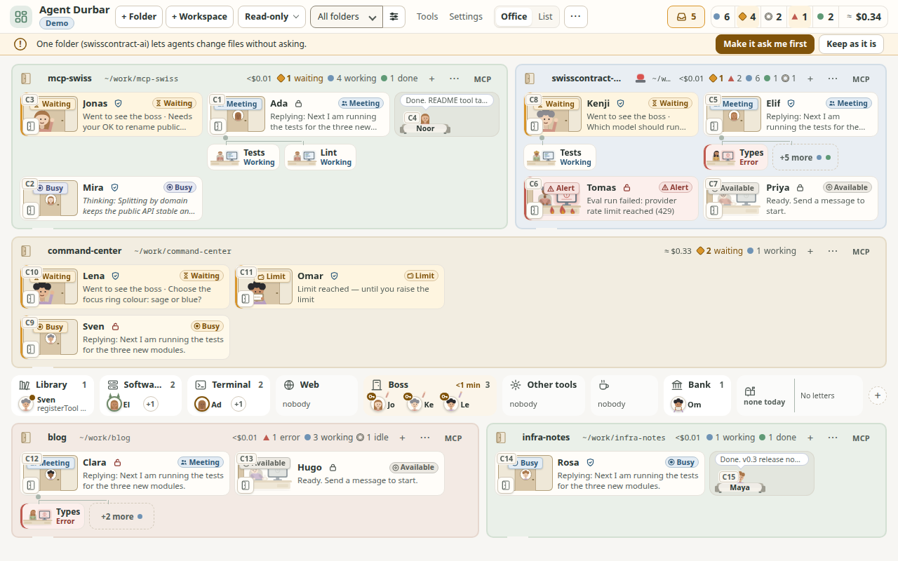

### What was new in v0.1.0-alpha.2 (never published; included in alpha.3)

Since alpha.1:

- **MCP:** the Copilot CLI's server list is global and read live; Agent Durbar's own extras are per folder.
- **Tools:** *This session* and *All time* usage (all-time counts are kept on disk, names and counts only).
- **Credit caps** per session (soft cap, runtime minimum 30 AI credits).
- **Permissions:** change an agent's mode any time; the saved mode is restored exactly after a restart; reads outside the folder are asked or denied.
- **About:** Three Feathers as owner, with credits.
- **New app id `io.github.three-feathers.agentdurbar`.** An earlier test install (`io.github.vikramgorla.agentdurbar`) is a **separate app** and keeps its own settings; installing alpha.3 does not replace or migrate it.

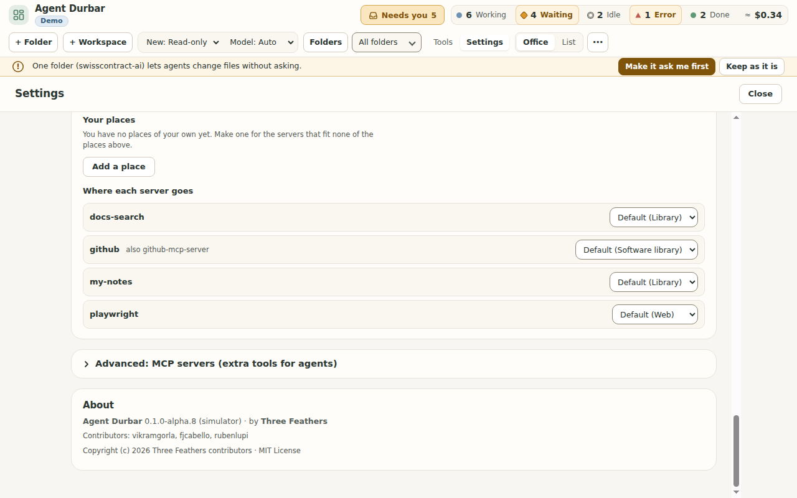

### These builds are not code-signed

Signing certificates cost money, so the builds are **unsigned and not notarized**. Your OS will warn you the first time; that is expected. Only open files you downloaded from this repository's Releases page.

- **macOS (Gatekeeper):** drag the app to Applications. On first launch, **right-click (or Control-click) the app and choose Open**, then Open again in the dialog. On recent macOS you may instead need System Settings > Privacy & Security > "Open Anyway". If macOS says the app is damaged, remove the download quarantine flag: `xattr -dr com.apple.quarantine "/Applications/Agent Durbar.app"`.
- **Windows (SmartScreen):** when "Windows protected your PC" appears, click **More info**, then **Run anyway**.
- **Linux:** `chmod +x Agent-Durbar-*.AppImage && ./Agent-Durbar-*.AppImage` (you may need `--no-sandbox` on systems without unprivileged user namespaces).

### Safety model

Agents run **locally, on your machine, as you**, in the folders you add. Nothing is sent anywhere except to GitHub Copilot through its own runtime. You choose a permission mode per agent: **Read-only** (reads only, everything else denied), **Ask first** (writes, shell commands, URLs and tools wait for your Approve / Approve for this session / Deny) or **Allow all** (no prompts; use only in folders you trust). The default is read-only. You can switch the mode of an agent any time (chat header chip or right-click on its card). Review what an agent asks to do, especially shell commands.

## Build from source

```bash
npm ci
npm run build && npm test
npm start                 # needs `copilot login` once
DURBAR_SIM=15 npm start   # 15 simulated agents, no sessions, no AI credits
npm run dist:dir          # unpacked app for this OS in release/
npm run dist              # installers/archives for this OS in release/ (no signing, no publishing)
```

Each release also lists `SHA256SUMS.txt`. Releases are built by GitHub Actions from `v*` tags into a **draft** release that the maintainer publishes by hand; see [CONTRIBUTING.md](CONTRIBUTING.md).

## Status (milestone 11: switch model and context inside a session, simulator only)

Spec [030](specs/030-switch-model-context/spec.md) (extends [007](specs/007-models-and-effort/spec.md) and [019](specs/019-mcp-tools-and-context/spec.md)), Phases 1 and 2: tasks T010..T035. Phase 1 was built and tested **on the simulator only**; Phase 2 wires the real Copilot adapter and tests it **against a fake session**. **AI credits spent: 0 AIU; no real Copilot session was started.** Phase 2: the Copilot adapter now has `setModel`, `cancelQueuedModel` and `compact` (built from the SDK 1.0.22 types and docs), so real agents get the same menu, confirmations and Compact action as the simulator, **flagged "Not verified on a real account yet"** in the menu and dialogs; an adapter without those members still shows a disabled menu with a reason and **New session**. The saved model, effort and context tier are now passed when a session is created **and when it is resumed**, so a switched model survives an ended session or a restart (the `auto` routing preference is only sent for a new `auto` session). The model list carries price fields when the runtime reports them (missing ones stay absent, shown as "price not reported"); the **unit of those prices is unverified**, so the UI shows them as "(unit not verified)", compares models only by ratio and does not check the credit cap with them.

- **Model menu in the chat header.** The model chip is a menu: models with their credit price per million tokens (or "price not reported"), window size, a reasoning-effort row, a **Long context** toggle only when the model has that tier, and a pending row with **Cancel** when a switch is queued behind a running reply. From the office, right-click a card (or Shift+F10) and choose **Model and context...**.
- **Confirm or Undo.** A switch to a **pricier** model, to a model whose **price is not reported**, to the **long-context tier**, or that would not fit the **credit cap headroom** asks first (with the price comparison and an estimate, never a promise). A cheaper switch applies directly with an **Undo** toast. The credit cap is never changed.
- **Context chip.** Shows the tier, says "Window: waiting for next message" right after a switch (the old figure belonged to the old window), and has a **Compact** action (idle agents only; asks first, optional focus text, one model call). Compaction (manual, automatic, before a switch to a smaller window, failed) leaves one quiet line in the chat.
- **Start fresh.** Near the limit (90% or more, after a compaction already ran or failed, or at once for an agent that cannot compact) a dismissible note offers **New session** in the same folder. It never says "clear": a host app cannot clear a conversation.
- **The runtime's own changes are shown.** A rate-limit or refusal fallback to another model is a note and a toast, never silent, and is never saved as the folder's choice. The agent stays on "Auto" when you chose Auto.
- **Saved per folder** in the app's own folder file (`model`, `effort`, `contextTier`), never in Copilot's settings.

Honest limits (`[KNOWN GAP]`): the simulator's prices, windows, queue-on-busy rule and compaction sizes are **made up**; what a real account reports (price fields and their unit, the long-tier window, what Stop does to a queued switch, the compaction decision values) is unverified until the owner-approved real checks (spec 030 T040..T046). **Checked on a real login (spec 030 T040..T046, free plan, `auto` only, 8 one-line prompts and 1 compaction, 0.56 AIU in total):** the login lists only `auto` (resolved to `gpt-6-luna`, 272k window), with no price, effort or tier fields. Verified there: a model the plan cannot use is refused (`cancelled`), a switch during a reply is queued and can be cancelled, **Stop drops a queued switch** (the app says so), history survives switch calls, compaction and resume, a compaction is one model call (0.19 AIU, now counted in the totals) and a tiny conversation grows when summarised. Switching between two real models, the long tier's window and price, and `confirmation_required` could not be tried on a free plan. Still unverified on a real account: that a switch between two different models keeps the history and applies at the next message, `confirmation_required` and the compaction decision values, and the price and window of the long tier. The SDK has no free window size and cannot clear a session. See the spec's research file.

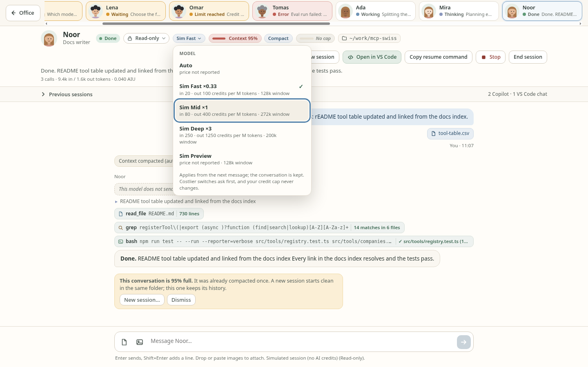
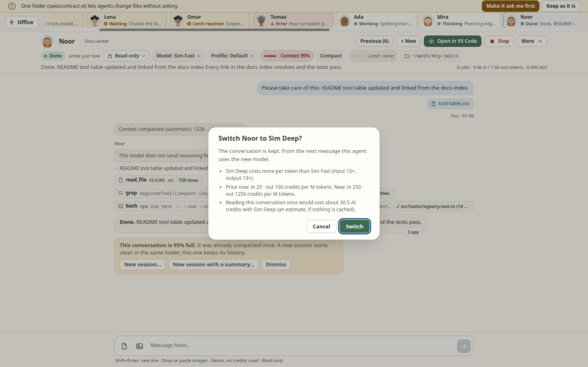
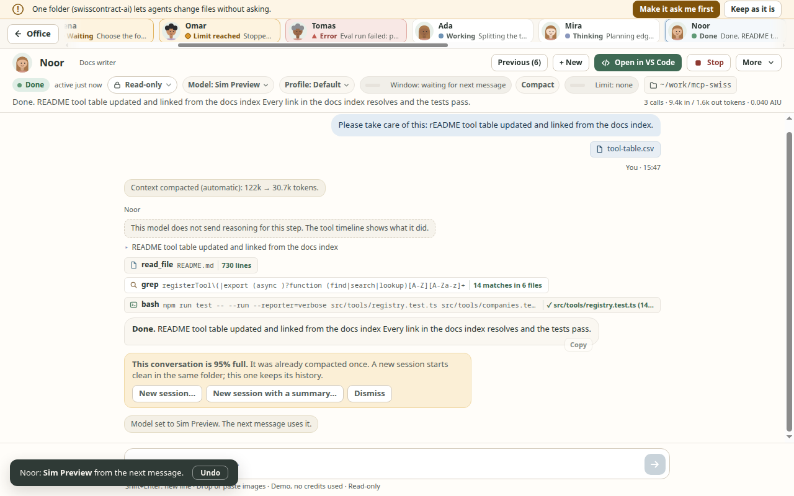
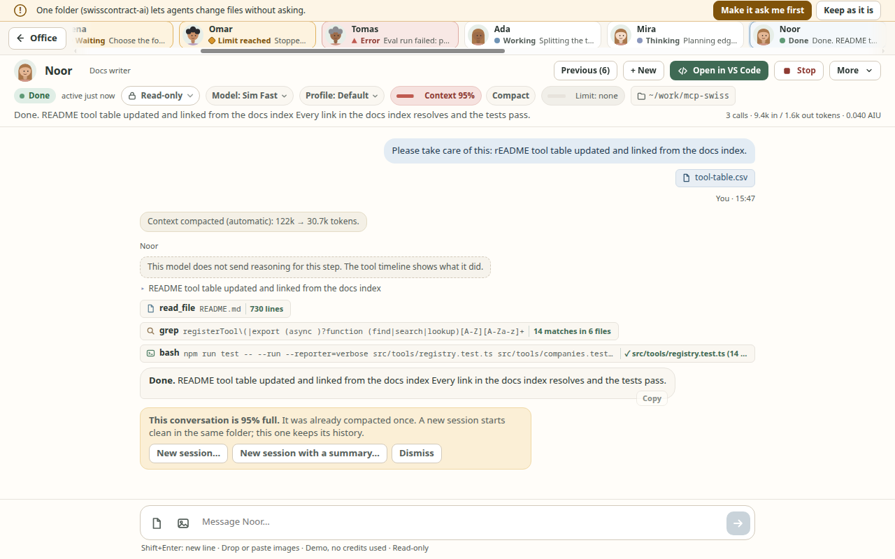
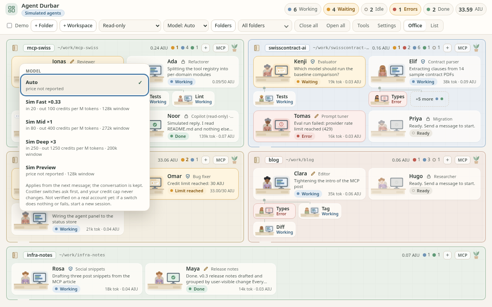

Tests (Phase 2: `test:copilotmodel` runs the real adapter against a fake client and session: what `setModel`, `cancelQueuedModel` and `compact` send, result mapping, resume config, pricing mapping, the capability contract). Phase 1: `npm test` adds `test:modelswitch` (price comparison, confirmation rules, estimates, start-fresh hint, IPC validation), `test:simmodel` (queued, cancelled, applied, needs-confirmation, fallback, manual and automatic compaction), and additions to `test:events`, `test:folders` and `test:dialog`. `npm run check:model` drives the whole UI in the simulator with real key events (menu, dialogs, Undo, queue, compaction, disabled state, text size) and writes the `030-*` screenshots at 1440x900 and 1280x800 (`scripts/shots-model.js`); `npm run check:office` stays green.

## Status (milestone 10: Tools "All time", the Copilot CLI MCP list first, MCP extras per folder)

Spec [020](specs/020-tools-all-time-and-mcp-cli-primary/spec.md) (changes spec 019). Built and tested on the simulator and unit tests. **AI credits spent: 0 AIU.**

- **Tools: This session / All time.** A switch at the top of the Tools view. *This session* is as before (counts since the app started, per agent, plus Models & context). *All time* is cumulative and **kept on disk** in the app's userData folder (`durbar-tool-usage.json`), so it survives restarts: per tool, per MCP server and per agent (`<agent name> · <folder name>`). Only tool names, server names, agent labels and counts are stored; never arguments, output, prompts, paths or secrets (a test checks this). Counting happens in the main process, so it works with the Tools view closed. **Reset all-time counts** clears it. Writes are debounced (2 s) and flushed on quit.
- **MCP: the Copilot CLI list is the primary source.** `~/.copilot/mcp-config.json` (plus the built-in GitHub server) is read live and listed first in Settings and in the Tools view ("Configured MCP servers", with call counts, 0 included), with the exact command or URL and no env/header values. Nothing to configure or import: the Import buttons and the app-level server list are gone. The per-server switch (for new sessions) and each agent's MCP toggles stay.
- **Extras only per folder or workspace.** Agent Durbar's own optional servers are stored **per folder/workspace** and applied only to agents in that folder (a room-header **MCP** button, or *Folder extras...* in an agent's MCP menu), labelled "Extra, this folder only". There is **no** app-level list of extras. Trust prompts with the exact command stay for extras (and again when the command or URL changes); secrets stay encrypted with the OS store. A name already used by the CLI list is refused. Servers from the old milestone-8 global list are kept but **not applied**; a folder's extras screen offers **Move here** or **Remove**.
- **Decided (Vikram, 2026-10-16):** CLI-list servers (the Copilot CLI file plus the built-in one) get **no** trust prompt (the runtime starts them in every session anyway, as the CLI does); the prompt applies to extras, the only servers this app itself passes to a session.
- **Import from VS Code, per folder (spec 020 FR-020..FR-031, issue #7, 2026-10-17).** A folder's extras screen has **Import from VS Code...**. It reads that folder's `.vscode/mcp.json` (for a workspace, the file of each of its folders), tolerating comments and trailing commas, and shows a preview with a checkbox per server: type, exact command and args or URL, and environment/header **keys with masked values**. Nothing is ticked by default. Ticked servers become extras of **this folder only**, **switched off and untrusted**, so the first switch-on shows the usual trust dialog. It never writes the VS Code file, never touches `~/.copilot/mcp-config.json` and never adds anything to the global list. **Safety decisions:** literal env/header values go into the same encrypted secret store as hand-typed ones and are never shown; a value containing a `${...}` reference is not copied or resolved (the key is kept, the server shows *needs secrets* until you enter it); Agent Durbar never prompts for, stores or resolves VS Code `inputs`, and an entry that needs an `${input:...}` (or any other unresolved variable except `${workspaceFolder}`) in its command, arguments, URL or working directory cannot be imported (add it by hand); unsupported fields (`envFile`, `sandbox`, ...) are listed as ignored. Not read: VS Code's user-level `mcp.json`, `settings.json` and `.code-workspace` `mcp` blocks. Simulator and unit tests only; no real VS Code file from a user's machine, macOS or Windows was checked.

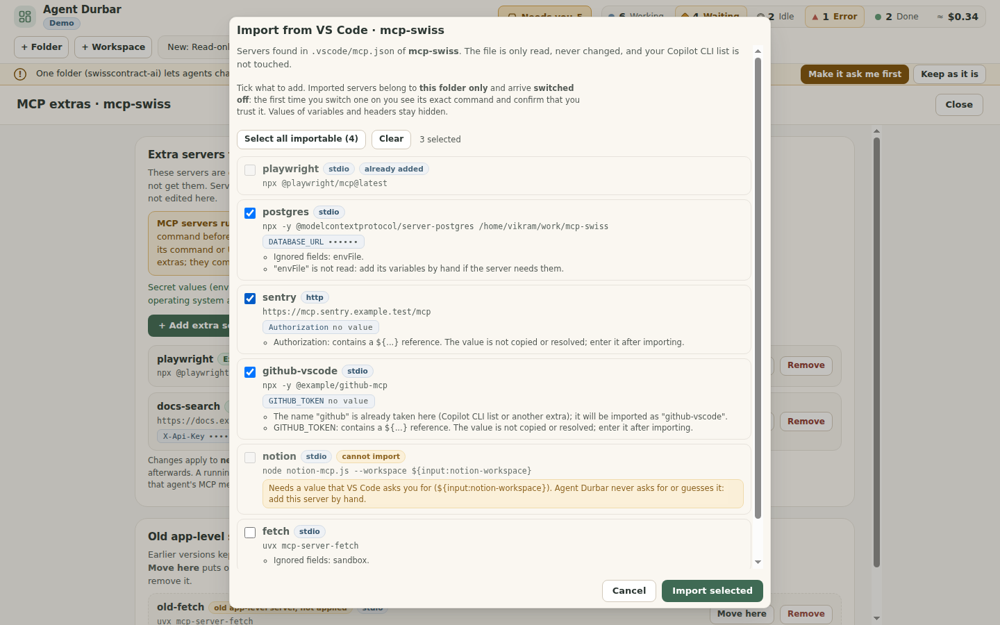

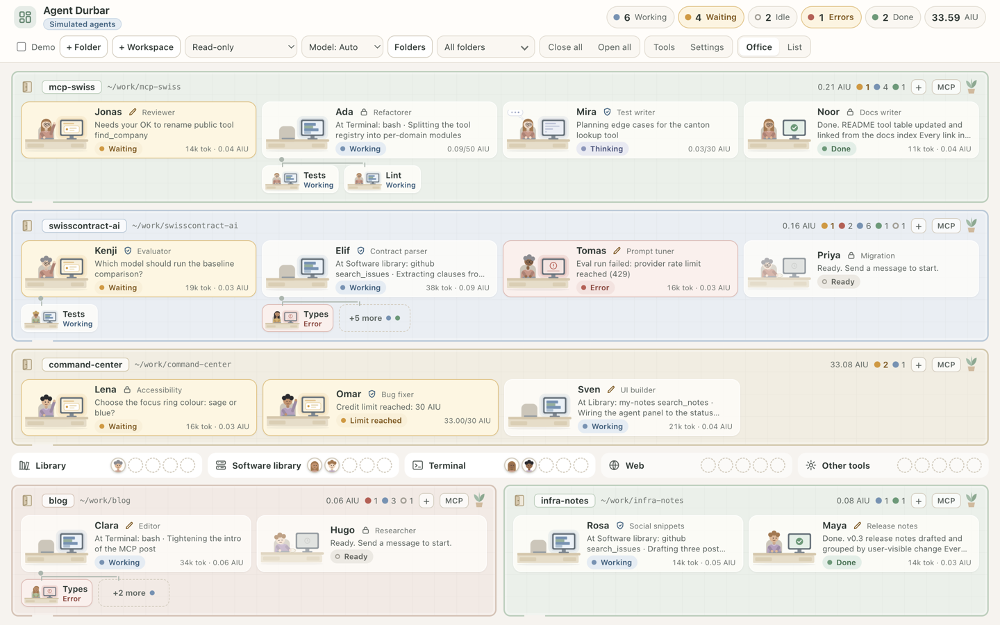
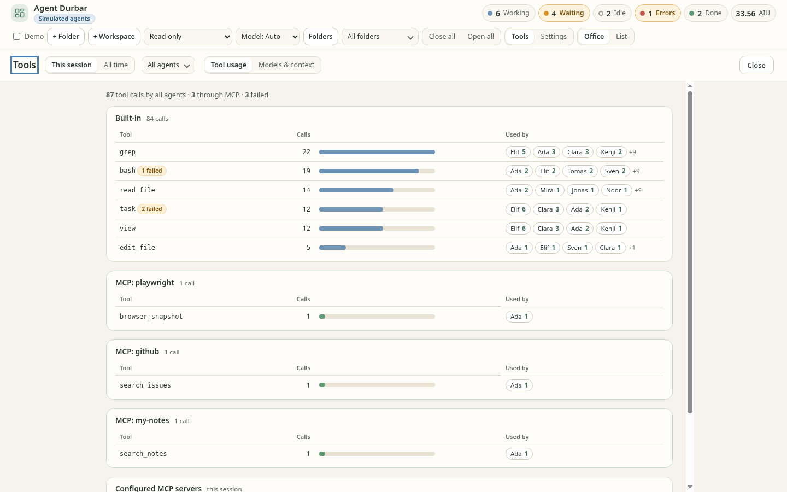
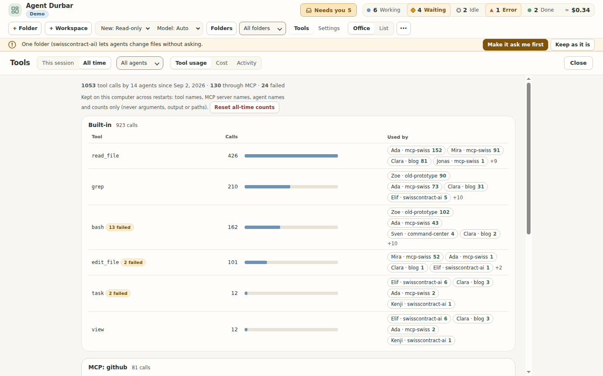
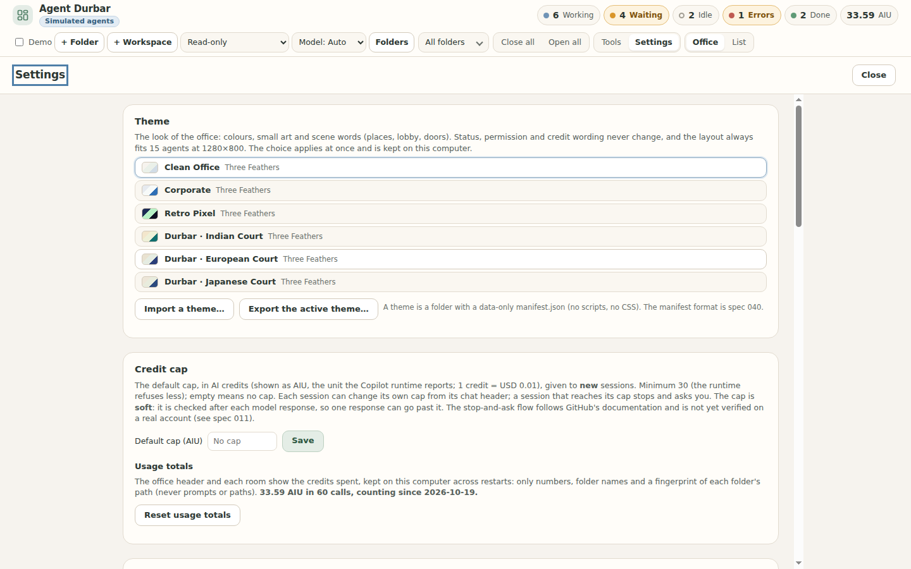
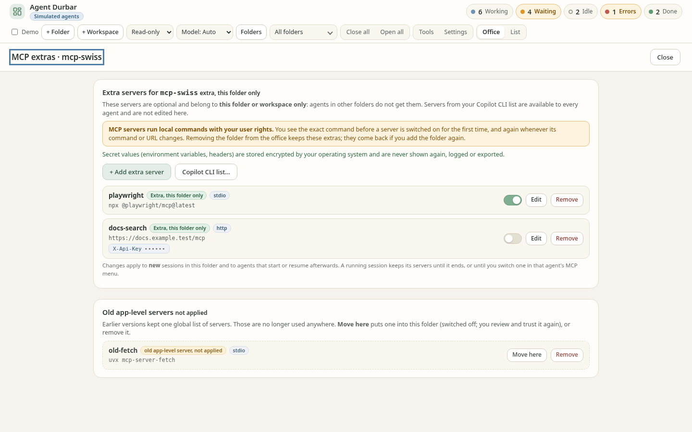
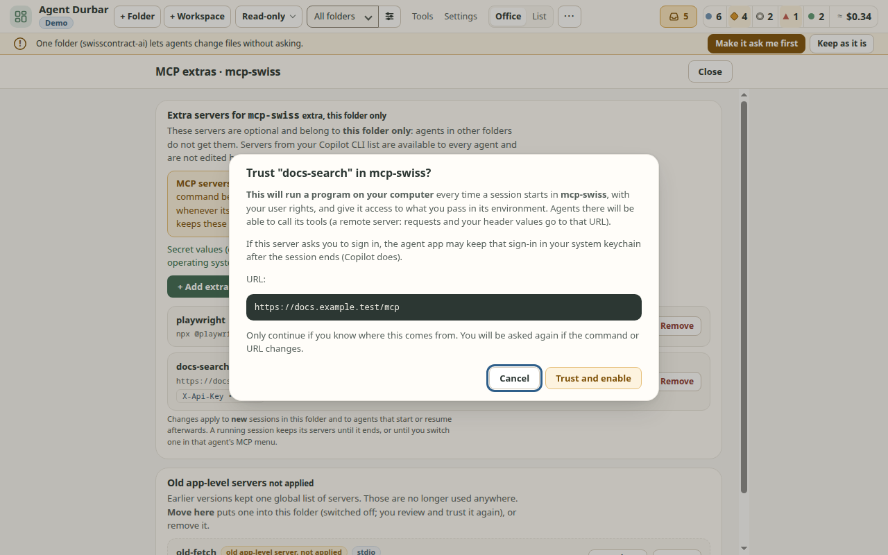
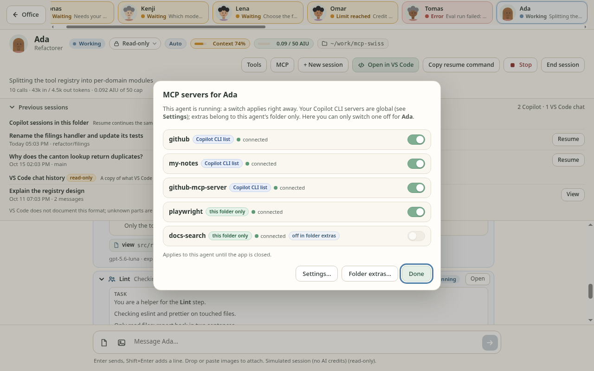

Tests: `npm test` adds `test:toolusage`, `test:usagestore`, the per-folder MCP store (scoping, legacy migration, name clash), the CLI list reader, and the all-time rows. Screenshots: `scripts/shots-m10.js` (1440x900 and 1280x800, with assertions). The VS Code import adds tests to `test:mcp` (JSONC, types, `inputs`, masking, bad files, name clashes, per-folder store) and `scripts/shots-i7.js` (`docs/screenshots/i7-import-preview-*.png`).

## Status (milestone 9: credit caps, safer defaults, dev hooks)

Specs [011](specs/011-credit-caps-and-usage-display/spec.md), [003](specs/003-permissions-and-approvals/spec.md) (FR-021..FR-024) and [010](specs/010-simulator/spec.md) (FR-017..FR-020). Built and tested on the simulator and unit tests. **AI credits spent: 0 AIU.**

- **Credit caps.** Each session can have a cap in AI credits (shown as AIU, the unit the Copilot runtime reports; GitHub says 1 credit = USD 0.01). The runtime's **minimum is 30** (a real `session.create` with less fails: `Minimum session limit is 30 AI credits`), so the app refuses lower values. A cap is set in the new-session dialog (pre-filled with the **global default** from Settings, empty = no cap), or from the **cap chip** in the chat header; it is saved per folder. Agent cards show `used/cap AIU`, the chat header shows a chip with a bar. It is a **soft** cap (GitHub: usage is checked after each model response, so one response can overshoot). When it is reached the card says **Limit reached** (listed first, like Waiting) and the chat shows **Add credits / Remove cap / Stop here**; after adding, the agent continues. `[UNVERIFIED]` on a real account: the exhausted-limit handshake follows the SDK types and GitHub's docs and is covered by mapper fixtures and the simulator, because reaching a 30-credit cap costs real money (about USD 0.30). `npm run verify:cap` checks the part that is free (session with a cap, raise, remove, the minimum) against the real runtime. The SDK is pinned exactly (`1.0.22`); see CONTRIBUTING.md for how to upgrade.
- **Permissions.** (a) The permission mode of each folder/workspace is **restored exactly** after a restart, *Allow all* included (no silent downgrade); a restored Allow all is made visible with a small *restored* note on the mode chip in the chat header until you switch the mode, and switching *to* Allow all still asks for confirmation. *Approve for this session* grants stay **session-only** and never survive a restart. (b) *Approve for this session* on a shell command covers the **exact command** by default; "any arguments" is a separate, explicit choice, only offered for simple commands (no pipes or redirects, and never for shells, interpreters or `sudo`). (c) **Reads outside the folder and the workspace roots** (and attached files) are not auto-approved: in Ask they ask, in Read-only they are denied, and only Allow all lets them through. The read path comes from the SDK's `read` permission request; shell commands expose `possiblePaths` too.
- **Developer hooks.** The `DURBAR_*` variables (`DURBAR_SIM`, `DURBAR_DRIVER`, `DURBAR_PERM`, `DURBAR_SHOT`, ...) are ignored in a packaged build unless `DURBAR_DEV=1` is set; a test scans the sources for direct reads. See CONTRIBUTING.md "Developer hooks".
- **CI** also runs `npm run check:office` (xvfb on Ubuntu, 95 layout combinations, no AI credits).


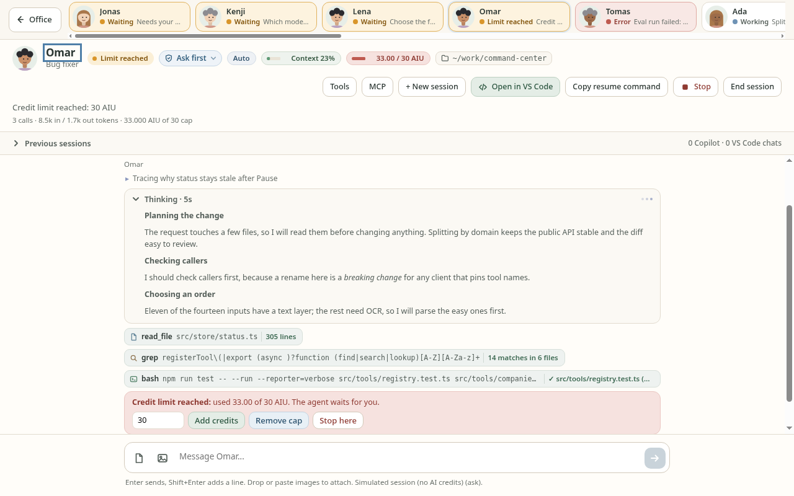
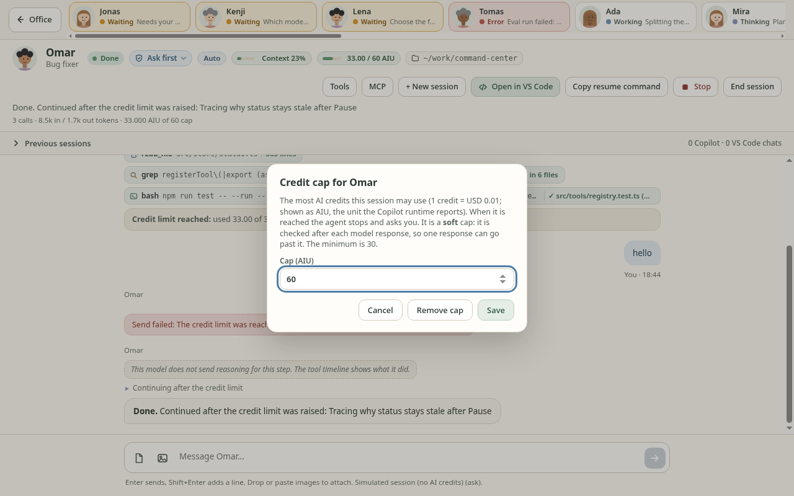
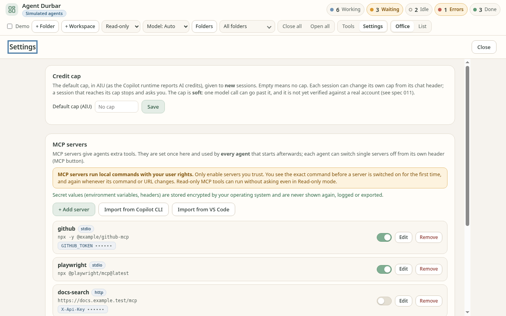

## Status (milestone 8: global MCP servers, tool usage, context window)

Spec [019](specs/019-mcp-tools-and-context/spec.md) (research in [research.md](specs/019-mcp-tools-and-context/research.md)). Built and tested on the simulator and on sanitised recordings of real events. Research cost: **1 real prompt, 2 model calls, 0.167 AIU**.

*(Superseded by milestone 10: the app-level server list, its Import buttons and the global trust flow below were replaced by the Copilot CLI list and per-folder extras.)* **Settings (top bar)** is one global screen, not per agent. It lists MCP servers with add / edit / remove / enable (stdio: command, args, env; http/sse: URL, headers). Values of env variables and headers are secrets: the renderer never receives them (key names and "set" only), they show as `••••••`, and they are stored only encrypted with Electron `safeStorage`. If the OS has no protected store (Linux `basic_text` counts as none) they are kept in memory for the run and the screen says so. They are not logged, exported or committed. **Enabling a server shows its exact command (or URL) and a warning that MCP servers run local commands with your rights**; trust is remembered for that exact definition and asked again if it changes. **Import** reads `~/.copilot/mcp-config.json` or the VS Code user `mcp.json` read-only, shows a preview and imports only what you tick, switched off. Servers apply to **new** sessions as defaults; each agent has an **MCP** button in its header to switch single servers off for itself (live sessions switch right away through the runtime).

**Tools (top bar, and per agent in the chat header)**: tool calls per agent and for all agents, built-in tools and MCP tools grouped by server, a table with small bars, failed calls and "used by". A second tab, **Models & context**, shows per agent the model(s) used, and the context window used / size with a percent bar (amber from 70%, red above 90%); the chat header has the same as a chip. Counts are kept in memory for the run (a resumed session starts at zero).

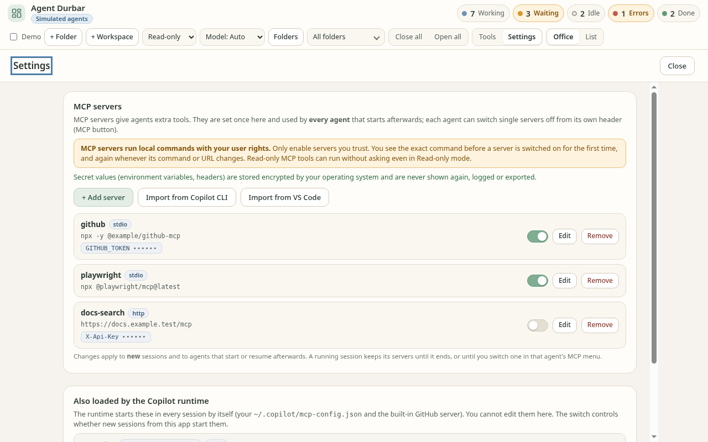
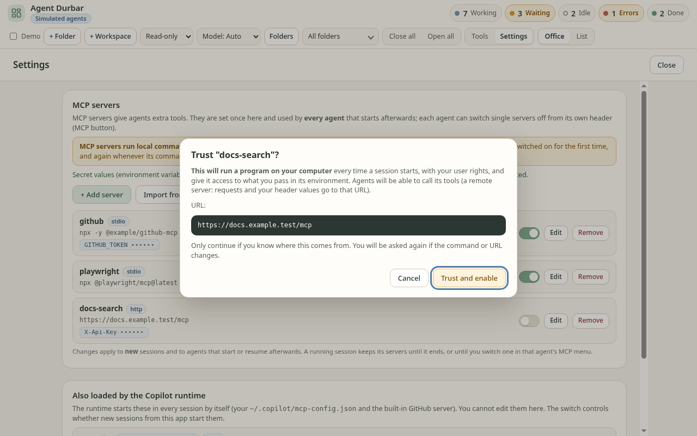
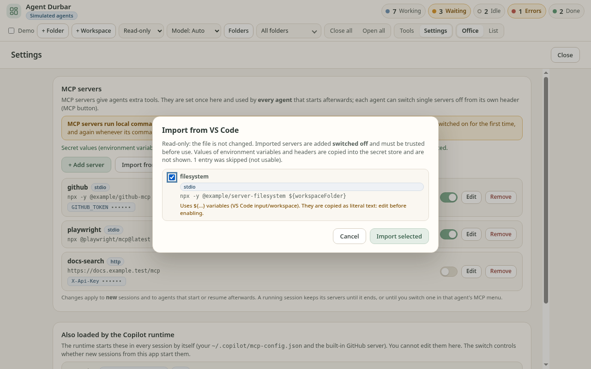
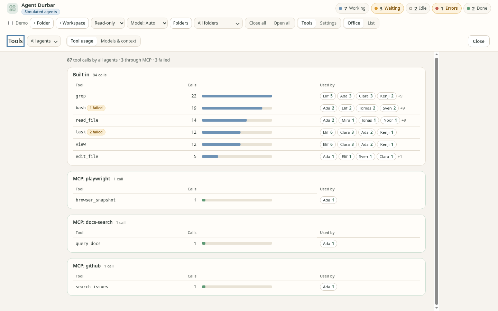
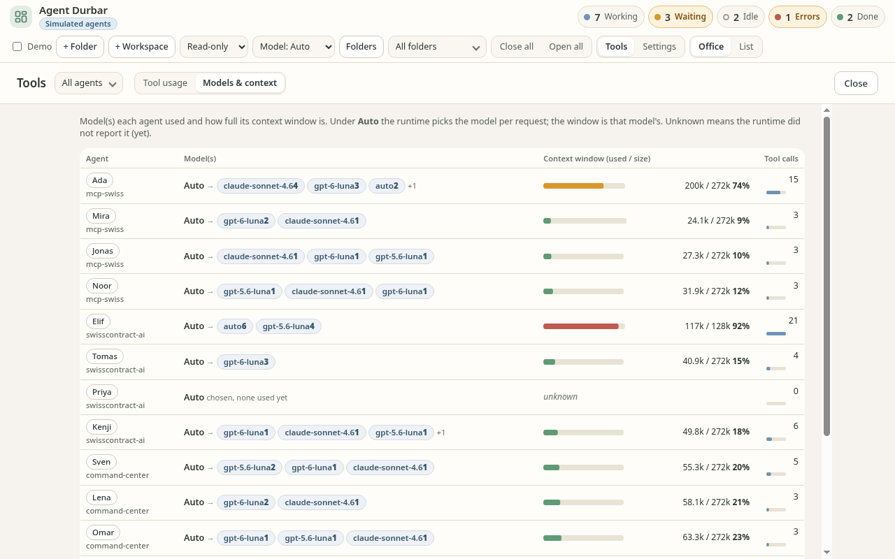
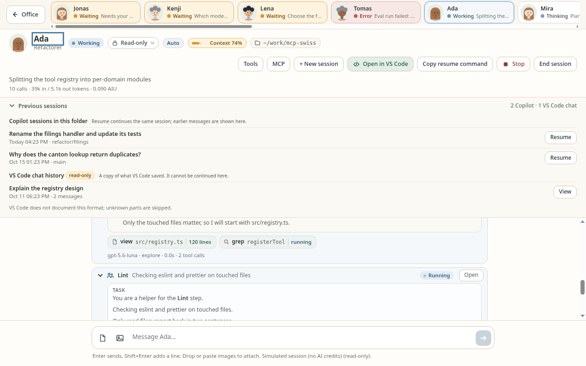
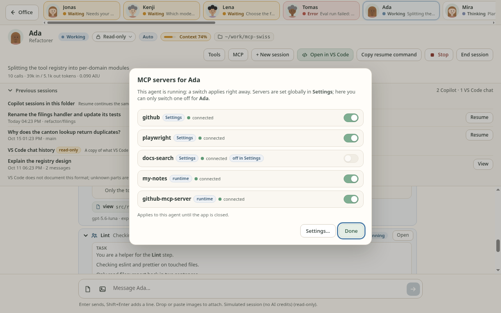

**Findings (Copilot SDK 1.0.22, CLI runtime 1.0.98)**

| | Status |
| --- | --- |
| `createSession` / `resumeSession` take `mcpServers` (stdio worked end to end; http/sse only in the types) and `disabledMcpServers` | confirmed (stdio, disable by name) |
| The runtime **also always loads** `~/.copilot/mcp-config.json` and the built-in `github-mcp-server`. So our config is additive; those are listed read-only with an on/off switch for new sessions | confirmed |
| Running session: `session.rpc.mcp.enable/disable` work live and write nothing to `~/.copilot` | confirmed |
| `tool.execution_start` carries `mcpServerName` / `mcpToolName` | confirmed |
| `session.usage_info` gives `tokenLimit` and `currentTokens` before each model call (real: 272000) | confirmed |
| `listModels` window (`max_context_window_tokens`) | present in the type; **0 (unknown) for `auto`** on this account, so the window comes from usage events after the first turn |
| A read-only-annotated MCP tool ran **without** a permission prompt (so even in Read-only mode a trusted MCP server can act; Settings says so) | confirmed (one tool); a write-capable MCP tool was not tested |
| Tool allow/deny lists (`availableTools` / `excludedTools`, `mcp:<server>-<tool>`), OAuth (`needs-auth`), `contextTier` | types only; not used. [KNOWN GAP] servers needing OAuth show "needs auth" and are not handled |

**Limits.** Remote (http/sse) servers are untested against a real server. Before the first model call the window is "unknown". Under `auto` the window is the answering model's. Sub-agent tool calls count for the owning agent. Usage counts are not persisted across app restarts. Imported `${...}` variables are copied as literal text and flagged. Plain-text secrets cannot be avoided in the CLI's own `mcp-config.json`; we never write to it.

Tests: `npm test` adds MCP store/import/validation (fake secret codec, dummy fixtures), tool statistics, MCP/usage mapping on real-event fixtures and the MCP permission key. Screenshots: `scripts/shots-m8.js` (replaced by `scripts/shots-m10.js` in milestone 10; the milestone-8 pictures are kept in `docs/screenshots/`). `npm run check:office`: 95/95 still pass.

## Status (milestone 7: thinking, sub-agents, Markdown, room doors, permission mode)

Specs [015](specs/015-thinking-and-subagent-activity/spec.md) to [018](specs/018-permission-mode-switch/spec.md). Built and tested on the simulator and on sanitised recordings of real events (no further AI credits).

**What the real runtime sends** (captured with `scripts/capture-raw.ts`, Copilot CLI 1.0.98, model `auto` = `gpt-6-luna`, free plan; fixtures in `scripts/fixtures/events/`). Only `auto` is offered and it has no reasoning-effort options, so an explicit reasoning model could not be tested.
- Prompts that need thought stream `assistant.reasoning_delta` (a markdown summary, about 1 s burst) and a closing `assistant.reasoning` with the same `reasoningId`. Turns that only delegate or read files send **no** reasoning and no `assistant.intent` (`reasoningTokens: 0`). That is why Thinking looked empty.
- Sub-agents: `subagent.started` (toolCallId, agentName), then events carrying `agentId` (sub-agent `user.message`, `assistant.*`, `tool.*`), then `subagent.completed` with model, duration, tokens and tool-call count.
- Cost of the capture: about 0.17 AIU for two tiny prompts (plus one interrupted first run).

**Thinking.** The chat is a timeline: intent line, live "Thinking" block (streams, then collapses to "Thought for 3s" with a preview), tool chips and answers. When a step has no reasoning, a small honest note says "This model does not send reasoning for this step. The tool timeline shows what it did."

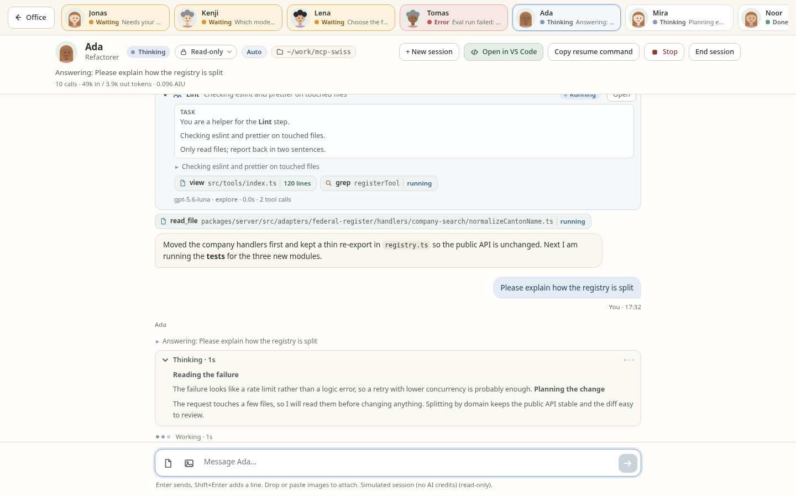

**Sub-agents.** Under the parent's task call a nested, collapsible block shows the helper's name, prompt, own thinking/intent, tool chips, result and live state. Its tool calls are no longer mixed into the parent's list. **Open** (or clicking the helper card in the office) shows the same log as a read-only transcript in the full-screen chat.

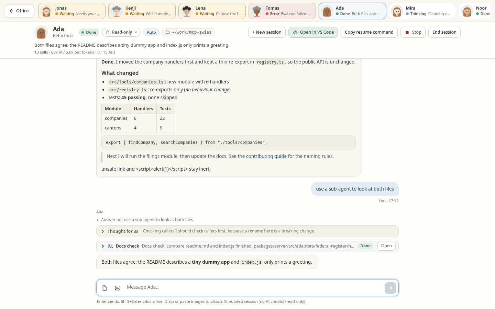
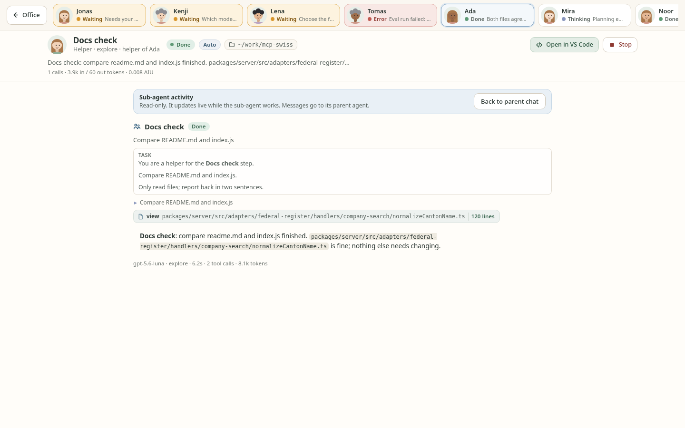

**Safe Markdown.** Assistant text, thinking and sub-agent results render bold/italic, headings, lists, links (http/https only, opened with `shell.openExternal`), inline code, fenced code with a Copy button, tables and blockquotes. `marked` + DOMPurify are bundled locally (no CDN); raw HTML, scripts, `javascript:` links and remote images are removed; re-rendering on each delta is keyed so it does not flicker or lose scroll. Tests include malicious input.

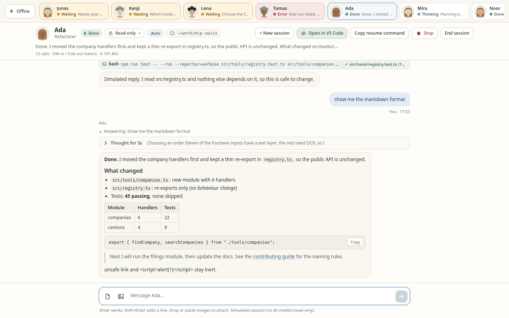

**Room doors.** Each room has a door: click it (or Enter/Space, `aria-expanded`) to close it into a compact plate with a one-line summary (Busy - N working, Waiting for you - N, Available, Meeting in progress, Needs attention - error, All done). Waiting and error rooms stay amber/red and still count in the top-bar pills. Closed rooms free space so the open ones may use a bigger density. Closed state persists in userData. **Close all / Open all** in the toolbar. Simulator: `?closed=a,b` or the buttons.

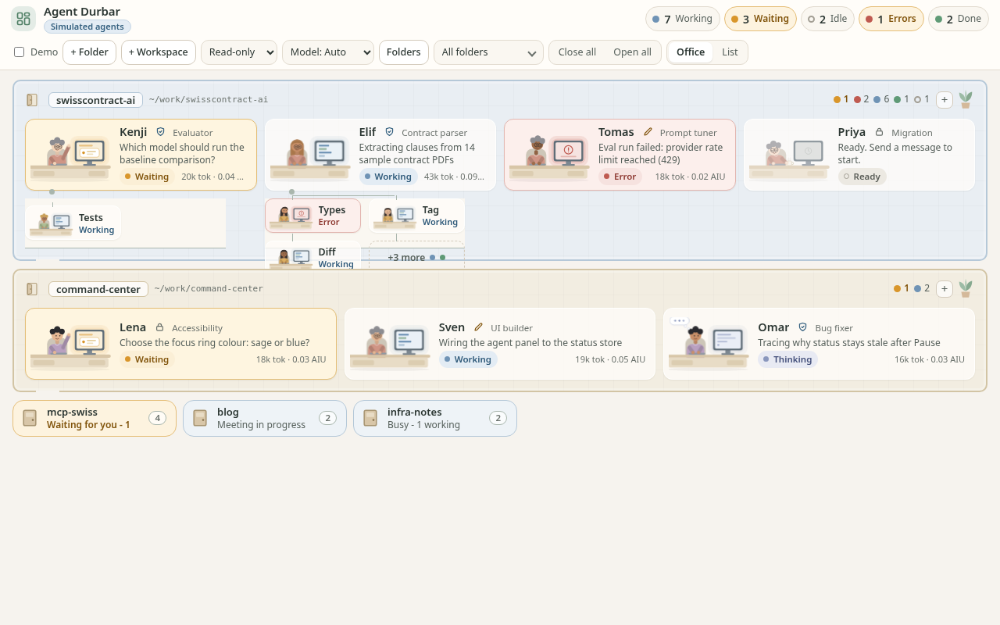

**Doors fix (m7b).** A class-name collision (`.helpers.strip` vs the chat bar's `.strip`, fixed height 64px and a background) made two-row helper strips overlap the next desk row and gave strips a stray box; it is now `.hstrip`. With rooms closed the layout search also gets `full` with 2 helpers and a per-agent helper boost, so open rooms grow into the freed space (3 rooms closed at 1440x900: `full`, 714 of 810px used instead of `roomy`, 427px). `npm run check:office` (Electron under xvfb, no AI credits) checks bounding-box overlap, clipping, floor/page overflow and the 10.5px floor for SIM=12/15 at 1440x900 and 1280x800 with 0/1/2/3/4/all rooms closed; it runs in CI on Ubuntu (job `office-check`, about 70 s).

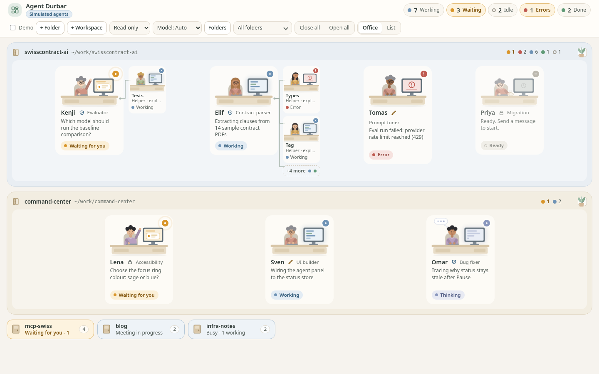
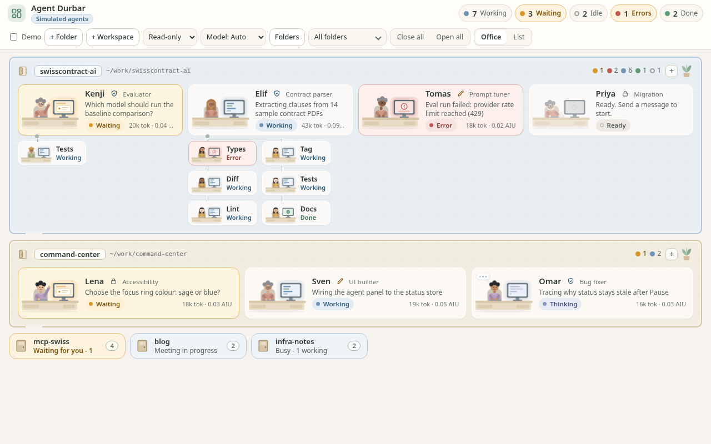

**Permission mode any time.** The chat header chip and the card context menu (right click) switch Read-only / Ask first / Allow all for that agent. It applies from the next request without restarting the session (the broker reads the mode dynamically). Switching to Allow all asks for confirmation and, if a request is pending, offers to approve it; leaving Allow all asks whether to forget session grants. Cards show a small mode icon; the mode is saved per folder and restored. The top-bar selector is the default for new sessions. The confirmation works from the keyboard: focus stays inside it, Tab is trapped, Escape cancels (the mode stays as it was) and focus goes back to the chip; *Allow all* always needs an explicit confirm (spec 003 FR-033).


Simulator keywords: `quick` (no reasoning), `markdown`, `sub-agent`/`helper`/`delegate`.

## Status (milestone 6: full-screen chat, previous sessions, new sessions, folders, models)

Built and tested on simulated agents and fixtures (`DURBAR_SIM`, no AI credits, no prompts to real models). 

**Full-screen chat.** Opening an agent replaces the office with the chat; the docked right panel is gone. Every other agent stays visible in a slim 64px strip at the top (avatar, name, status dot and word, a short intent), horizontally scrollable, **waiting and error agents first and highlighted**. Click one to switch chat, **Office** (top left) or **Esc** goes back. Thinking block, tool chips, attachments, approvals, model name, Stop / End session and Open in VS Code are all still there. Checked with SIM=15 at 1440x900 and 1280x800: no page overflow, no horizontal overflow in the chat.

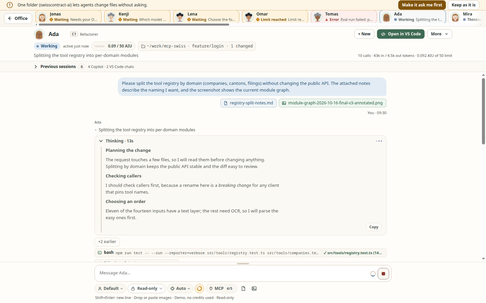

**Previous sessions per folder.** When you add a folder, or open an agent that has not been used yet, a "Previous sessions" list shows
- *Copilot CLI/SDK sessions whose working folder matches* (newest first, title, time, branch). **Resume** continues the very same session (`resumeSession`) and replays the earlier messages and tool calls from its `events.jsonl` into the chat (last 300 items, long outputs trimmed).
- *VS Code Copilot Chat history for that folder*, marked **read-only**: a copy of the transcript, clearly labelled "cannot be continued here". It reads `workspaceStorage/<hash>/chatSessions/*.jsonl|json` (macOS `~/Library/Application Support/Code/User`, Windows `%APPDATA%\Code\User`, Linux `~/.config/Code/User`; also Insiders and VSCodium; Cursor is not read), matching the folder through each store's `workspace.json`. The format is undocumented and changes between VS Code versions: parsing is tolerant (unknown parts become one honest note, corrupt or oversized files are counted and skipped, nothing is uploaded or logged). Empty-window chats are not included.

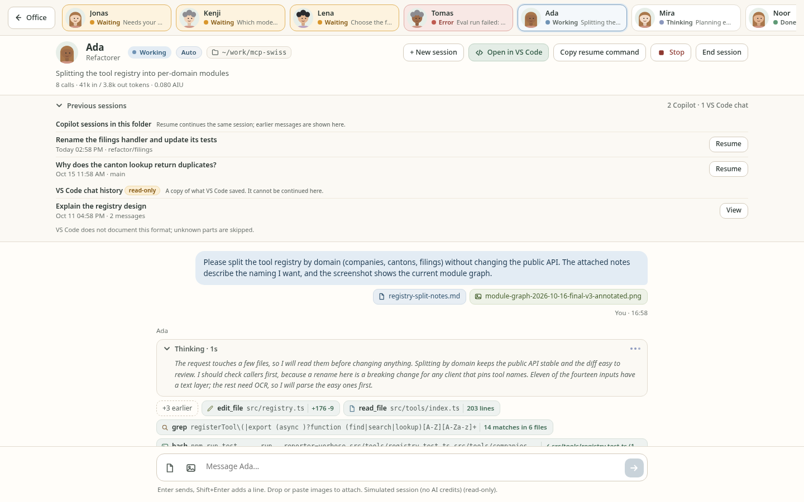
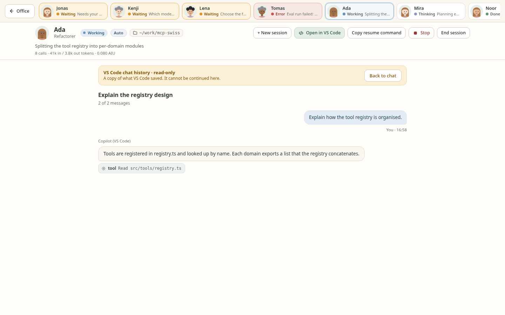

**The six bug reports**
1. **Stop** now only interrupts the current turn (pending approvals are denied, grants kept, the agent is Ready again). **End session** frees the session. Sending to an ended or not-yet-started agent starts or resumes it automatically (no more "unknown or stopped session").
2. **New session in an existing folder**: the **+** on each room, **New session** in the chat header, or Folders > New session. Each one is its own agent with its own chat (named `Ada #2`), with permission, model and effort choices.
3. **Thinking**: sessions are created with `streaming: true`, and `assistant.reasoning_delta` events stream into the Thinking block live. The complete `assistant.reasoning` block is shown only when no deltas came for it (never twice). Whether reasoning arrives at all depends on the model and effort; many models, and Auto, often return none. In that case the block is replaced by "No reasoning summary was provided for this step." and the card keeps showing intent and tool activity. A live elapsed-seconds counter shows it is working. Not verified against a real reasoning model here (no credits spent).
4. **Remove / Hide**: the **Folders** button lists every folder with New session, **Hide** (agents keep running, the room leaves the office, list and strip) and **Remove** (ends its sessions, asks first if any is working; earlier Copilot sessions stay on disk). The folder list is saved in the app's user-data folder (`durbar-folders.json`: path, permission mode, hidden, model, effort; no tokens) and restored on start. Restored agents are lazy: nothing starts until you send the first message.
5. **Model picker** (top bar and New session dialog) from the SDK's `listModels()`, default Auto, with the account's credit multiplier (x0.33, x3 ...) when the API reports one and a reasoning-effort picker for models that list supported efforts. The chosen model and effort show as a chip in the chat header.
6. **VS Code visibility** (research, honest): the VS Code docs ("Manage agent sessions", *View sessions from other applications*) say VS Code discovers local Copilot CLI sessions created outside VS Code, for sessions tied to a repository and updated in the last 7 days, but **hides them by default**: sessions list filter > **External** (or setting `chat.agentSessions.showExternal`) > Last 7 days / All, and you can continue them there ("Resume in Terminal" for CLI sessions). So sessions this app creates in a repo's folder should appear in VS Code's session list once External is enabled. I could not run VS Code with a signed-in Copilot on this box, so this is **documented, not verified end to end**. What the app offers: **Open in VS Code** (opens the folder) and **Copy resume command** (`copilot --resume <id>`, run it in the integrated terminal after ending the session here, because one process should drive a session at a time). It is not possible to push our session into the VS Code *Local* chat view.

Tests: `npm test` (adds history, VS Code chat reader on synthetic fixtures under `scripts/fixtures/`, folder store).

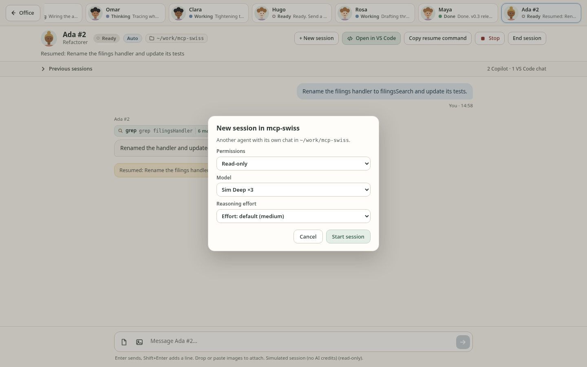
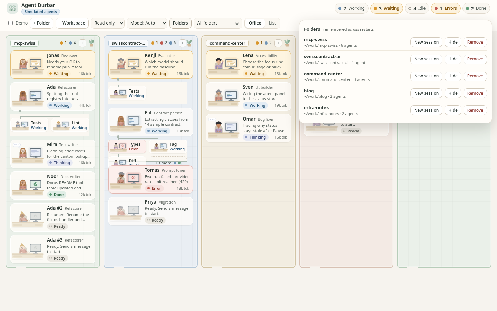

## Status (milestone 5: permissions, attachments, office polish)

All seven remaining issues from milestones 3 and 4 are fixed. Built and tested on simulated agents (`DURBAR_SIM`, no AI credits); the permission path was also verified once on a real session with **one tiny prompt, 0.189 AIU** (3 API calls, as reported by the API).

1. **Approve for this session.** Each pending permission now offers **Approve**, **Approve for this session** and **Deny**. "For this session" remembers a narrow scope until you stop that session: writes in that file's folder, a simple shell command by name (anything with pipes, `&&`, redirects or substitutions is only remembered for that exact command), a URL host, or an MCP/custom tool name. It shows as a small green chip in the panel header (`Allowed: write in src/`) with an **x** to revoke; later matching requests are approved automatically and shown as "approved (allowed for this session)" in the timeline. Deny never remembers, grants vanish on Stop. The logic is a pure class ([`src/adapters/permissions.ts`](src/adapters/permissions.ts), `npm run test:permissions`).
2. **Stop with a pending permission** denies the request cleanly: the adapter resolves it as denied (`via: stopped`), the note reads "denied (session stopped)", Approve/Deny disappear, the card goes idle and the chips are cleared.
3. **The permission note is inline** in the tool timeline, between the tool chips in the order things happened, not below the answer. (On a real session the SDK starts the tool call before it asks, so the order is `apply_patch` then its permission note.)
4. **Attachment caps**: 10 MB per file and 5 files per message, enforced in the renderer (fast, with a message in the composer such as `"big.mov" is 11 MB, over the 10 MB per-file limit. Not attached.` or `Up to 5 files per message. Not attached: "d.png", "e.png".`) and again in the main process on stage and on send. A counter (`3/5`) shows next to the chips. **Drag and drop** files onto the panel (overlay "Drop to attach") and **paste** images into the message box (image only: it attaches; image plus text: it attaches and the text still pastes). The renderer has no file path for these, so the bytes go to the main process, which checks the real format by magic bytes (PNG, JPEG, GIF, WebP, BMP; SVG and renamed non-images are rejected), strips directories and control characters from the name, forces the extension from the real format, and writes a private copy (mode 0600) into a temp folder that is deleted on quit ([`src/shared/attachments.ts`](src/shared/attachments.ts), `npm run test:attachments`). A file dropped anywhere else no longer navigates the window.
5. **Keyed DOM updates in the office view.** Trial layouts are measured in a hidden probe element, never in the visible floor, and the chosen layout is cached until the office shape changes (agents, helper counts, filters, size, panel). A tick or status change then patches only what changed: rooms, units, desks and helper tiles are matched by id, text and attributes are updated in place, and a desk scene (SVG) is replaced only when its status or look changes. Measured over 24 s of live ticks at SIM=15: no desk node was replaced, only the scenes of agents whose status changed, and no running animation of an unchanged agent restarted. The stat pills use the same patching.
6. **Helper strip**: up to **3 helpers** show before `+N more` when the floor has room (the strip is a 2-column grid, so 2 rows). The layout search tries 3 first and falls back to 1; when only 1 fits, the leftover space is spent per agent (agents with the most helpers, attention-needing ones first) while everything still fits, e.g. Elif shows `Types`, `Tag`, `Diff` + `+3 more` at 1280x800 with the panel open.
7. **Spare floor space**: a new `roomy` density (card with bigger desks, 92px rows, 14.5px names, 11-12px text, bigger helper tiles) is tried right after `full`; it wins only when it fits, so the 1280x800 fits are unchanged. At 1440x900 with the panel closed, SIM=12 and SIM=15 now use `roomy`; at 1280x800, SIM=12 closed also fits `roomy`.

Checked at 1440x900 and 1280x800, panel closed and open, SIM=12 and 15, also over 18 s of live ticks each (no overlaps, no clipping, nothing outside the floor, no page or floor scroll, text never below 10.5px, densities stable). The densities below were what milestone 5 measured; **they have drifted** since the room doors, the full-screen chat (the docked panel columns no longer exist) and later layout work, so they are kept only as history. The current numbers, re-measured on 2026-10-16 with `npm run check:office` (Electron under xvfb on Linux, all rooms open, chat closed):

| Densities chosen today (all rooms open) | 1440x900 | 1280x800 |
| --- | --- | --- |
| SIM=12 | roomy | roomy |
| SIM=15 | card | card |

Milestone 5 had written `SIM=15 | roomy | card | card | mini` (1440 closed, 1440 panel, 1280 closed, 1280 panel). At 1280x800 with the chat closed the answer is `card`, as it was then; at 1440x900 it is now `card`, not `roomy` (a door row was added since). The choice of density depends on font metrics, so another OS can pick a different one; the check asserts that whatever is chosen fits (no overlap, clipping, overflow, text under 10.5px), not which density it is.

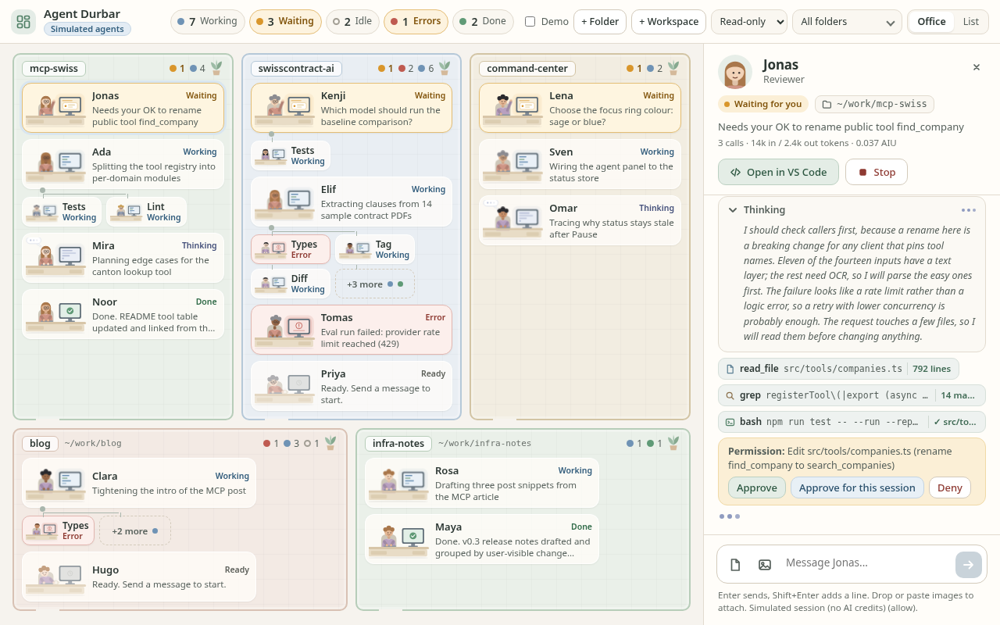
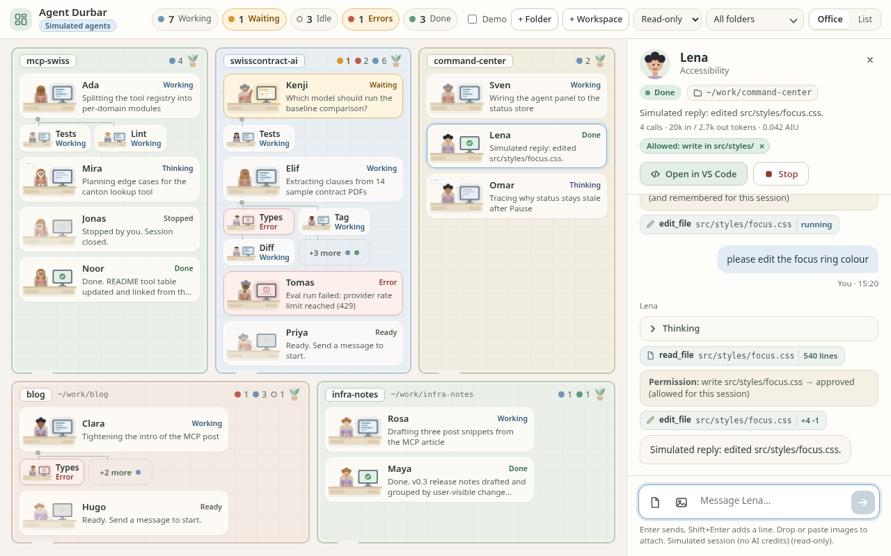
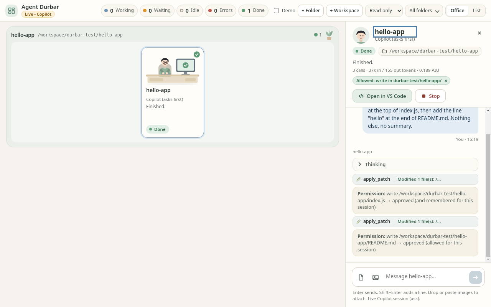
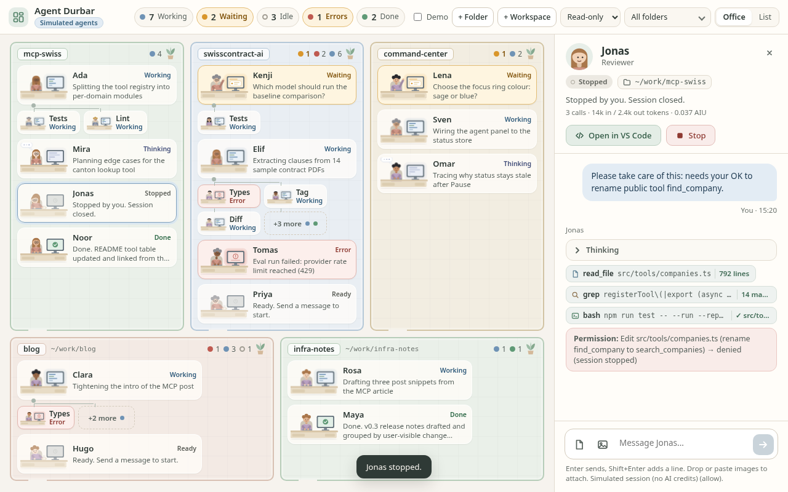
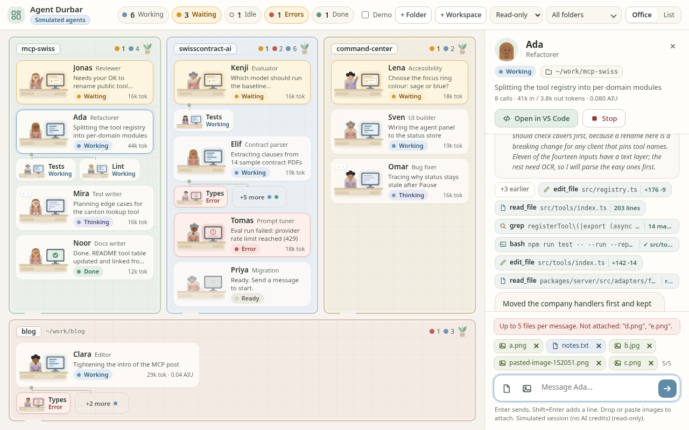
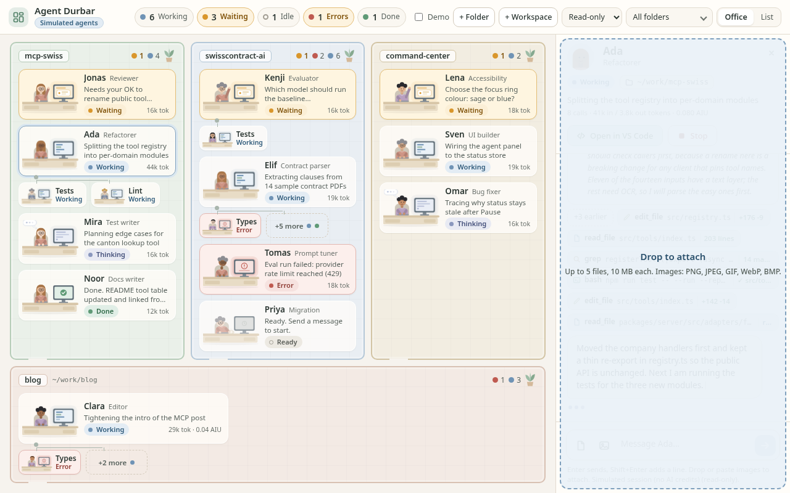
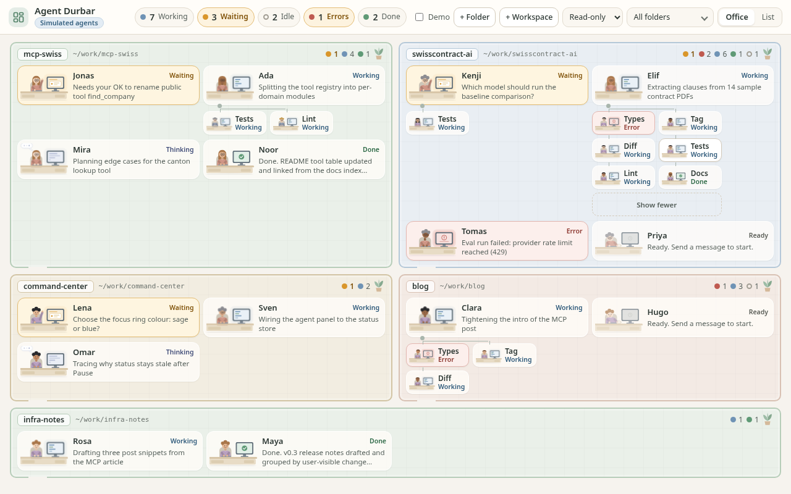
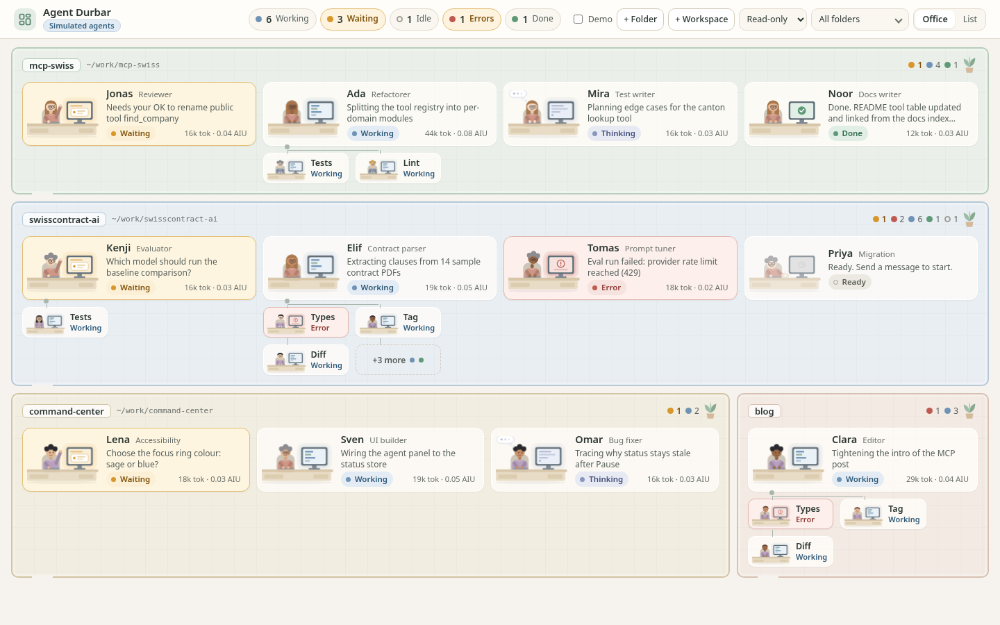

Tests: `npm test` (permission broker, attachment rules; no Copilot, no credits). End-to-end driver phases: `PHASES=m5` (real Electron main and adapter session start, no prompt: real staging IPC, drop/paste, permission UI, Stop through the real adapter), `PHASES=real` (the one real prompt: two edits in ask mode, Approve for this session once, the second edit was approved automatically). Both with `DURBAR_DRIVER=$PWD/scripts/e2e-driver.js xvfb-run -a npx electron . --no-sandbox`.

Remaining: a layout re-search (resize, opening the panel, adding agents) takes roughly 150-200 ms at 15 agents in headless software rendering (cached otherwise); the grant scopes are chosen conservatively (folder, command name, host, tool) and not configurable; dropped non-image files are copied to the temp folder like images (not referenced in place); in `micro` the helper figures are still very small and the helper boost only applies when something fits; long folder names truncate the nameplate when narrow; macOS/Windows untested; no AI-credit cap or session resume yet (see Roadmap).

## Status (milestone 4: office floor-plan look for 10-15 agents)

The compact densities (`card` / `mini` / `micro`, used automatically for 10-15 agents) no longer look like a dashboard of cards; the office is a floor plan again. No AI credits were used (`DURBAR_SIM=12` / `15`, plus `?sim=30` for a stress check).

- **Every agent is a tiny desk scene** (the prototype's flat-vector person, desk and monitor, cropped and reused). Status is shown by the scene itself: typing hands and a soft monitor glow while working, a thought bubble with blinking cursor while thinking, a raised waving hand and amber monitor when waiting for you, a red screen with `!` on error, a green check on done, and a dimmed figure with a coffee mug when idle. A coloured status word stays next to the name, so colour is never the only cue.
- **Rooms are floor-plan zones**: tinted floor with faint tiles, a wall edge with a door gap, a nameplate and a plant. Desks sit on a grid so rows and columns line up. The renderer also tries several desk-column counts per room and keeps the one whose desks are closest to a comfortable width among those that fit.
- **Helpers are smaller figures at mini-desks** on a strip under their parent, joined by a connector. The strip shows the highest-priority helper (waiting, then error first) plus a `+N more` chip with status dots that expands in place ("Show fewer" collapses it). Sorting (waiting-for-you, then errors first) and the status / folder filters are unchanged.
- `card` keeps role, a two-line intent, a status pill and usage; `mini` is name, status word and a two-line intent; `micro` is name, status word and a one-line intent. Text never goes below 10.5px.
- **Calm and light**: flat tints, no emoji, no blur filters in compact scenes. Animations are CSS only, run in coarse steps (a few repaints per second), and all stop under `prefers-reduced-motion`. In headless Chrome with software rendering, 15 animated agents (78 running animations) use about 10% of one core in total and about 0.2% with reduced motion; the sim tick is the only JS and only touches changed agents.
- The `full` density used for a handful of agents is unchanged (pixel-compared before and after).

Checked at 1440x900 and 1280x800, panel closed and open, with 12 and 15 simulated agents: no overlaps, no clipping, no page scroll, floor does not scroll. 15 agents used `card` everywhere except 1280x800 with the then-docked panel open, which used `mini` (history; see the density table in milestone 5 for today's numbers).

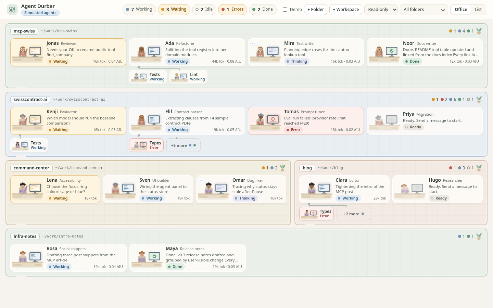
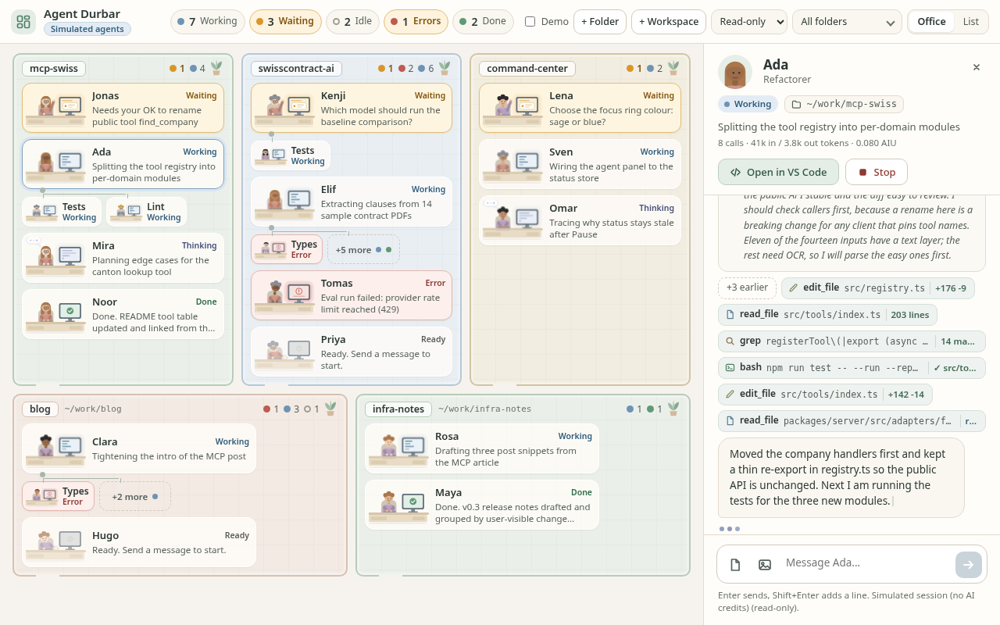
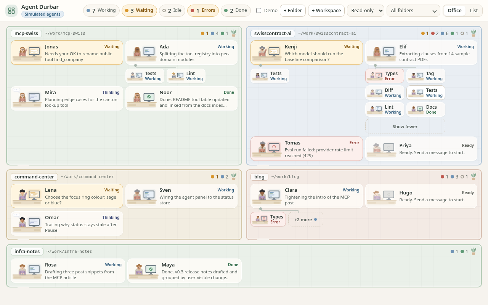

Remaining (as of milestone 4; the helper strip, the animation restarts and the spare floor space are fixed in milestone 5): the helper strip showed one helper plus `+N more`; in `micro` the helper figures are very small (about 34px wide); rooms with many agents and a long folder name truncate the nameplate and hide the path and the idle/done counts when narrow.

## Status (milestone 3)

Verified end to end on real `auto`/`efficiency` sessions through the Electron app (xvfb, real renderer clicks, real adapter), 4 tiny prompts, **0.416 AIU** in total (as reported by the API):

| Check | Result |
| --- | --- |
| Ask mode: write is held, card goes to "Waiting for you", chat shows the permission with Approve/Deny | pass |
| Deny: `apply_patch` fails with the feedback, `git diff` empty, model reports the edit was denied | pass |
| Second prompt, Approve: edit applied (`// hello` added at the top of `index.js`, confirmed with `git diff`) | pass |
| Read-only mode: write denied, note "(denied: read-only mode)", model explains it in chat, file unchanged | pass |
| Attachments: text file and PNG show as chips in the composer and in the sent message; the SDK received a `file` and a base64 `blob` (`image/png`); the answer described the red circle and summarised the text | pass (images work on `auto` / free plan) |

Fixes in this milestone: the approval note said "denyd" after Deny; Approve/Deny buttons sat on the text line (now their own row); the read-only note says how to allow edits; images are now sent as SDK `blob` attachments (base64 + mime type) instead of a file path, text files as `file` attachments with a display name.

Dev hooks for repeatable tests without a native dialog: `DURBAR_PICK=/a.txt:/b.png` (answers the attach picker), `DURBAR_LOG=/tmp/events.jsonl` (every normalized event and what is handed to the SDK), `DURBAR_DRIVER=scripts/e2e-driver.js` (drives the real window; `PHASES=fake|ask|ro|att`). Example: `PHASES=fake DURBAR_DRIVER=$PWD/scripts/e2e-driver.js xvfb-run -a npx electron . --no-sandbox` (the `fake` phase sends synthetic events, no credits). Fixtures in `scripts/fixtures/`.

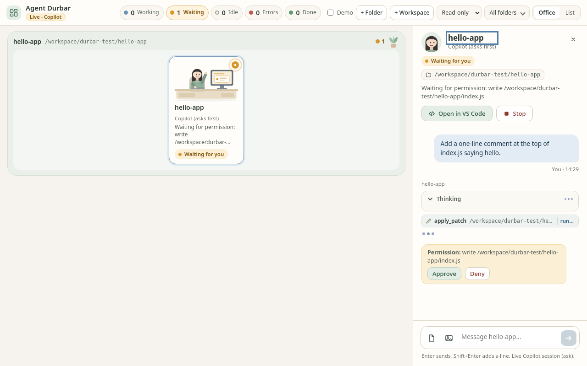


Remaining (as of milestone 3; all fixed in milestone 5): stopping a session while a permission was pending left the Approve/Deny buttons visible; the permission note sat below the answer; "Approve for this session" was not offered; no attachment size cap; attachment chips only existed for files picked in the native dialog.

## Status (milestone 2)

Added in milestone 2 (office polish, no AI credits spent while building it):
- **Simulated live agents**: `DURBAR_SIM=15 npm start` (or open `dist/renderer/index.html?sim=15` in a browser) feeds fake *normalized* events (`status`, `thinking`, `output`, `toolCall`, `subagent`, `usage`, plus a new `user` echo event) through the same renderer path as the Copilot adapter ([`src/renderer/sim.ts`](src/renderer/sim.ts)). No session is started. Extras: `DURBAR_SIM_FREEZE=1` (no background activity), `DURBAR_SIM_ROOMS=solo` (one folder per agent), `?density=full|card|mini|micro`, `?seed=N`. The **Demo** toggle (sample office) still works next to it.
- **Auto-fit density**: the office view picks the richest density that fits the floor at 100% scale, so text is never scaled down: `full` (illustrated desks, few agents), `card` (avatar, name, one-line intent, status pill, tiny usage line), `mini` (tighter cards) and `micro` (last resort). The chat panel stays docked, and the density re-evaluates when it opens. Rooms (per folder) flow and wrap; the density is computed from the unfiltered set so cards do not change shape when a status filter is on.
- **Sub-agents** sit beside the parent with a connecting line; more than the cap show `+N more` (with status dots, click to expand).
- **Status clarity**: working / thinking / waiting / error / done / idle each have a colour, a badge icon and a label. Waiting-for-you agents (amber card) and errors sort first inside each room; room headers count them. The top-bar pills count top-level agents and still filter.
- **Chat panel**: tool chips truncate to one line and wrap, click to expand the full command and output, and only the latest six show (`+N earlier`). The Thinking block is collapsible (auto-collapses when the turn ends). Sent attachments show as chips in the message.
- UI source moved from the prototype into `src/renderer` (`index.html`, `styles.css`, `app.js`, `demo.js`, `sim.ts`); `prototype/` stays as the static design reference. Dev screenshot hook: `DURBAR_SHOT=/tmp/out.png DURBAR_SHOT_SIZE=1280x800 [DURBAR_SHOT_CLICK=sim-1] DURBAR_SIM=15 npm start`.

Screenshots: [15 agents, 1440x900](docs/screenshots/m2-sim15-1440x900-closed.png), [15 agents, 1280x800](docs/screenshots/m2-sim15-1280x800-closed.png), [panel open, 1280x800](docs/screenshots/m2-sim15-1280x800-panel.png).

Known gaps in milestone 2:
- Past about 15 agents plus many helpers (or 15 single-agent folders with the panel open at 1280x800) the layout falls to `micro`, and beyond that the floor scrolls inside itself (the page never does).
- Intents truncate to one line in `mini`/`micro` (full text in the tooltip and the panel).
- (Real sessions were exercised in milestone 3, see above.)

## Status (milestone 1)

Working:
- **Copilot adapter** ([`src/adapters/copilot.ts`](src/adapters/copilot.ts)) on `@github/copilot-sdk` 1.0.22 (CLI runtime 1.0.98, pinned in `package.json`): streaming sessions per folder, `send` with file/image attachments, `stop`, and normalized events: `status`, `thinking` (reasoning deltas), `output`, `toolCall`, `subagent` (with `agentId`), plus `usage` (tokens and AI credits in nano-AIU as reported by the API).
- **Permission policy**: reads are approved; writes, shell, MCP, URL and custom tools are denied by default. `allow: true` approves everything; `ask: true` leaves requests pending (card shows "Waiting for you", chat shows Approve/Deny).
- **Electron IPC**: main owns the adapter; the renderer gets events through a narrow preload bridge (`window.agentDurbar`). Add a folder (picker), add a `.code-workspace` file (first folder becomes the session cwd), send chat messages with attachments, stop, and **Open in VS Code** (`code <absolute path>`, spawned without a shell).
- **Office view** shows real agents, status, current intent/tool, sub-agent helpers and a per-agent usage line. **Demo data** toggle brings back the sample office.
- `npm run smoke`: headless check with one tiny read-only prompt on `/workspace/durbar-test/{hello-app,notes-app}`.

Not done yet / known gaps:
- Only the `auto` model is exposed on the tested (free-plan) account, so there is no model picker; sessions use `auto` with the `efficiency` tier.
- Credits: the API reports usage in nano-AIU; the conversion to dollars/"AI Credits" is not shown. No per-session cap yet.
- Sub-agent events are mapped by a pure, unit-tested mapper (`src/adapters/map.ts`); card identity is the spawning task tool-call id and a sub-agent's own events go to its own activity view (milestone 7).
- No session resume UI, no persistence of agent list, no VS Code session discovery. "Open in VS Code" needs `code` on `PATH`.
- Developer shortcut: `DURBAR_OPEN=/path/a:/path/b npm start` starts agents on launch (`DURBAR_PERM=ask|allow` to change the policy).

## Vision

- **See**: every running coding agent at a glance, what it is doing now, and its state (idle / working / needs permission / error).
- **Control**: start, stop and message agents; approve or deny permission prompts.
- **Coordinate**: group agents by project/folder and watch them work in parallel.
- **Office view**: each agent is a person in a room; sub-agents appear next to the agent that spawned them.
- **Chat with live thinking**: open any agent and talk to it while its reasoning, tool calls and output stream in.
- **Attach files and images** to messages.
- **Open VS Code** on an agent's folder or workspace in one click.
- **10-15 agents on one screen** without it turning into noise.

Prototype: [`prototype/index.html`](prototype/index.html) (open in a browser). Screenshots: [office](prototype/office_1280.png), [chat panel](prototype/panel_1280.png).

## Decisions

- **Electron + TypeScript**, using the official **`@github/copilot-sdk`** (Node/TS) in the main process. Lowest-risk path to streaming events including sub-agent identity (`agentId`, `subagent.*`).
- **One session per folder or `.code-workspace` file.**
- **Adapter interface** ([`src/adapters/types.ts`](src/adapters/types.ts)): `start`, `send`, `stop`, `onEvent` with normalized events (`status`, `thinking`, `output`, `toolCall`, `subagent`). Copilot is the only adapter today. Claude Code and Codex are planned ([spec 012](specs/012-claude-codex-adapters/spec.md)); the interface has never been implemented twice, so it is unproven, and adding them needs an adapter registry, a capability list and an agent picker (small UI change).
- Full background and sources: [`docs/research.md`](docs/research.md).

## Known limits

- **VS Code chat history is read-only.** VS Code's own Copilot Chat sessions (the Chat view's "Local" sessions) live in an undocumented store that neither the SDK nor the CLI can resume. We only parse it to show a copy of the transcript. Copilot **CLI/SDK** sessions are different: they can be listed and resumed, see milestone 6.
- **ACP drops sub-agent identity**: sub-agent text arrives as plain message chunks, so parallel sub-agents interleave. Hence the SDK rather than raw ACP.
- **AI credit usage**: since 2026-06-01 Copilot is billed in usage-based AI Credits, and 10-15 agents can burn them fast. The app shows a per-agent counter, office and per-folder totals (since launch, not saved) and supports a soft per-session cap (milestone 9, spec 011); a spend history across restarts is not built.
- **MCP import from VS Code is a one-time copy per folder:** later edits of `.vscode/mcp.json` are not tracked, only the folder's own file is read (not VS Code's user-level `mcp.json`), and entries that need VS Code `inputs` or unresolved variables must be added by hand.
- Permission prompts need a real approve/deny UI; allow-all across 15 agents is risky.
- SDK/ACP/AHP protocols are evolving; pin CLI and SDK versions.
- Overlap with the GitHub Copilot app and the VS Code Agents window; the office view is the differentiator.

## MVP milestone

An Electron app that:

1. lets you pick N folders,
2. starts one SDK session per folder with streaming,
3. shows a grid of 10-15 agent cards with state, current intent, last tool and nested sub-agent chips,
4. opens a chat panel with live thinking, output and tool calls, plus file/image attach,
5. has an "Open in VS Code" button and a per-agent AI-credit counter.

## Roadmap

- [x] Repo, prototype, research, Electron + TypeScript skeleton, `AgentAdapter` interface
- [x] Copilot adapter on `@github/copilot-sdk` (start/send/stop, event mapping)
- [x] Wire office view to live adapter events
- [x] Chat panel with streaming thinking, attachments (basic)
- [x] Permission approve/deny flow (basic; read-only default)
- [x] AI-credit counter and per-session caps with a global default (milestone 9; the limit-reached flow follows GitHub's docs and is not yet verified on a real account)
- [x] Tools "All time" view, Copilot CLI MCP list first, MCP extras per folder (milestone 10), per-folder import from VS Code's `.vscode/mcp.json`
- [x] Usage totals: office total in the header and per-folder totals in room headers and door plates, in memory since the app opened (spec 011, 2026-10-17; persisted usage is still open)
- [x] Resume Copilot CLI/SDK sessions per folder and show VS Code chat history read-only (milestone 6); not done: continuing VS Code's own chats, discovery of sessions from other folders
- [x] Open in VS Code (`code <folder>`)
- [x] Office polish for 10-15 agents: auto-fit density, helpers with `+N`, status sorting, chat chips (simulated agents mode)
- [x] Floor-plan look for the compact densities: desk scenes, room zones, helper mini-desks (milestone 4)
- [x] Approve for this session (revocable), clean Stop with pending permission, inline permission notes, attachment caps with drag-and-drop/paste, keyed office updates, up to 3 helpers, roomy desks (milestone 5)
- [ ] Second adapter (Claude Code and Codex): planned, not built. Spec, research, plan and tasks are in [spec 012](specs/012-claude-codex-adapters/spec.md); nothing has been tried on a real account, and subscription-login use needs the owner's decision first
- [ ] Change the model, effort and context tier of a running session, compact the context, start-fresh hint: **Phases 1 and 2 are built** (milestone 11 above): the simulator fully, the real Copilot adapter from the SDK docs and tested on a fake session, so its controls are flagged "not verified on a real account yet" until the owner-approved real checks (Phase 3). Spec, research, plan and tasks are in [spec 030](specs/030-switch-model-context/spec.md). The Copilot SDK 1.0.22 declares a live model switch and a manual compaction, but it has **no free choice of window size** and **cannot clear a conversation from a host app**; all of it was read from types and docs only, nothing was run on a real account. Where an adapter cannot switch, the model stays fixed (start a new session to change it)
- [x] Collaboration harness: team rules in [AGENTS.md](AGENTS.md), issues and a [project board](https://github.com/orgs/three-feathers/projects/1), Spec Kit gate, PR template (spec 021)
- [ ] Code signing and notarization (spec 014, needs a purchase approved by the maintainer)
- [x] Packaging with electron-builder (unsigned dmg/zip, nsis/portable, AppImage) and GitHub Actions CI + releases built as drafts, published by hand (alpha.3 is the first published pre-release)

## How we work

Agent Durbar is spec-driven with [GitHub Spec Kit](https://github.com/github/spec-kit): **no code without a spec, a plan and tasks.** Features 001-010 in [`specs/`](specs/README.md) were reverse-engineered from the shipped code (each requirement is marked `[IMPLEMENTED]` or `[KNOWN GAP]`, with how it was checked); 011 (credit caps and usage totals) and 015-021, 023 are built; 012 (Claude Code and Codex adapters) and 030 (change model and context window inside a session) have a spec, research, plan and tasks but no code; 013-014 are backlog drafts. Spec Kit's helper scripts (`.specify/scripts/bash/*.sh`) are shell scripts: on Windows run them in WSL or Git Bash, or re-initialise with PowerShell scripts (`specify init --here --script ps`); writing the spec files by hand works everywhere. The rules are in the [constitution](.specify/memory/constitution.md). Every change goes `/speckit.specify` → `/speckit.clarify` → `/speckit.plan` → `/speckit.tasks` → `/speckit.analyze` → `/speckit.implement` (a bug fix is a short spec delta in the owning spec), and a CI check fails pull requests that change `src/` without changing `specs/` unless they carry a `Spec-Exempt: <reason>`. Coding agents: see [AGENTS.md](AGENTS.md) (it also says which docs a PR must update: README, docs, specs, screenshots, CHANGELOG). Teams: claim an issue first; start with [docs/collaboration.md](docs/collaboration.md) and the [project board](https://github.com/orgs/three-feathers/projects/1). Releases: [CHANGELOG.md](CHANGELOG.md). Details: [CONTRIBUTING.md](CONTRIBUTING.md#spec-kit-workflow-is-mandatory).

## Development

```bash
npm ci                    # or npm install
npm run typecheck         # tsc, no emit
npm run build             # tsc + copy src/renderer assets into dist/renderer
npm test                  # every unit suite (permissions, attachments, folders, MCP, tool usage, usage totals, about, ...): no Copilot, no credits
npm run check:office      # layout check of 95 combinations (Electron under xvfb on Linux), simulator only
npm run check:dialog-focus # keyboard check of the Allow all confirmation (Electron under xvfb on Linux), simulator only
npm start                 # build and launch Electron (needs `copilot login` once)
DURBAR_SIM=15 npm start   # 15 simulated agents, no sessions, no AI credits
npm run pack:dir          # unpacked app in release/ (also: npm run dist, dist:mac:arm64, dist:mac:x64, dist:win, dist:linux; unsigned)
```

These spend AI credits or need a real Copilot login, so run them only on purpose: `npm run smoke` (headless adapter test, sends 2 tiny prompts) and `npm run verify:cap` (checks session caps against the real runtime; no model call). Single suites are `npm run test:<name>` (see `scripts/test-*.ts` and `package.json`).

Layout: `build/` (app icons), `.github/` (workflows: CI, release, Spec Kit gate; PR and issue templates; scripts), `specs/` (Spec Kit specs), `.specify/` (constitution, templates, scripts), `src/main` (Electron main), `src/preload` (bridge), `src/renderer` (UI: html/css/js, demo data, simulator), `src/adapters` (agent adapters, permission broker), `src/shared` (IPC types, attachment rules), `prototype/` (static design), `docs/` (research, [collaboration guide](docs/collaboration.md), screenshots), `scripts/` (tests and screenshot scripts), `CHANGELOG.md`, `AGENTS.md` (rules for agents).

## License

[MIT](LICENSE), Copyright (c) 2026 Three Feathers contributors.

**Credits.** Agent Durbar is by **Three Feathers**. Key contributors: [vikramgorla](https://github.com/vikramgorla), [fjcabello](https://github.com/fjcabello) and [rubenlupi](https://github.com/rubenlupi) (GitHub handles are used as the names). The names live in one place, [`src/shared/about.ts`](src/shared/about.ts) (plus `contributors` in `package.json`; `npm run test:about` keeps them in step). They are shown in the OS About panel and in Settings > About; the copyright line is also in `LICENSE` and in the installer metadata.

**App id changed (2026-10-16).** The bundle/app id is now `io.github.three-feathers.agentdurbar` (was `io.github.vikramgorla.agentdurbar`). An install of an earlier test build is therefore a **separate app** to the OS (own Windows uninstall entry and shortcuts, own macOS bundle id); uninstall it by hand. Saved data (`durbar-*.json` in the Electron user-data folder) is named after the app name, not the id, so it is shared and kept.

Repository: <https://github.com/three-feathers/agent-durbar>. Board: <https://github.com/orgs/three-feathers/projects/1>. See also [SECURITY.md](SECURITY.md), [CONTRIBUTING.md](CONTRIBUTING.md) and [CHANGELOG.md](CHANGELOG.md).
