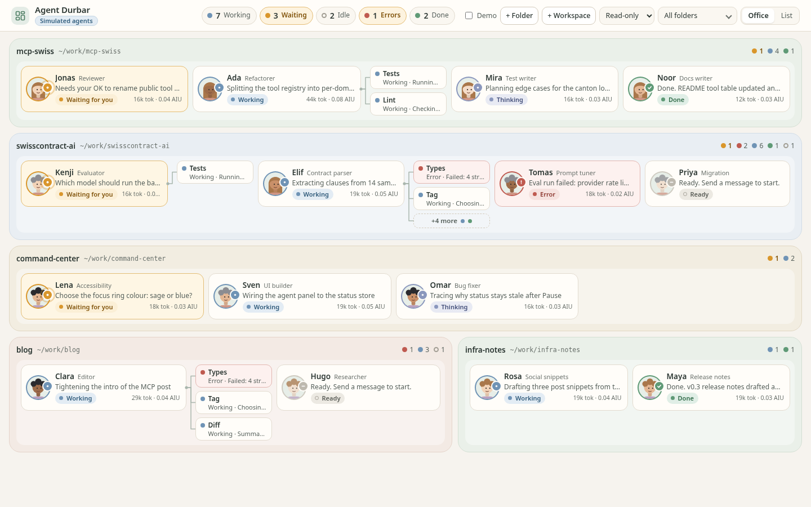
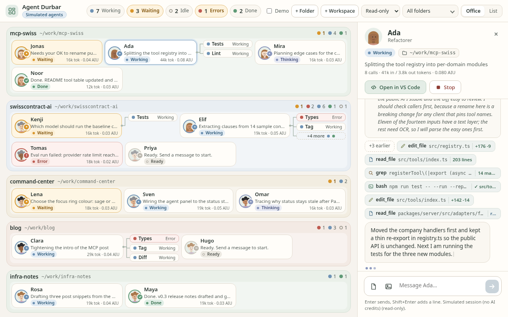

# Agent Durbar

Command center to see, chat with and coordinate coding agents (Copilot CLI first) in an office-style view.

> Status: **milestone 2 (works on Linux; macOS/Windows untested).** The Electron app starts real GitHub Copilot sessions through `@github/copilot-sdk`, one per folder or `.code-workspace` file, and feeds the office view from live events. Milestone 2 makes 10-15 agents readable on one 1440x900 / 1280x800 screen. See [Status](#status-milestone-2).




## Status (milestone 2)

Added in milestone 2 (office polish, no AI credits spent while building it):
- **Simulated live agents**: `DURBAR_SIM=15 npm start` (or open `dist/renderer/index.html?sim=15` in a browser) feeds fake *normalized* events (`status`, `thinking`, `output`, `toolCall`, `subagent`, `usage`, plus a new `user` echo event) through the same renderer path as the Copilot adapter ([`src/renderer/sim.ts`](src/renderer/sim.ts)). No session is started. Extras: `DURBAR_SIM_FREEZE=1` (no background activity), `DURBAR_SIM_ROOMS=solo` (one folder per agent), `?density=full|card|mini|micro`, `?seed=N`. The **Demo** toggle (sample office) still works next to it.
- **Auto-fit density**: the office view picks the richest density that fits the floor at 100% scale, so text is never scaled down: `full` (illustrated desks, few agents), `card` (avatar, name, one-line intent, status pill, tiny usage line), `mini` (tighter cards) and `micro` (last resort). The chat panel stays docked, and the density re-evaluates when it opens. Rooms (per folder) flow and wrap; the density is computed from the unfiltered set so cards do not change shape when a status filter is on.
- **Sub-agents** sit beside the parent with a connecting line; more than the cap show `+N more` (with status dots, click to expand).
- **Status clarity**: working / thinking / waiting / error / done / idle each have a colour, a badge icon and a label. Waiting-for-you agents (amber card) and errors sort first inside each room; room headers count them. The top-bar pills count top-level agents and still filter.
- **Chat panel**: tool chips truncate to one line and wrap, click to expand the full command and output, and only the latest six show (`+N earlier`). The Thinking block is collapsible (auto-collapses when the turn ends). Sent attachments show as chips in the message.
- UI source moved from the prototype into `src/renderer` (`index.html`, `styles.css`, `app.js`, `demo.js`, `sim.ts`); `prototype/` stays as the static design reference. Dev screenshot hook: `DURBAR_SHOT=/tmp/out.png DURBAR_SHOT_SIZE=1280x800 [DURBAR_SHOT_CLICK=sim-1] DURBAR_SIM=15 npm start`.

Screenshots: [15 agents, 1440x900](docs/screenshots/m2-sim15-1440x900-closed.png), [15 agents, 1280x800](docs/screenshots/m2-sim15-1280x800-closed.png), [panel open, 1280x800](docs/screenshots/m2-sim15-1280x800-panel.png).

Known gaps in milestone 2:
- Past about 15 agents plus many helpers (or 15 single-agent folders with the panel open at 1280x800) the layout falls to `micro`, and beyond that the floor scrolls inside itself (the page never does).
- Intents truncate to one line in `mini`/`micro` (full text in the tooltip and the panel).
- Not run with real Copilot sessions in this milestone (that costs credits); the real-adapter path only gained the `intent`-first card text and the unchanged event handling.

## Status (milestone 1)

Working:
- **Copilot adapter** ([`src/adapters/copilot.ts`](src/adapters/copilot.ts)) on `@github/copilot-sdk` 1.0.22 (CLI runtime 1.0.98, pinned in `package.json`): streaming sessions per folder, `send` with file/image attachments, `stop`, and normalized events: `status`, `thinking` (reasoning deltas), `output`, `toolCall`, `subagent` (with `agentId`), plus `usage` (tokens and AI credits in nano-AIU as reported by the API).
- **Permission policy**: reads are approved; writes, shell, MCP, URL and custom tools are denied by default. `allow: true` approves everything; `ask: true` leaves requests pending (card shows "Waiting for you", chat shows Approve/Deny).
- **Electron IPC**: main owns the adapter; the renderer gets events through a narrow preload bridge (`window.agentDurbar`). Add a folder (picker), add a `.code-workspace` file (first folder becomes the session cwd), send chat messages with attachments, stop, and **Open in VS Code** (`code <absolute path>`, spawned without a shell).
- **Office view** shows real agents, status, current intent/tool, sub-agent helpers and a per-agent usage line. **Demo data** toggle brings back the sample office.
- `npm run smoke`: headless check with one tiny read-only prompt on `/workspace/durbar-test/{hello-app,notes-app}`.

Not done yet / known gaps:
- Only the `auto` model is exposed on the tested (free-plan) account, so there is no model picker; sessions use `auto` with the `efficiency` tier.
- Credits: the API reports usage in nano-AIU; the conversion to dollars/"AI Credits" is not shown. No per-session cap yet.
- Sub-agent event mapping is best effort: card identity uses the spawning tool call id, and events from inside a sub-agent are shown in the parent's chat.
- No session resume UI, no persistence of agent list, no VS Code session discovery. "Open in VS Code" needs `code` on `PATH`.
- Developer shortcut: `DURBAR_OPEN=/path/a:/path/b npm start` starts agents on launch (`DURBAR_PERM=ask|allow` to change the policy).

## Vision

- **See**: every running coding agent at a glance, what it is doing now, and its state (idle / working / needs permission / error).
- **Control**: start, stop and message agents; approve or deny permission prompts.
- **Coordinate**: group agents by project/folder and watch them work in parallel.
- **Office view**: each agent is a person in a room; sub-agents appear next to the agent that spawned them.
- **Chat with live thinking**: open any agent and talk to it while its reasoning, tool calls and output stream in.
- **Attach files and images** to messages.
- **Open VS Code** on an agent's folder or workspace in one click.
- **10-15 agents on one screen** without it turning into noise.

Prototype: [`prototype/index.html`](prototype/index.html) (open in a browser). Screenshots: [office](prototype/office_1280.png), [chat panel](prototype/panel_1280.png).

## Decisions

- **Electron + TypeScript**, using the official **`@github/copilot-sdk`** (Node/TS) in the main process. Lowest-risk path to streaming events including sub-agent identity (`agentId`, `subagent.*`).
- **One session per folder or `.code-workspace` file.**
- **Adapter interface** ([`src/adapters/types.ts`](src/adapters/types.ts)): `start`, `send`, `stop`, `onEvent` with normalized events (`status`, `thinking`, `output`, `toolCall`, `subagent`). Copilot is first; Claude and Codex CLIs can be added later without touching the UI.
- Full background and sources: [`docs/research.md`](docs/research.md).

## Known limits

- **Sessions started in VS Code are read-only** (no API to control them; only fragile parsing of files on disk). Live control works for sessions Agent Durbar starts itself.
- **ACP drops sub-agent identity**: sub-agent text arrives as plain message chunks, so parallel sub-agents interleave. Hence the SDK rather than raw ACP.
- **AI credit usage**: since 2026-06-01 Copilot is billed in usage-based AI Credits, and 10-15 agents can burn them fast. Show a **per-agent credit counter** and support a per-session cap.
- Permission prompts need a real approve/deny UI; allow-all across 15 agents is risky.
- SDK/ACP/AHP protocols are evolving; pin CLI and SDK versions.
- Overlap with the GitHub Copilot app and the VS Code Agents window; the office view is the differentiator.

## MVP milestone

An Electron app that:

1. lets you pick N folders,
2. starts one SDK session per folder with streaming,
3. shows a grid of 10-15 agent cards with state, current intent, last tool and nested sub-agent chips,
4. opens a chat panel with live thinking, output and tool calls, plus file/image attach,
5. has an "Open in VS Code" button and a per-agent AI-credit counter.

## Roadmap

- [x] Repo, prototype, research, Electron + TypeScript skeleton, `AgentAdapter` interface
- [x] Copilot adapter on `@github/copilot-sdk` (start/send/stop, event mapping)
- [x] Wire office view to live adapter events
- [x] Chat panel with streaming thinking, attachments (basic)
- [x] Permission approve/deny flow (basic; read-only default)
- [ ] AI-credit counter and caps
- [ ] Resume sessions; read-only discovery of VS Code / terminal sessions
- [x] Open in VS Code (`code <folder>`)
- [x] Office polish for 10-15 agents: auto-fit density, helpers with `+N`, status sorting, chat chips (simulated agents mode)
- [ ] Second adapter (Claude or Codex CLI)
- [ ] Packaging (macOS, Windows, Linux)

## Development

```bash
npm install
npm run build   # tsc + copy src/renderer assets into dist/renderer
npm start       # build and launch Electron (needs `copilot login` once)
DURBAR_SIM=15 npm start   # 15 simulated agents, no sessions, no AI credits
npm run smoke   # headless adapter test, sends 2 tiny prompts (uses AI credits)
```

Layout: `src/main` (Electron main), `src/preload` (bridge), `src/renderer` (UI: html/css/js, demo data, simulator), `src/adapters` (agent adapters), `prototype/` (static design), `docs/` (research).

## License

MIT, Vikram Gorla.
