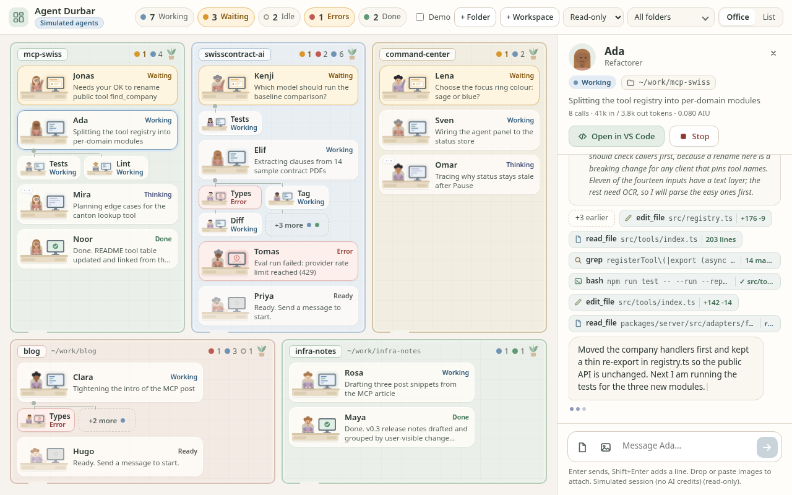

# Agent Durbar

Command center to see, chat with and coordinate coding agents (Copilot CLI first) in an office-style view.

> Status: **milestone 5 (permission, attachment and office polish) on top of milestone 4 (floor-plan look for 10-15 agents) and milestone 3 (approvals and attachments verified on real Copilot sessions; Linux only, macOS/Windows untested).** The Electron app starts real GitHub Copilot sessions through `@github/copilot-sdk`, one per folder or `.code-workspace` file, and feeds the office view from live events. 10-15 agents stay readable on one 1440x900 / 1280x800 screen. See [Status](#status-milestone-5).




> **Disclaimer.** Agent Durbar is an independent, community project. It is **not affiliated with, endorsed by or sponsored by GitHub or Microsoft**. "GitHub", "GitHub Copilot" and "Visual Studio Code" are trademarks of their respective owners. This app only drives the official `@github/copilot-sdk` and the `code` command on your own machine.

## Requirements

- **A GitHub Copilot subscription (a free plan works) and a Copilot login on your machine.** Agent Durbar does not ship or replace Copilot: it uses the Copilot runtime bundled with the official SDK and your existing Copilot sign-in. Sign in once with the GitHub Copilot CLI (`copilot login`; install it from [github/copilot-cli](https://github.com/github/copilot-cli)) before starting a session. Agent Durbar never sees, stores or sends your token: the Copilot runtime reads it from the place the CLI saved it (your OS keychain or the Copilot config folder), and Agent Durbar has no accounts, no servers and no telemetry of its own.
- Usage bills against **your** Copilot plan (AI credits); several agents in parallel can use credits quickly.
- Optional: VS Code with the `code` command, for the "Open in VS Code" button.

## Install from releases

Download the build for your system from the [Releases page](https://github.com/vikramgorla/agent-durbar/releases) (pre-releases are alpha builds):

| System | File |
| --- | --- |
| macOS, Apple Silicon (M1 and later) | `Agent-Durbar-<version>-arm64.dmg` (or `...-arm64.zip`) |
| macOS, Intel | `Agent-Durbar-<version>-x64.dmg` (or `...-x64.zip`) |
| Windows 10/11, x64 | `Agent-Durbar-Setup-<version>.exe` (installer) or `Agent-Durbar-<version>-portable.exe` |
| Linux, x64 | `Agent-Durbar-<version>-x86_64.AppImage` (`chmod +x` it, then run) |

There is no auto-update: download a newer release to update.

### These builds are not code-signed

Signing certificates cost money, so the builds are **unsigned and not notarized**. Your OS will warn you the first time; that is expected. Only open files you downloaded from this repository's Releases page.

- **macOS (Gatekeeper):** drag the app to Applications. On first launch, **right-click (or Control-click) the app and choose Open**, then Open again in the dialog. On recent macOS you may instead need System Settings > Privacy & Security > "Open Anyway". If macOS says the app is damaged, remove the download quarantine flag: `xattr -dr com.apple.quarantine "/Applications/Agent Durbar.app"`.
- **Windows (SmartScreen):** when "Windows protected your PC" appears, click **More info**, then **Run anyway**.
- **Linux:** `chmod +x Agent-Durbar-*.AppImage && ./Agent-Durbar-*.AppImage` (you may need `--no-sandbox` on systems without unprivileged user namespaces).

### Safety model

Agents run **locally, on your machine, as you**, in the folders you add. Nothing is sent anywhere except to GitHub Copilot through its own runtime. You choose a permission mode per agent: **Read-only** (reads only, everything else denied), **Ask** (writes, shell commands, URLs and tools wait for your Approve / Approve for this session / Deny) or **Allow all** (no prompts; use only in folders you trust). The default is read-only. Review what an agent asks to do, especially shell commands.

## Build from source

```bash
npm ci
npm run build && npm test
npm start                 # needs `copilot login` once
npm run dist:dir          # unpacked app for this OS in release/
npm run dist              # installers/archives for this OS in release/ (no signing, no publishing)
```

Each release also lists `SHA256SUMS.txt`. Releases are built by GitHub Actions from `v*` tags into a **draft** release; see [CONTRIBUTING.md](CONTRIBUTING.md).

## Status (milestone 5: permissions, attachments, office polish)

All seven remaining issues from milestones 3 and 4 are fixed. Built and tested on simulated agents (`DURBAR_SIM`, no AI credits); the permission path was also verified once on a real session with **one tiny prompt, 0.189 AIU** (3 API calls, as reported by the API).

1. **Approve for this session.** Each pending permission now offers **Approve**, **Approve for this session** and **Deny**. "For this session" remembers a narrow scope until you stop that session: writes in that file's folder, a simple shell command by name (anything with pipes, `&&`, redirects or substitutions is only remembered for that exact command), a URL host, or an MCP/custom tool name. It shows as a small green chip in the panel header (`Allowed: write in src/`) with an **x** to revoke; later matching requests are approved automatically and shown as "approved (allowed for this session)" in the timeline. Deny never remembers, grants vanish on Stop. The logic is a pure class ([`src/adapters/permissions.ts`](src/adapters/permissions.ts), `npm run test:permissions`).
2. **Stop with a pending permission** denies the request cleanly: the adapter resolves it as denied (`via: stopped`), the note reads "denied (session stopped)", Approve/Deny disappear, the card goes idle and the chips are cleared.
3. **The permission note is inline** in the tool timeline, between the tool chips in the order things happened, not below the answer. (On a real session the SDK starts the tool call before it asks, so the order is `apply_patch` then its permission note.)
4. **Attachment caps**: 10 MB per file and 5 files per message, enforced in the renderer (fast, with a message in the composer such as `"big.mov" is 11 MB, over the 10 MB per-file limit. Not attached.` or `Up to 5 files per message. Not attached: "d.png", "e.png".`) and again in the main process on stage and on send. A counter (`3/5`) shows next to the chips. **Drag and drop** files onto the panel (overlay "Drop to attach") and **paste** images into the message box (image only: it attaches; image plus text: it attaches and the text still pastes). The renderer has no file path for these, so the bytes go to the main process, which checks the real format by magic bytes (PNG, JPEG, GIF, WebP, BMP; SVG and renamed non-images are rejected), strips directories and control characters from the name, forces the extension from the real format, and writes a private copy (mode 0600) into a temp folder that is deleted on quit ([`src/shared/attachments.ts`](src/shared/attachments.ts), `npm run test:attachments`). A file dropped anywhere else no longer navigates the window.
5. **Keyed DOM updates in the office view.** Trial layouts are measured in a hidden probe element, never in the visible floor, and the chosen layout is cached until the office shape changes (agents, helper counts, filters, size, panel). A tick or status change then patches only what changed: rooms, units, desks and helper tiles are matched by id, text and attributes are updated in place, and a desk scene (SVG) is replaced only when its status or look changes. Measured over 24 s of live ticks at SIM=15: no desk node was replaced, only the scenes of agents whose status changed, and no running animation of an unchanged agent restarted. The stat pills use the same patching.
6. **Helper strip**: up to **3 helpers** show before `+N more` when the floor has room (the strip is a 2-column grid, so 2 rows). The layout search tries 3 first and falls back to 1; when only 1 fits, the leftover space is spent per agent (agents with the most helpers, attention-needing ones first) while everything still fits, e.g. Elif shows `Types`, `Tag`, `Diff` + `+3 more` at 1280x800 with the panel open.
7. **Spare floor space**: a new `roomy` density (card with bigger desks, 92px rows, 14.5px names, 11-12px text, bigger helper tiles) is tried right after `full`; it wins only when it fits, so the 1280x800 fits are unchanged. At 1440x900 with the panel closed, SIM=12 and SIM=15 now use `roomy`; at 1280x800, SIM=12 closed also fits `roomy`.

Checked at 1440x900 and 1280x800, panel closed and open, SIM=12 and 15, also over 18 s of live ticks each (no overlaps, no clipping, nothing outside the floor, no page or floor scroll, text never below 10.5px, densities stable):

| | 1440x900 closed | 1440x900 panel | 1280x800 closed | 1280x800 panel |
| --- | --- | --- | --- | --- |
| SIM=12 | roomy | card | roomy | card |
| SIM=15 | roomy | card | card | mini |


Tests: `npm test` (permission broker, attachment rules; no Copilot, no credits). End-to-end driver phases: `PHASES=m5` (real Electron main and adapter session start, no prompt: real staging IPC, drop/paste, permission UI, Stop through the real adapter), `PHASES=real` (the one real prompt: two edits in ask mode, Approve for this session once, the second edit was approved automatically). Both with `DURBAR_DRIVER=$PWD/scripts/e2e-driver.js xvfb-run -a npx electron . --no-sandbox`.

Remaining: a layout re-search (resize, opening the panel, adding agents) takes roughly 150-200 ms at 15 agents in headless software rendering (cached otherwise); the grant scopes are chosen conservatively (folder, command name, host, tool) and not configurable; dropped non-image files are copied to the temp folder like images (not referenced in place); in `micro` the helper figures are still very small and the helper boost only applies when something fits; long folder names truncate the nameplate when narrow; macOS/Windows untested; no AI-credit cap or session resume yet (see Roadmap).

## Status (milestone 4: office floor-plan look for 10-15 agents)

The compact densities (`card` / `mini` / `micro`, used automatically for 10-15 agents) no longer look like a dashboard of cards; the office is a floor plan again. No AI credits were used (`DURBAR_SIM=12` / `15`, plus `?sim=30` for a stress check).

- **Every agent is a tiny desk scene** (the prototype's flat-vector person, desk and monitor, cropped and reused). Status is shown by the scene itself: typing hands and a soft monitor glow while working, a thought bubble with blinking cursor while thinking, a raised waving hand and amber monitor when waiting for you, a red screen with `!` on error, a green check on done, and a dimmed figure with a coffee mug when idle. A coloured status word stays next to the name, so colour is never the only cue.
- **Rooms are floor-plan zones**: tinted floor with faint tiles, a wall edge with a door gap, a nameplate and a plant. Desks sit on a grid so rows and columns line up. The renderer also tries several desk-column counts per room and keeps the one whose desks are closest to a comfortable width among those that fit.
- **Helpers are smaller figures at mini-desks** on a strip under their parent, joined by a connector. The strip shows the highest-priority helper (waiting, then error first) plus a `+N more` chip with status dots that expands in place ("Show fewer" collapses it). Sorting (waiting-for-you, then errors first) and the status / folder filters are unchanged.
- `card` keeps role, a two-line intent, a status pill and usage; `mini` is name, status word and a two-line intent; `micro` is name, status word and a one-line intent. Text never goes below 10.5px.
- **Calm and light**: flat tints, no emoji, no blur filters in compact scenes. Animations are CSS only, run in coarse steps (a few repaints per second), and all stop under `prefers-reduced-motion`. In headless Chrome with software rendering, 15 animated agents (78 running animations) use about 10% of one core in total and about 0.2% with reduced motion; the sim tick is the only JS and only touches changed agents.
- The `full` density used for a handful of agents is unchanged (pixel-compared before and after).

Checked at 1440x900 and 1280x800, panel closed and open, with 12 and 15 simulated agents: no overlaps, no clipping, no page scroll, floor does not scroll. 15 agents use `card` everywhere except 1280x800 with the panel open, which uses `mini`.


Remaining (as of milestone 4; the helper strip, the animation restarts and the spare floor space are fixed in milestone 5): the helper strip showed one helper plus `+N more`; in `micro` the helper figures are very small (about 34px wide); rooms with many agents and a long folder name truncate the nameplate and hide the path and the idle/done counts when narrow.

## Status (milestone 3)

Verified end to end on real `auto`/`efficiency` sessions through the Electron app (xvfb, real renderer clicks, real adapter), 4 tiny prompts, **0.416 AIU** in total (as reported by the API):

| Check | Result |
| --- | --- |
| Ask mode: write is held, card goes to "Waiting for you", chat shows the permission with Approve/Deny | pass |
| Deny: `apply_patch` fails with the feedback, `git diff` empty, model reports the edit was denied | pass |
| Second prompt, Approve: edit applied (`// hello` added at the top of `index.js`, confirmed with `git diff`) | pass |
| Read-only mode: write denied, note "(denied: read-only mode)", model explains it in chat, file unchanged | pass |
| Attachments: text file and PNG show as chips in the composer and in the sent message; the SDK received a `file` and a base64 `blob` (`image/png`); the answer described the red circle and summarised the text | pass (images work on `auto` / free plan) |

Fixes in this milestone: the approval note said "denyd" after Deny; Approve/Deny buttons sat on the text line (now their own row); the read-only note says how to allow edits; images are now sent as SDK `blob` attachments (base64 + mime type) instead of a file path, text files as `file` attachments with a display name.

Dev hooks for repeatable tests without a native dialog: `DURBAR_PICK=/a.txt:/b.png` (answers the attach picker), `DURBAR_LOG=/tmp/events.jsonl` (every normalized event and what is handed to the SDK), `DURBAR_DRIVER=scripts/e2e-driver.js` (drives the real window; `PHASES=fake|ask|ro|att`). Example: `PHASES=fake DURBAR_DRIVER=$PWD/scripts/e2e-driver.js xvfb-run -a npx electron . --no-sandbox` (the `fake` phase sends synthetic events, no credits). Fixtures in `scripts/fixtures/`.


Remaining (as of milestone 3; all fixed in milestone 5): stopping a session while a permission was pending left the Approve/Deny buttons visible; the permission note sat below the answer; "Approve for this session" was not offered; no attachment size cap; attachment chips only existed for files picked in the native dialog.

## Status (milestone 2)

Added in milestone 2 (office polish, no AI credits spent while building it):
- **Simulated live agents**: `DURBAR_SIM=15 npm start` (or open `dist/renderer/index.html?sim=15` in a browser) feeds fake *normalized* events (`status`, `thinking`, `output`, `toolCall`, `subagent`, `usage`, plus a new `user` echo event) through the same renderer path as the Copilot adapter ([`src/renderer/sim.ts`](src/renderer/sim.ts)). No session is started. Extras: `DURBAR_SIM_FREEZE=1` (no background activity), `DURBAR_SIM_ROOMS=solo` (one folder per agent), `?density=full|card|mini|micro`, `?seed=N`. The **Demo** toggle (sample office) still works next to it.
- **Auto-fit density**: the office view picks the richest density that fits the floor at 100% scale, so text is never scaled down: `full` (illustrated desks, few agents), `card` (avatar, name, one-line intent, status pill, tiny usage line), `mini` (tighter cards) and `micro` (last resort). The chat panel stays docked, and the density re-evaluates when it opens. Rooms (per folder) flow and wrap; the density is computed from the unfiltered set so cards do not change shape when a status filter is on.
- **Sub-agents** sit beside the parent with a connecting line; more than the cap show `+N more` (with status dots, click to expand).
- **Status clarity**: working / thinking / waiting / error / done / idle each have a colour, a badge icon and a label. Waiting-for-you agents (amber card) and errors sort first inside each room; room headers count them. The top-bar pills count top-level agents and still filter.
- **Chat panel**: tool chips truncate to one line and wrap, click to expand the full command and output, and only the latest six show (`+N earlier`). The Thinking block is collapsible (auto-collapses when the turn ends). Sent attachments show as chips in the message.
- UI source moved from the prototype into `src/renderer` (`index.html`, `styles.css`, `app.js`, `demo.js`, `sim.ts`); `prototype/` stays as the static design reference. Dev screenshot hook: `DURBAR_SHOT=/tmp/out.png DURBAR_SHOT_SIZE=1280x800 [DURBAR_SHOT_CLICK=sim-1] DURBAR_SIM=15 npm start`.

Screenshots: [15 agents, 1440x900](docs/screenshots/m2-sim15-1440x900-closed.png), [15 agents, 1280x800](docs/screenshots/m2-sim15-1280x800-closed.png), [panel open, 1280x800](docs/screenshots/m2-sim15-1280x800-panel.png).

Known gaps in milestone 2:
- Past about 15 agents plus many helpers (or 15 single-agent folders with the panel open at 1280x800) the layout falls to `micro`, and beyond that the floor scrolls inside itself (the page never does).
- Intents truncate to one line in `mini`/`micro` (full text in the tooltip and the panel).
- (Real sessions were exercised in milestone 3, see above.)

## Status (milestone 1)

Working:
- **Copilot adapter** ([`src/adapters/copilot.ts`](src/adapters/copilot.ts)) on `@github/copilot-sdk` 1.0.22 (CLI runtime 1.0.98, pinned in `package.json`): streaming sessions per folder, `send` with file/image attachments, `stop`, and normalized events: `status`, `thinking` (reasoning deltas), `output`, `toolCall`, `subagent` (with `agentId`), plus `usage` (tokens and AI credits in nano-AIU as reported by the API).
- **Permission policy**: reads are approved; writes, shell, MCP, URL and custom tools are denied by default. `allow: true` approves everything; `ask: true` leaves requests pending (card shows "Waiting for you", chat shows Approve/Deny).
- **Electron IPC**: main owns the adapter; the renderer gets events through a narrow preload bridge (`window.agentDurbar`). Add a folder (picker), add a `.code-workspace` file (first folder becomes the session cwd), send chat messages with attachments, stop, and **Open in VS Code** (`code <absolute path>`, spawned without a shell).
- **Office view** shows real agents, status, current intent/tool, sub-agent helpers and a per-agent usage line. **Demo data** toggle brings back the sample office.
- `npm run smoke`: headless check with one tiny read-only prompt on `/workspace/durbar-test/{hello-app,notes-app}`.

Not done yet / known gaps:
- Only the `auto` model is exposed on the tested (free-plan) account, so there is no model picker; sessions use `auto` with the `efficiency` tier.
- Credits: the API reports usage in nano-AIU; the conversion to dollars/"AI Credits" is not shown. No per-session cap yet.
- Sub-agent event mapping is best effort: card identity uses the spawning tool call id, and events from inside a sub-agent are shown in the parent's chat.
- No session resume UI, no persistence of agent list, no VS Code session discovery. "Open in VS Code" needs `code` on `PATH`.
- Developer shortcut: `DURBAR_OPEN=/path/a:/path/b npm start` starts agents on launch (`DURBAR_PERM=ask|allow` to change the policy).

## Vision

- **See**: every running coding agent at a glance, what it is doing now, and its state (idle / working / needs permission / error).
- **Control**: start, stop and message agents; approve or deny permission prompts.
- **Coordinate**: group agents by project/folder and watch them work in parallel.
- **Office view**: each agent is a person in a room; sub-agents appear next to the agent that spawned them.
- **Chat with live thinking**: open any agent and talk to it while its reasoning, tool calls and output stream in.
- **Attach files and images** to messages.
- **Open VS Code** on an agent's folder or workspace in one click.
- **10-15 agents on one screen** without it turning into noise.

Prototype: [`prototype/index.html`](prototype/index.html) (open in a browser). Screenshots: [office](prototype/office_1280.png), [chat panel](prototype/panel_1280.png).

## Decisions

- **Electron + TypeScript**, using the official **`@github/copilot-sdk`** (Node/TS) in the main process. Lowest-risk path to streaming events including sub-agent identity (`agentId`, `subagent.*`).
- **One session per folder or `.code-workspace` file.**
- **Adapter interface** ([`src/adapters/types.ts`](src/adapters/types.ts)): `start`, `send`, `stop`, `onEvent` with normalized events (`status`, `thinking`, `output`, `toolCall`, `subagent`). Copilot is first; Claude and Codex CLIs can be added later without touching the UI.
- Full background and sources: [`docs/research.md`](docs/research.md).

## Known limits

- **Sessions started in VS Code are read-only** (no API to control them; only fragile parsing of files on disk). Live control works for sessions Agent Durbar starts itself.
- **ACP drops sub-agent identity**: sub-agent text arrives as plain message chunks, so parallel sub-agents interleave. Hence the SDK rather than raw ACP.
- **AI credit usage**: since 2026-06-01 Copilot is billed in usage-based AI Credits, and 10-15 agents can burn them fast. Show a **per-agent credit counter** and support a per-session cap.
- Permission prompts need a real approve/deny UI; allow-all across 15 agents is risky.
- SDK/ACP/AHP protocols are evolving; pin CLI and SDK versions.
- Overlap with the GitHub Copilot app and the VS Code Agents window; the office view is the differentiator.

## MVP milestone

An Electron app that:

1. lets you pick N folders,
2. starts one SDK session per folder with streaming,
3. shows a grid of 10-15 agent cards with state, current intent, last tool and nested sub-agent chips,
4. opens a chat panel with live thinking, output and tool calls, plus file/image attach,
5. has an "Open in VS Code" button and a per-agent AI-credit counter.

## Roadmap

- [x] Repo, prototype, research, Electron + TypeScript skeleton, `AgentAdapter` interface
- [x] Copilot adapter on `@github/copilot-sdk` (start/send/stop, event mapping)
- [x] Wire office view to live adapter events
- [x] Chat panel with streaming thinking, attachments (basic)
- [x] Permission approve/deny flow (basic; read-only default)
- [ ] AI-credit counter and caps
- [ ] Resume sessions; read-only discovery of VS Code / terminal sessions
- [x] Open in VS Code (`code <folder>`)
- [x] Office polish for 10-15 agents: auto-fit density, helpers with `+N`, status sorting, chat chips (simulated agents mode)
- [x] Floor-plan look for the compact densities: desk scenes, room zones, helper mini-desks (milestone 4)
- [x] Approve for this session (revocable), clean Stop with pending permission, inline permission notes, attachment caps with drag-and-drop/paste, keyed office updates, up to 3 helpers, roomy desks (milestone 5)
- [ ] Second adapter (Claude or Codex CLI)
- [x] Packaging with electron-builder (unsigned dmg/zip, nsis/portable, AppImage) and GitHub Actions CI + draft releases (alpha)

## Development

```bash
npm install
npm run build   # tsc + copy src/renderer assets into dist/renderer
npm start       # build and launch Electron (needs `copilot login` once)
DURBAR_SIM=15 npm start   # 15 simulated agents, no sessions, no AI credits
npm test        # permission broker + attachment rules, no Copilot, no credits
npm run smoke   # headless adapter test, sends 2 tiny prompts (uses AI credits)
```

Layout: `build/` (app icons), `.github/workflows/` (CI and release), `src/main` (Electron main), `src/preload` (bridge), `src/renderer` (UI: html/css/js, demo data, simulator), `src/adapters` (agent adapters, permission broker), `src/shared` (IPC types, attachment rules), `prototype/` (static design), `docs/` (research).

## License

[MIT](LICENSE), Vikram Gorla. See also [SECURITY.md](SECURITY.md) and [CONTRIBUTING.md](CONTRIBUTING.md).
