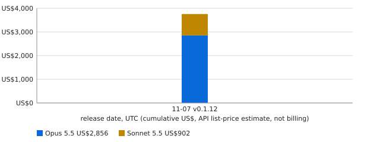
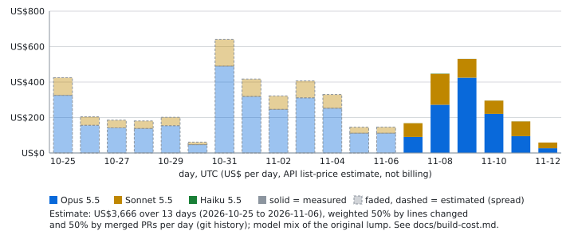

# Build cost: what the agents spend to build this app

A reference for contributors (spec 008 FR-181; owner request 2026-11-07): how many tokens the team's agents use per model and what they would cost at API list price. Each daily release can carry the table.

**It is an API list-price estimate, not billing.** Claude Code computes `claude_code.cost.usage` from list prices; a subscription is not charged per token, and a discount or cache rule can differ. Treat the dollars as a size, not an invoice.

**Numbers start on the day you switch it on.** Nothing earlier is known, and a machine that never runs the receiver is missing from the table. The report says the first day with data.





**Estimated days.** Telemetry only began on 2026-11-07, so the earlier spend (the baseline's lump, 2026-10-25 to 2026-11-06) was one number. It is **spread, not measured**: each day's weight is 50% its share of the lines changed (added plus deleted, `git log --numstat` on `main`, without lockfiles, pictures and other binaries, generated and build-cost files) and 50% its share of the merged PRs (merge commits and `(#N)` squash commits). The per-model split of an estimated day uses the same mix as the lump (an assumption). Estimated days are the faded, dashed bars and say so in the chart's legend; measured days keep their real numbers and the total is unchanged to the cent. See section 4.

(The pictures and the README's *Build cost so far* block are generated: section 4.)

## 1. Point Claude Code at the receiver

Add the `env` block to your Claude Code settings (`~/.claude/settings.json`, or the git-ignored `.claude/settings.local.json`):

```json
{
  "env": {
    "CLAUDE_CODE_ENABLE_TELEMETRY": "1",
    "OTEL_METRICS_EXPORTER": "otlp",
    "OTEL_EXPORTER_OTLP_PROTOCOL": "http/json",
    "OTEL_EXPORTER_OTLP_ENDPOINT": "http://127.0.0.1:4318",
    "OTEL_EXPORTER_OTLP_METRICS_TEMPORALITY_PREFERENCE": "delta",
    "OTEL_METRICS_INCLUDE_REPOSITORY": "true"
  }
}
```

Metrics only: do not add a logs or traces exporter. The receiver adds **delta** sums only, which is why the env block asks for delta explicitly; a cumulative sum is dropped (it cannot be told from a repeat without the session id, which is never kept), counted in the usage file and printed by `usage:day` as *Dropped data points*, so a wrong setting shows as a count and not as a silent zero. Claude Code exports every 60 s (`OTEL_METRIC_EXPORT_INTERVAL`), so the last minute of a session that exits may be missing. When the receiver is not running, Claude Code just fails to export; nothing else changes.

## 2. Run the receiver

```
DURBAR_USAGE_MACHINE=linux node scripts/usage-receiver.js            # or: npm run usage:receiver
```

- **Only Agent Durbar work is counted** (owner, 2026-11-08: "it should only be about costs of developing Durbar, [not] other work or projects"). Claude Code's metrics carry no working directory, but with `OTEL_METRICS_INCLUDE_REPOSITORY=true` (Claude Code 2.1.269 or later; the sixth env var above) every data point carries `vcs.repository.url.full`, taken from the session's `origin` remote (a worktree has the same `origin`). The receiver keeps a data point only when that repository is `three-feathers/agent-durbar` on github.com, or one of the comma-separated entries of `DURBAR_USAGE_REPOS` (for a fork). Any spelling of a remote is accepted and reduced to `https://<host>/<owner>/<repo>` (lower case; `https://`, `ssh://`, `git://` and `git@host:owner/repo` forms; `user[:token]@`, port, `.git` and a trailing slash removed, never stored or printed), so an SSH-remote machine counts; a spelling a URL parser would read differently (`#`, `?`, `\\` or a control character in it, e.g. `https://evil.com#@github.com/...`) or a look-alike (`agent-durbar-evil`, another owner or host, an extra path part, a non-ASCII homoglyph) does not; a point of another repository, a look-alike name or **no repository attribute at all** is dropped without being stored (the URL is compared and never written). **Each machine sets it** (Linux and the Mac included: it is in the env block above); if it is missing the receiver records nothing, and a zero is the sign to check the env block. The baseline lump and the first measured day (2026-11-07), recorded before the filter, are Durbar-only: the owner used that account for Durbar only (2026-11-08).
- **The rule for publishing a machine's file:** a file may go into `docs/build-cost/data/` only if every number in it is Agent Durbar work. Receiver files written with the repository setting on are that, by construction. A file made before it, or by a tool that sends no repository (the Copilot CLI, Codex, a hand-written file), is publishable only if that machine ran Durbar work and nothing else in those days. Every committed file declares it with `"scope": "agent-durbar"` (required; the release step and `test:usage` refuse a file without it or with another value). The receiver writes the field itself.
- `DURBAR_USAGE_MACHINE` is **required**: a short label you choose (`linux`, `mac`, `paco-mac`; 1-24 letters, digits, `_`, `-`). The host name is never used.
- `--port <n>` or `DURBAR_USAGE_PORT` (default 4318; then change the endpoint above to match), `--dir <folder>` or `DURBAR_USAGE_DIR` (default `<home folder>/.durbar-usage`, from `os.homedir()`).
- It listens on `127.0.0.1` only and writes `<dir>/usage-<machine>.json`. Stop it any time; the next start continues from the file. It needs Node only, no `npm ci`. A lock file `usage-<machine>.lock` (the process id only, owner-only) next to the usage file stops a second receiver on the same folder and label from starting (it would overwrite the first one's sums). It is removed on a normal stop and on SIGTERM, SIGINT and SIGHUP. A lock left by a process that is gone, or written before the last boot, is taken over atomically (a temporary lock is renamed over it and read back; two receivers replacing the same stale lock at the same moment may both believe they hold it for a moment; the receiver checks the lock is still its own before every write, and the loser writes nothing, answers 503, prints `usage-receiver: lock lost to pid N, exiting` on stderr and exits with code 1, so a service manager restarts it and the restart refuses loudly). A lock that is not a process id, or whose live process is another user's, is never replaced: **if a receiver refuses to start and you know none runs (for example the old process id now belongs to something else), delete the `.lock` file by hand.** The receiver cannot tell that a live process with that id is not a receiver. Different labels or folders run side by side.
- As a background process: `nohup env DURBAR_USAGE_MACHINE=linux node scripts/usage-receiver.js > /dev/null 2>&1 &` (macOS and Linux), or `Start-Process node -ArgumentList 'scripts\usage-receiver.js' -WindowStyle Hidden` after `$env:DURBAR_USAGE_MACHINE='win'` (PowerShell).

Start-at-login examples (text only, not tested by this repo; replace the paths):

```ini
# Linux: ~/.config/systemd/user/durbar-usage.service, then: systemctl --user enable --now durbar-usage
[Unit]
Description=Agent Durbar build-cost receiver
[Service]
Environment=DURBAR_USAGE_MACHINE=linux
ExecStart=/usr/bin/node /path/to/agent-durbar/scripts/usage-receiver.js
Restart=on-failure
[Install]
WantedBy=default.target
```

```xml
<!-- macOS: ~/Library/LaunchAgents/app.durbar.usage.plist, then: launchctl load ~/Library/LaunchAgents/app.durbar.usage.plist -->
<plist version="1.0"><dict>
  <key>Label</key><string>app.durbar.usage</string>
  <key>ProgramArguments</key><array><string>/usr/local/bin/node</string><string>/path/to/agent-durbar/scripts/usage-receiver.js</string></array>
  <key>EnvironmentVariables</key><dict><key>DURBAR_USAGE_MACHINE</key><string>mac</string></dict>
  <key>RunAtLoad</key><true/><key>KeepAlive</key><true/>
</dict></plist>
```

```
:: Windows (Task Scheduler, at log on): program node.exe, argument "C:\path\to\agent-durbar\scripts\usage-receiver.js";
:: set the label first in the task's environment or in a one-line .cmd: set DURBAR_USAGE_MACHINE=win
```

## 3. Print the report

```
npm run usage:day -- --date 2026-11-07
npm run usage:day -- --date 2026-11-07 --files linux.json,mac.json
```

The table has one row per machine and model (input, output, cache read, cache write tokens and the list-price USD), then the day total, the total since tracking began, the day's cost by main, subagent and auxiliary source, and the machines read. Without `--files` it reads every `usage-*.json` of the folder; copy another machine's file there (or name it with `--files`) and it is added. Two files with one machine label are refused (they would count twice). The date is a UTC day; the default is today.

**Tools that send no telemetry** (the Copilot CLI, Codex, a teammate's setup): write a file by hand with the same shape and its own label and pass it with `--files`:

```json
{ "version": 1, "machine": "paco-codex", "scope": "agent-durbar", "days": { "2026-11-07": { "models": { "gpt-5": { "input": 120000, "output": 8000, "cacheRead": 0, "cacheCreation": 0, "costUsd": 1.4 } } } } }
```

Paste the printed table into the release notes next to the clip (`changelog.d/README.md`, release steps).

## 4. README block, badge and chart at every release

`npm run usage:readme -- --release vX.Y.Z [--date YYYY-MM-DD] [--files a.json,b.json]` (pure text, no network) adds up `docs/build-cost-baseline.json` (what was spent before the receivers ran: `since`, `through`, per-model and per-machine dollars, and a note on what is not counted) and every usage-file day after the baseline's `through` day, then:
- rewrites the README block between `<!-- build-cost:begin ... -->` and `<!-- build-cost:end -->` (it fails, changing nothing, when either marker is missing, doubled or out of order);
- adds the release's row (date, version, cumulative dollars per model and per machine) to `docs/build-cost-history.json` (the same version replaces its row);
- regenerates `docs/build-cost-badge.svg`, `docs/build-cost.svg` (local plain SVG, no external service, a few KB; the chart stacks the models over release dates) and `docs/build-cost-days.svg` (US$ per day by model: measured solid, estimated faded and dashed).
- **Every machine publishes its own file at each release.** Every team machine runs the same receiver and, at each daily release, runs `npm run usage:readme -- --release vX.Y.Z --publish` (copies its `usage-<machine>.json` into `docs/build-cost/data/` through the same validation and merges days into what is committed) or commits its file there by hand. The release step reads **all** `docs/build-cost/data/usage-*.json` plus the local folder, so the README block, chart and badge come from every machine's committed file. A file whose machine label is not in the baseline's `machines` counts in full from its first day (it adds to the total); `test:usage` fails on a malformed committed file, so another side's PR cannot break the release.
- **The spread** (`npm run usage:spread -- --write`, `scripts/usage-spread.js`) reads the git history on `origin/main` (pinned to the commit recorded in `docs/build-cost-spread.json`, so a later merge cannot change it) and writes the per-day weights and cents. It spreads only the baseline's remainder: the lump minus what telemetry measured per day on the baseline's machines (a measured day is not spread over; a model measured but not listed in the lump is taken from the largest model so the total holds). Whole cents by largest remainder; `test:usage` checks that the weights sum to 1, the total is kept to the cent, measured days are unchanged, the result is deterministic and the committed file equals what the pinned history gives (skipped in a shallow clone). Another machine's measured days are its own: they never remove a day from the spread.
`--check` prints the block and writes nothing. It runs in the doc-only fold PR after each release (`changelog.d/README.md`). The baseline is keyed by the model ids the telemetry sends (`claude-opus-5-5`), so a baseline and a usage file for one model are one row; `MODEL_NAMES` in `scripts/usage-lib.js` is the one place that maps ids to the display names shown in the README, the badge and the chart (an id not listed shows as itself). When a machine's usage starts, raise nothing by hand: its files are summed from the day after the baseline's `through`.

## What is kept, and what is not

- Only sums per UTC day, model and token type (and per main, subagent, auxiliary source) are written. The receiver parses the whole JSON body, and **keeps only** three attributes of a data point (`type`, `model`, `query_source`) and reads one more, `vcs.repository.url.full`, only to compare it with the allowed repositories (never stored); it checks an attribute's key before it looks at its value. **Emails, user, account and organization ids, session ids and agent names are never kept, written or printed** (`test:usage` plants fake ones and checks the file and the report).
- The receiver reads no Claude Code file (nothing under `~/.claude`), starts no process, makes no outgoing connection and has no dependency. It accepts `POST /v1/metrics` with `application/json` from a loopback `Host` only, at most 1 MiB (also after gunzip), a strict JSON parse; anything else is refused and changes nothing. The file is written through a temporary file (created with `wx`) and a rename, readable by you only (on POSIX; the folder is created 0700, and the default `.durbar-usage` folder is tightened to it).
- Bounded: a data point must be dated between two days ago and five minutes ahead (an exporter reports "now"; anything else is dropped and counted), so at most four days open per request and only as time passes (and at most 1,500 days in a file); at most 50 distinct models per day (the rest are added to `other-model`), a data point above 10^12 tokens or US$1,000,000 is refused, and a write that would take the file past 5 MiB is refused with 507 and loses nothing already stored.
- A model name that is not a plain id is counted as `other-model`; the usage files hold no prompt, path or file content.
- **The numbers are not authenticated.** Loopback only keeps other computers and web pages out; any process of any user on this machine can POST made-up usage to `127.0.0.1:4318`, and it ends up in the README number. The report is an estimate from Claude Code's own telemetry on the machines of people we trust, not an audit; whoever publishes a release reads the table before it goes into the README.
- Cumulative sums are dropped, as above; the count is printed in the report.
- Not verified: on Windows the SIGTERM test of the real receiver, the lock-symlink check and the lock file-mode check are skipped (Windows has no SIGTERM, and symlinks and modes work differently; Node does deliver SIGINT and SIGHUP to the handlers there, not run on Windows, so unverified; a `taskkill /F` leaves the lock behind and the next start replaces it by the process-id check); a macOS or Windows run (the code uses `os.homedir()`, `path.join` and no shell; the Linux run is the one tested), and the exact attribute names against a live Claude Code on every version (they follow the docs: https://code.claude.com/docs/en/monitoring-usage.md).
